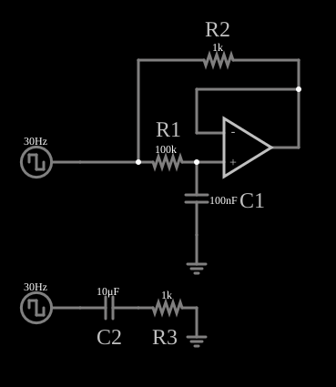

# Multiplicador de capacitância

<!-- navegacao:inicio -->
[Índice](README.md) · [Anterior: Gyrator](gyrator.md) · [Próximo: Howland Current Source](howland.md)
<!-- navegacao:fim -->

## Objetivo

Mostrar o multiplicador de capacitância: um capacitor pequeno ($100\ \text{nF}$) e um amplificador operacional se comportam, visto da fonte, como um capacitor 100 vezes maior ($10\ \mu\text{F}$). O exemplo compara o circuito com um capacitor real de $10\ \mu\text{F}$.

## O circuito

<!-- esquema:inicio -->

<!-- esquema:fim -->

Duas montagens recebem a mesma onda quadrada de $30\ \text{Hz}$ e $\pm 5\ \text{V}$. Na de baixo, um capacitor real de $10\ \mu\text{F}$ em série com um resistor de $1\ \text{k}\Omega$. Na de cima, a fonte alimenta um resistor $R_1 = 100\ \text{k}\Omega$ seguido de um capacitor $C_1 = 100\ \text{nF}$ para a terra; um amplificador operacional seguidor copia a tensão do capacitor e a aplica de volta à fonte por um resistor $R_2 = 1\ \text{k}\Omega$. Dois osciloscópios acompanham o capacitor real e o capacitor de $100\ \text{nF}$.

<!-- componentes:inicio -->
| N.º | Tipo | Elemento | Valores |
|----:|------|----------|---------|
| 0 | `OpAmpElm` | op-amp | Max Output (V) = 15; Min Output (V) = -15; Gain = 100k |
| 5 | `ResistorElm` | resistor | Resistance (ohms) = 1k |
| 7 | `ResistorElm` | resistor | Resistance (ohms) = 100k |
| 8 | `CapacitorElm` | capacitor | Capacitance (F) = 100n; Trapezoidal Approximation = sim; Initial Voltage (on Reset) = 1m; Series Resistance = 0 |
| 9 | `GroundElm` | ground | Symbol = Earth |
| 11 | `RailElm` | square wave gen | Max Voltage = 5; Waveform = Square Wave; DC Offset (V) = 0; Internal Resistance (ohms) = 0; Show Voltage = não; Specify As = Frequency/Duty Cycle; Frequency (Hz) = 30; Phase Offset (degrees) = 0; Duty Cycle = 50; Rise/Fall Time (s) = 0 |
| 12 | `RailElm` | square wave gen | Max Voltage = 5; Waveform = Square Wave; DC Offset (V) = 0; Internal Resistance (ohms) = 0; Show Voltage = não; Specify As = Frequency/Duty Cycle; Frequency (Hz) = 30; Phase Offset (degrees) = 0; Duty Cycle = 50; Rise/Fall Time (s) = 0 |
| 13 | `CapacitorElm` | capacitor | Capacitance (F) = 10μ; Trapezoidal Approximation = sim; Initial Voltage (on Reset) = 1m; Series Resistance = 0 |
| 14 | `ResistorElm` | resistor | Resistance (ohms) = 1k |
| 15 | `GroundElm` | ground | Symbol = Earth |
| 16 | `TextElm` | text | Text = R2; Size = 24; Draw Bar On Top = não; Color = #c0c0c0 |
| 17 | `TextElm` | text | Text = R1; Size = 24; Draw Bar On Top = não; Color = #c0c0c0 |
| 18 | `TextElm` | text | Text = C1; Size = 24; Draw Bar On Top = não; Color = #c0c0c0 |
| 19 | `TextElm` | text | Text = C2; Size = 24; Draw Bar On Top = não; Color = #c0c0c0 |
| 20 | `TextElm` | text | Text = R3; Size = 24; Draw Bar On Top = não; Color = #c0c0c0 |
<!-- componentes:fim -->

## Teoria

Seja $\tau = R_1 C_1 = 100\ \text{k}\Omega\cdot 100\ \text{nF} = 10\ \text{ms}$. O capacitor $C_1$ carrega pela fonte através de $R_1$, e a tensão $V_C$ nele é a da fonte filtrada: $V_C = V/(1 + s\tau)$. O seguidor leva $V_C$ ao outro lado de $R_2$, e a corrente total que a fonte fornece é

$$I = \frac{V - V_C}{R_2} + \frac{V - V_C}{R_1} = V\,\frac{s\tau}{1 + s\tau}\left(\frac{1}{R_2} + \frac{1}{R_1}\right).$$

Como $R_1 \gg R_2$, $1/R_2 + 1/R_1 \approx 1/R_2$ e

$$Y_\text{in} = \frac{I}{V} \approx \frac{s\,\tau/R_2}{1 + s\tau} = \frac{s\,C_\text{eq}}{1 + s\,R_2 C_\text{eq}}\ \ (\text{com } C_\text{eq}R_2 = \tau),\qquad C_\text{eq} = \frac{R_1}{R_2}\,C_1 = 100\cdot 100\ \text{nF} = 10\ \mu\text{F}.$$

A admitância é a de um capacitor $C_\text{eq} = 10\ \mu\text{F}$ em série com o resistor $R_2 = 1\ \text{k}\Omega$, exatamente a montagem de referência de baixo: o fator multiplicador é a razão $R_1/R_2$.

## Resultados esperados

Em $t = 10\ \text{ms}$ o circuito simulado (cima) e o capacitor real (baixo) dão a mesma corrente, em módulo:

| Montagem | Corrente |
|----------|---------:|
| Multiplicador de capacitância | $0{,}98934\ \text{mA}$ |
| Capacitor real de $10\ \mu\text{F}$ com $1\ \text{k}\Omega$ | $0{,}98930\ \text{mA}$ |

(sinais opostos por causa da orientação dos resistores). As verificações conferem os dois valores com tolerância de 0,1%.

## O que observar

- A corrente em cada montagem é um pico exponencial igual em cada flanco da onda quadrada, com constante de tempo de $10\ \text{ms}$.
- Mude $R_1$ ou $C_1$ e o capacitor equivalente muda na mesma proporção, sem trocar o capacitor.
- O multiplicador permite obter capacitâncias de milhares de microfarads a partir de capacitores pequenos, mas com a fuga e o ruído do operacional.

## Limites do modelo

Operacional ideal: a saída fornece toda a corrente de carga sem limite. A relação $C_\text{eq} = (R_1/R_2)C_1$ vale se $R_1 \gg R_2$; o capacitor equivalente tem a resistência em série $R_2$ e fica limitado pela tensão e corrente que o operacional aguenta.

## Referências

- A. S. Sedra e K. C. Smith, *Microeletrônica*, Pearson.
- P. Horowitz e W. Hill, *The Art of Electronics*, Cambridge University Press.
- W. G. Jung, *Op Amp Applications Handbook*, Newnes.

O circuito deste exemplo faz parte da coleção do simulador original de Paul Falstad e Iain Sharp (CircuitJS1); a explicação é deste projeto.
