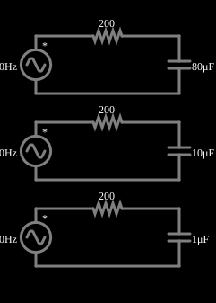

# Capacitores de várias capacitâncias

<!-- navegacao:inicio -->
[Índice](README.md) · [Anterior: Inductor](inductac.md) · [Próximo: Caps w/ Various Frequencies](capmultfreq.md)
<!-- navegacao:fim -->

## Objetivo

Comparar, na mesma frequência, o efeito da capacitância: quanto menor o capacitor, maior a reatância e maior a fração da tensão que fica sobre ele.

## O circuito

<!-- esquema:inicio -->

<!-- esquema:fim -->

Três circuitos RC série idênticos, cada um com uma fonte de 5 V de pico a 80 Hz e um resistor de $200\ \Omega$, diferem só no capacitor: $80\ \mu\text{F}$, $10\ \mu\text{F}$ e $1\ \mu\text{F}$. Três osciloscópios mostram as tensões nos capacitores.

<!-- componentes:inicio -->
| N.º | Tipo | Elemento | Valores |
|----:|------|----------|---------|
| 0 | `VoltageElm` | A/C source | Max Voltage = 5; Waveform = A/C; DC Offset (V) = 0; Internal Resistance (ohms) = 0; Show Voltage = não; Frequency (Hz) = 80; Phase Offset (degrees) = 0 |
| 1 | `ResistorElm` | resistor | Resistance (ohms) = 200 |
| 2 | `CapacitorElm` | capacitor | Capacitance (F) = 80μ; Trapezoidal Approximation = sim; Initial Voltage (on Reset) = 1m; Series Resistance = 0 |
| 4 | `VoltageElm` | A/C source | Max Voltage = 5; Waveform = A/C; DC Offset (V) = 0; Internal Resistance (ohms) = 0; Show Voltage = não; Frequency (Hz) = 80; Phase Offset (degrees) = 0 |
| 5 | `ResistorElm` | resistor | Resistance (ohms) = 200 |
| 7 | `CapacitorElm` | capacitor | Capacitance (F) = 10μ; Trapezoidal Approximation = sim; Initial Voltage (on Reset) = 1m; Series Resistance = 0 |
| 8 | `VoltageElm` | A/C source | Max Voltage = 5; Waveform = A/C; DC Offset (V) = 0; Internal Resistance (ohms) = 0; Show Voltage = não; Frequency (Hz) = 80; Phase Offset (degrees) = 0 |
| 10 | `CapacitorElm` | capacitor | Capacitance (F) = 1μ; Trapezoidal Approximation = sim; Initial Voltage (on Reset) = 1m; Series Resistance = 0 |
| 11 | `ResistorElm` | resistor | Resistance (ohms) = 200 |
<!-- componentes:fim -->

## Teoria

Em regime permanente senoidal, tensões e correntes são fasores e cada elemento tem uma **impedância**:

$$Z_R = R,\qquad Z_L = j\omega L,\qquad Z_C = \frac{1}{j\omega C},\qquad \omega = 2\pi f.$$

A parte imaginária é a **reatância**: $X_L=\omega L$ (cresce com a frequência) e $X_C = 1/(\omega C)$ (diminui com ela). A amplitude da corrente e a defasagem entre tensão e corrente seguem de $I = V/Z$.

O capacitor e o resistor formam um divisor de tensão complexo, e a amplitude sobre o capacitor é

$$V_{C} = V\,\frac{X_C}{\sqrt{R^2+X_C^2}}.$$

Quanto menor $C$, maior $X_C$ e mais tensão fica sobre o capacitor.

## Resultados esperados

A 80 Hz: $X_C = 24{,}9$, $198{,}9$ e $1989\ \Omega$ para $80$, $10$ e $1\ \mu\text{F}$, e

| $C$ | $V_{C,pico}$ | $I_{pico}$ | $\varphi$ |
|----:|-------------:|-----------:|----------:|
| $80\ \mu\text{F}$ | $0{,}617\ \text{V}$ | $24{,}8\ \text{mA}$ | $7{,}1^\circ$ |
| $10\ \mu\text{F}$ | $3{,}526\ \text{V}$ | $17{,}7\ \text{mA}$ | $44{,}8^\circ$ |
| $1\ \mu\text{F}$ | $4{,}975\ \text{V}$ | $2{,}5\ \text{mA}$ | $84{,}3^\circ$ |

As verificações medem os três picos de tensão depois do transitório (de 200 ms a 300 ms).

## O que observar

- O capacitor de $1\ \mu\text{F}$ quase "bloqueia" a corrente (a tensão do capacitor quase iguala a da fonte), e o de $80\ \mu\text{F}$ quase não oferece oposição.
- A defasagem tensão-corrente aproxima-se de $90^\circ$ quando $X_C\gg R$.

## Limites do modelo

Capacitores ideais, sem resistência série nem fuga.

## Referências

- J. W. Nilsson e S. A. Riedel, *Circuitos Elétricos*, Pearson.
- C. K. Alexander e M. N. O. Sadiku, *Fundamentos de Circuitos Elétricos*, AMGH.

O circuito deste exemplo faz parte da coleção do simulador original de Paul Falstad e Iain Sharp (CircuitJS1); a explicação é deste projeto.
