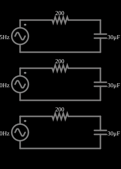

# Capacitores em várias frequências

<!-- navegacao:inicio -->
[Índice](README.md) · [Anterior: Caps of Various Capacitances](capmultcaps.md) · [Próximo: Inductors of Various Inductances](indmultind.md)
<!-- navegacao:fim -->

## Objetivo

Mostrar que o mesmo capacitor se comporta de modo diferente em frequências diferentes: a reatância $1/(\omega C)$ cai quando a frequência sobe.

## O circuito

<!-- esquema:inicio -->

<!-- esquema:fim -->

Três circuitos RC série iguais ($200\ \Omega$ e $30\ \mu\text{F}$) são alimentados por fontes de 5 V de pico com frequências de 15 Hz, 40 Hz e 80 Hz. Três osciloscópios mostram as tensões nos capacitores.

<!-- componentes:inicio -->
| N.º | Tipo | Elemento | Valores |
|----:|------|----------|---------|
| 0 | `VoltageElm` | A/C source | Max Voltage = 5; Waveform = A/C; DC Offset (V) = 0; Internal Resistance (ohms) = 0; Show Voltage = não; Frequency (Hz) = 15; Phase Offset (degrees) = 0 |
| 1 | `ResistorElm` | resistor | Resistance (ohms) = 200 |
| 2 | `CapacitorElm` | capacitor | Capacitance (F) = 30μ; Trapezoidal Approximation = sim; Initial Voltage (on Reset) = 1m; Series Resistance = 0 |
| 4 | `VoltageElm` | A/C source | Max Voltage = 5; Waveform = A/C; DC Offset (V) = 0; Internal Resistance (ohms) = 0; Show Voltage = não; Frequency (Hz) = 40; Phase Offset (degrees) = 0 |
| 5 | `ResistorElm` | resistor | Resistance (ohms) = 200 |
| 7 | `CapacitorElm` | capacitor | Capacitance (F) = 30μ; Trapezoidal Approximation = sim; Initial Voltage (on Reset) = 1m; Series Resistance = 0 |
| 8 | `VoltageElm` | A/C source | Max Voltage = 5; Waveform = A/C; DC Offset (V) = 0; Internal Resistance (ohms) = 0; Show Voltage = não; Frequency (Hz) = 80; Phase Offset (degrees) = 0 |
| 10 | `CapacitorElm` | capacitor | Capacitance (F) = 30μ; Trapezoidal Approximation = sim; Initial Voltage (on Reset) = 1m; Series Resistance = 0 |
| 11 | `ResistorElm` | resistor | Resistance (ohms) = 200 |
<!-- componentes:fim -->

## Teoria

Em regime permanente senoidal, tensões e correntes são fasores e cada elemento tem uma **impedância**:

$$Z_R = R,\qquad Z_L = j\omega L,\qquad Z_C = \frac{1}{j\omega C},\qquad \omega = 2\pi f.$$

A parte imaginária é a **reatância**: $X_L=\omega L$ (cresce com a frequência) e $X_C = 1/(\omega C)$ (diminui com ela). A amplitude da corrente e a defasagem entre tensão e corrente seguem de $I = V/Z$.

A tensão sobre o capacitor num divisor RC é $V_C = V\,\dfrac{X_C}{\sqrt{R^2+X_C^2}}$, com $X_C = 1/(2\pi f C)$. A frequência de corte do filtro RC (onde $X_C=R$) é $f_c = \dfrac{1}{2\pi RC} = 26{,}5\ \text{Hz}$ neste circuito.

## Resultados esperados

| $f$ | $X_C$ | $V_{C,pico}$ | $I_{pico}$ | $\varphi$ |
|----:|------:|-------------:|-----------:|----------:|
| 15 Hz | $353{,}7\ \Omega$ | $4{,}352\ \text{V}$ | $12{,}3\ \text{mA}$ | $60{,}5^\circ$ |
| 40 Hz | $132{,}6\ \Omega$ | $2{,}763\ \text{V}$ | $20{,}8\ \text{mA}$ | $33{,}6^\circ$ |
| 80 Hz | $66{,}3\ \Omega$ | $1{,}574\ \text{V}$ | $23{,}7\ \text{mA}$ | $18{,}3^\circ$ |

As verificações medem os três picos de tensão depois do transitório (de 300 ms a 500 ms).

## O que observar

- Em frequência baixa o capacitor se comporta quase como circuito aberto (tensão alta sobre ele); em frequência alta, quase como curto.
- Isto é o princípio dos filtros RC: veja os exemplos de filtros passa-baixas e passa-altas.

## Limites do modelo

Elementos ideais.

## Referências

- J. W. Nilsson e S. A. Riedel, *Circuitos Elétricos*, Pearson.
- C. K. Alexander e M. N. O. Sadiku, *Fundamentos de Circuitos Elétricos*, AMGH.

O circuito deste exemplo faz parte da coleção do simulador original de Paul Falstad e Iain Sharp (CircuitJS1); a explicação é deste projeto.
