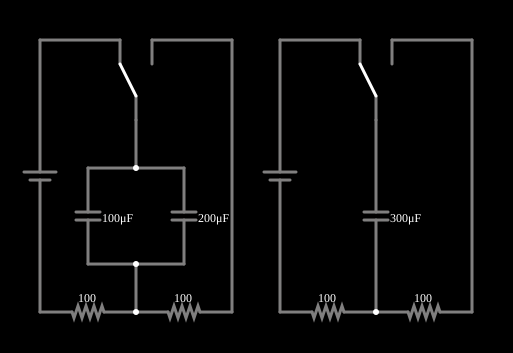

# Capacitores em paralelo

<!-- navegacao:inicio -->
[Índice](README.md) · [Anterior: Caps in Series](capseries.md)
<!-- navegacao:fim -->

## Objetivo

Mostrar que capacitores em paralelo equivalem a um capacitor de capacitância igual à soma, e que a corrente se divide em proporção às capacitâncias.

## O circuito

<!-- esquema:inicio -->

<!-- esquema:fim -->

Cada exemplo desta família tem dois circuitos lado a lado, idênticos exceto por um detalhe: à esquerda a associação de dois (ou mais) elementos, à direita o **único elemento equivalente**. Cada circuito é uma fonte de 5 V contínuos em série com um resistor de $100\ \Omega$, e uma chave de duas posições liga o elemento ao circuito (na posição em que o exemplo abre, o segundo resistor de $100\ \Omega$ fica fora do caminho da corrente, como mostram as correntes nulas dele na simulação). Se a associação for mesmo equivalente ao elemento único, as duas metades se comportam de forma idêntica. Aqui a associação é de $C_1 = 200\ \mu\text{F}$ e $C_2 = 100\ \mu\text{F}$ em paralelo, comparada com um capacitor de $300\ \mu\text{F}$. O arquivo do exemplo foi salvo com a simulação em andamento, então os capacitores já começam carregados a cerca de $V_0 = 0{,}93\ \text{V}$ (o botão de reiniciar os leva a $1\ \text{mV}$).

<!-- componentes:inicio -->
| N.º | Tipo | Elemento | Valores |
|----:|------|----------|---------|
| 0 | `VoltageElm` | voltage source | Voltage = 5; Waveform = D/C; DC Offset (V) = 0; Internal Resistance (ohms) = 0; Show Voltage = não; Circle Symbol = não |
| 1 | `Switch2Elm` | switch (SPDT) | Momentary Switch = não; Group Number (for linking) = 1; # of Throws = 2; Keyboard Shortcut = ; On Resistance (ohms) = 0 |
| 3 | `ResistorElm` | resistor | Resistance (ohms) = 100 |
| 4 | `ResistorElm` | resistor | Resistance (ohms) = 100 |
| 7 | `ResistorElm` | resistor | Resistance (ohms) = 100 |
| 8 | `ResistorElm` | resistor | Resistance (ohms) = 100 |
| 10 | `Switch2Elm` | switch (SPDT) | Momentary Switch = não; Group Number (for linking) = 1; # of Throws = 2; Keyboard Shortcut = ; On Resistance (ohms) = 0 |
| 13 | `CapacitorElm` | capacitor | Capacitance (F) = 300μ; Trapezoidal Approximation = sim; Initial Voltage (on Reset) = 1m; Series Resistance = 0 |
| 14 | `VoltageElm` | voltage source | Voltage = 5; Waveform = D/C; DC Offset (V) = 0; Internal Resistance (ohms) = 0; Show Voltage = não; Circle Symbol = não |
| 20 | `CapacitorElm` | capacitor | Capacitance (F) = 200μ; Trapezoidal Approximation = sim; Initial Voltage (on Reset) = 1m; Series Resistance = 0 |
| 21 | `CapacitorElm` | capacitor | Capacitance (F) = 100μ; Trapezoidal Approximation = sim; Initial Voltage (on Reset) = 1m; Series Resistance = 0 |
<!-- componentes:fim -->

## Teoria

Capacitores em paralelo têm a mesma tensão $v$; a corrente de cada um é $i_k = C_k\,\dfrac{dv}{dt}$, e a corrente total é a soma:

$$C_{eq} = \sum_k C_k .$$

A corrente se divide em proporção às capacitâncias: $i_k = i\,\dfrac{C_k}{C_{eq}}$ (o maior capacitor leva a maior parte).

Carregado por uma fonte $V$ através de $R$, a partir de uma tensão inicial $V_0$: $\tau = R\,C_{eq}$,

$$v_C(t) = V - (V - V_0)\,e^{-t/\tau},\qquad i(t) = \frac{V - V_0}{R}\,e^{-t/\tau}.$$

## Resultados esperados

$C_{eq} = 200 + 100 = 300\ \mu\text{F}$ e $\tau = 100\cdot 300\ \mu\text{F} = 30\ \text{ms}$. Com $V = 5\ \text{V}$ e $V_0 = 0{,}9375\ \text{V}$, em $t = \tau$:

$$v_C = 5 - 4{,}0625\,e^{-1} = 3{,}505\ \text{V},\qquad i = 40{,}63\,e^{-1} = 14{,}95\ \text{mA}.$$

A corrente do conjunto se divide em $\tfrac23 \to 9{,}96\ \text{mA}$ para o capacitor de $200\ \mu\text{F}$ e $\tfrac13 \to 4{,}98\ \text{mA}$ para o de $100\ \mu\text{F}$. As verificações conferem a tensão e a corrente do capacitor único e as duas correntes parciais, em $t = 30\ \text{ms}$ (o simulador difere da teoria em menos de 0,4%, porque as tensões iniciais salvas dos três capacitores diferem um pouco entre si).

## O que observar

- Compare a corrente do capacitor único com a soma das correntes dos dois da esquerda.
- As duas metades têm a mesma tensão nos capacitores, a todo instante.
- Compare com o exemplo de capacitores em série, em que a capacitância equivalente é menor que a menor das parcelas.

## Limites do modelo

Capacitores ideais e sem acoplamento; carga inicial praticamente nula (tensão inicial de $1\ \text{mV}$). O capacitor de $200\ \mu\text{F}$ do exemplo tem uma resistência série de $0{,}1\ \Omega$, que desloca muito pouco os números acima (a tolerância das verificações cobre isso).

## Referências

- J. W. Nilsson e S. A. Riedel, *Circuitos Elétricos*, Pearson.
- C. K. Alexander e M. N. O. Sadiku, *Fundamentos de Circuitos Elétricos*, AMGH.

O circuito deste exemplo faz parte da coleção do simulador original de Paul Falstad e Iain Sharp (CircuitJS1); a explicação é deste projeto.
