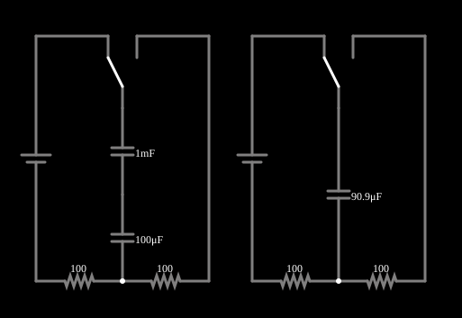

# Capacitores em série

<!-- navegacao:inicio -->
[Índice](README.md) · [Anterior: Inductors in Parallel](indpar.md) · [Próximo: Caps in Parallel](cappar.md)
<!-- navegacao:fim -->

## Objetivo

Mostrar que capacitores em série equivalem a um capacitor de capacitância menor que a de qualquer um deles, e que a tensão se divide em proporção inversa às capacitâncias.

## O circuito

<!-- esquema:inicio -->

<!-- esquema:fim -->

Cada exemplo desta família tem dois circuitos lado a lado, idênticos exceto por um detalhe: à esquerda a associação de dois (ou mais) elementos, à direita o **único elemento equivalente**. Cada circuito é uma fonte de 5 V contínuos em série com um resistor de $100\ \Omega$, e uma chave de duas posições liga o elemento ao circuito (na posição em que o exemplo abre, o segundo resistor de $100\ \Omega$ fica fora do caminho da corrente, como mostram as correntes nulas dele na simulação). Se a associação for mesmo equivalente ao elemento único, as duas metades se comportam de forma idêntica. Aqui a associação é de $C_1 = 1\ \text{mF}$ e $C_2 = 100\ \mu\text{F}$ em série, comparada com um capacitor de $90{,}9\ \mu\text{F}$.

<!-- componentes:inicio -->
| N.º | Tipo | Elemento | Valores |
|----:|------|----------|---------|
| 0 | `VoltageElm` | voltage source | Voltage = 5; Waveform = D/C; DC Offset (V) = 0; Internal Resistance (ohms) = 0; Show Voltage = não; Circle Symbol = não |
| 1 | `Switch2Elm` | switch (SPDT) | Momentary Switch = não; Group Number (for linking) = 1; # of Throws = 2; Keyboard Shortcut = ; On Resistance (ohms) = 0 |
| 3 | `ResistorElm` | resistor | Resistance (ohms) = 100 |
| 4 | `ResistorElm` | resistor | Resistance (ohms) = 100 |
| 5 | `CapacitorElm` | capacitor | Capacitance (F) = 1m; Trapezoidal Approximation = sim; Initial Voltage (on Reset) = 1m; Series Resistance = 0 |
| 6 | `CapacitorElm` | capacitor | Capacitance (F) = 100μ; Trapezoidal Approximation = sim; Initial Voltage (on Reset) = 1m; Series Resistance = 0 |
| 9 | `ResistorElm` | resistor | Resistance (ohms) = 100 |
| 10 | `ResistorElm` | resistor | Resistance (ohms) = 100 |
| 12 | `Switch2Elm` | switch (SPDT) | Momentary Switch = não; Group Number (for linking) = 1; # of Throws = 2; Keyboard Shortcut = ; On Resistance (ohms) = 0 |
| 15 | `CapacitorElm` | capacitor | Capacitance (F) = 90.9μ; Trapezoidal Approximation = sim; Initial Voltage (on Reset) = 1m; Series Resistance = 0 |
| 16 | `VoltageElm` | voltage source | Voltage = 5; Waveform = D/C; DC Offset (V) = 0; Internal Resistance (ohms) = 0; Show Voltage = não; Circle Symbol = não |
<!-- componentes:fim -->

## Teoria

Capacitores em série são atravessados pela mesma corrente e, portanto, acumulam a mesma carga $Q$. A tensão total é a soma das tensões: $v = \dfrac{Q}{C_1} + \dfrac{Q}{C_2}$, de modo que

$$\frac{1}{C_{eq}} = \sum_k \frac{1}{C_k},\qquad C_{eq} = \frac{C_1 C_2}{C_1 + C_2}.$$

A tensão em cada capacitor é $v_k = Q/C_k = v\,\dfrac{C_{eq}}{C_k}$: **o menor capacitor fica com a maior tensão**.

Carregado por uma fonte $V$ através de $R$, o conjunto tem $\tau = R\,C_{eq}$ e

$$v_C(t) = V\left(1 - e^{-t/\tau}\right),\qquad i(t) = \frac{V}{R}\,e^{-t/\tau}.$$

## Resultados esperados

$C_{eq} = \dfrac{1000\cdot 100}{1100} = 90{,}91\ \mu\text{F}$ e $\tau = 100\cdot 90{,}91\ \mu\text{F} = 9{,}091\ \text{ms}$. Em $t = \tau$:

$$v_C = 5\,(1-e^{-1}) = 3{,}161\ \text{V},\qquad i = 50\,e^{-1} = 18{,}39\ \text{mA}.$$

A carga é $Q = C_{eq}\,v_C = 287{,}3\ \mu\text{C}$, e a tensão se divide em $Q/1\,\text{mF} = 0{,}2873\ \text{V}$ e $Q/100\,\mu\text{F} = 2{,}873\ \text{V}$ (soma $3{,}161\ \text{V}$). As verificações conferem a tensão do capacitor único, as duas tensões parciais e a corrente.

## O que observar

- A tensão do capacitor único é a soma das tensões dos dois em série, a todo instante.
- O capacitor de $100\ \mu\text{F}$ carrega-se a quase toda a tensão, e o de $1\ \text{mF}$ a uma fração pequena.
- Em regime (muito depois de $\tau$), a corrente cai a zero e os capacitores ficam carregados com as tensões inversamente proporcionais às capacitâncias.

## Limites do modelo

Capacitores ideais (sem corrente de fuga, sem resistência série), com carga inicial praticamente nula (o exemplo usa $1\ \text{mV}$ de tensão inicial). Na prática, as correntes de fuga fazem a tensão se dividir segundo as resistências de fuga, não segundo as capacitâncias.

## Referências

- J. W. Nilsson e S. A. Riedel, *Circuitos Elétricos*, Pearson.
- C. K. Alexander e M. N. O. Sadiku, *Fundamentos de Circuitos Elétricos*, AMGH.

O circuito deste exemplo faz parte da coleção do simulador original de Paul Falstad e Iain Sharp (CircuitJS1); a explicação é deste projeto.
