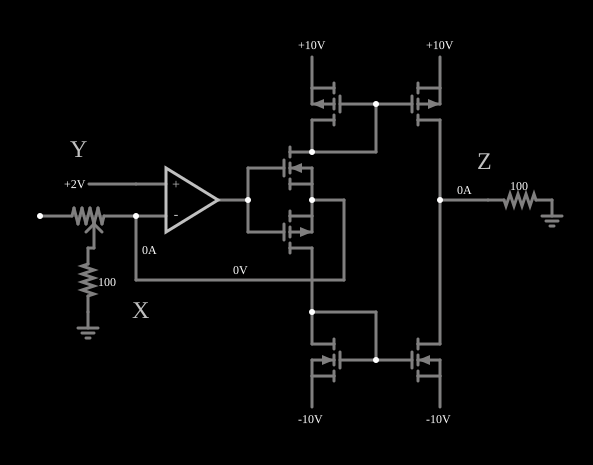

# Implementação de um CCII+ com amp-op e MOSFETs

<!-- navegacao:inicio -->
[Índice](README.md) · [Anterior: Inductor Simulator](ccinductor.md) · [Próximo: CCII- Implementation](cc2impn.md)
<!-- navegacao:fim -->

## Objetivo

Mostrar como um **CCII$+$** pode ser construído com um amp-op e espelhos de corrente de MOSFETs, e que o circuito se comporta como o elemento ideal do exemplo *CCII+*.

## O circuito

<!-- esquema:inicio -->

<!-- esquema:fim -->

Um amp-op ($\text{Av} = 10^5$, saturação em $\pm 15\ \text{V}$) mantém o terminal $X$ na tensão de $Y$ ($2\ \text{V}$, ajustável de $-4$ a $4\ \text{V}$). A corrente que flui em $X$ passa por um MOSFET e é copiada por espelhos de corrente de MOSFETs complementares (alimentados por $\pm 10\ \text{V}$) até um resistor de carga de $100\ \Omega$ no terminal $Z$. O terminal $X$ passa por um potenciômetro de $500\ \Omega$ (em $70{,}8\ \%$) e um resistor de $100\ \Omega$ para a terra.

<!-- componentes:inicio -->
| N.º | Tipo | Elemento | Valores |
|----:|------|----------|---------|
| 0 | `OpAmpElm` | op-amp | Max Output (V) = 15; Min Output (V) = -15; Gain = 100k |
| 1 | `NMosfetElm` | MOSFET | Model = default-nodiode; Swap D/S = não |
| 2 | `PMosfetElm` | MOSFET | Model = default-nodiode; Swap D/S = não |
| 10 | `NMosfetElm` | MOSFET | Model = default-nodiode; Swap D/S = não |
| 11 | `NMosfetElm` | MOSFET | Model = default-nodiode; Swap D/S = não |
| 15 | `PMosfetElm` | MOSFET | Model = default-nodiode; Swap D/S = não |
| 16 | `PMosfetElm` | MOSFET | Model = default-nodiode; Swap D/S = não |
| 22 | `VarRailElm` | voltage source | Min Voltage = -4; Max Voltage = 4; Slider Text = Y Voltage |
| 23 | `PotElm` | potentiometer | Resistance (ohms) = 500; Slider Text = X Resistance; Show Values = não; Group Number (for linking) = 0 |
| 24 | `ResistorElm` | resistor | Resistance (ohms) = 100 |
| 25 | `GroundElm` | ground | Symbol = Earth |
| 27 | `ResistorElm` | resistor | Resistance (ohms) = 100 |
| 28 | `GroundElm` | ground | Symbol = Earth |
| 29 | `RailElm` | voltage source | Voltage = 10; Waveform = D/C; DC Offset (V) = 0; Internal Resistance (ohms) = 0 |
| 30 | `RailElm` | voltage source | Voltage = 10; Waveform = D/C; DC Offset (V) = 0; Internal Resistance (ohms) = 0 |
| 31 | `RailElm` | voltage source | Voltage = -10; Waveform = D/C; DC Offset (V) = 0; Internal Resistance (ohms) = 0 |
| 32 | `RailElm` | voltage source | Voltage = -10; Waveform = D/C; DC Offset (V) = 0; Internal Resistance (ohms) = 0 |
| 35 | `TextElm` | text | Text = Y; Size = 24; Draw Bar On Top = não; Color = #c0c0c0 |
| 36 | `TextElm` | text | Text = X; Size = 24; Draw Bar On Top = não; Color = #c0c0c0 |
| 37 | `TextElm` | text | Text = Z; Size = 24; Draw Bar On Top = não; Color = #c0c0c0 |
<!-- componentes:fim -->

## Teoria

O **transportador de corrente** de segunda geração (CCII, *second-generation current conveyor*) tem três terminais: $X$, $Y$ e $Z$. Idealmente,

$$V_X = V_Y,\qquad I_Y = 0,\qquad I_Z = \pm I_X,$$

isto é, a tensão em $Y$ (de entrada de alta impedância) é copiada em $X$ (de baixa impedância), e a corrente que flui em $X$ é copiada para $Z$ (saída de alta impedância), com o mesmo sinal no CCII$+$ e o oposto no CCII$-$. O elemento do simulador tem ganho de corrente $\pm 1$.

O amp-op de ganho alto força $V_X \approx V_Y$ (a tensão entre suas entradas é $V_{out}/A_v$, de microvolts). A corrente $I_X$ passa por um espelho de corrente de MOSFETs, que a copia para $Z$ como $I_Z = I_X$ (os espelhos de MOSFETs em pares casados têm ganho $1$ quando os dois transistores têm o mesmo $V_{GS}$). Com $V_Y = 2\ \text{V}$ e a resistência total vista em $X$ de $146 + 100 = 246\ \Omega$ (a parte de $146\ \Omega$ do potenciômetro mais o resistor de $100\ \Omega$), $I_X = 2\ \text{V}/246\ \Omega \approx 8{,}1\ \text{mA}$ e $V_Z = I_Z\cdot 100\ \Omega = 0{,}81\ \text{V}$.

## Resultados esperados

O simulador dá:

- **Seguimento:** $V_X = 1{,}99996\ \text{V}$ para $V_Y = 2{,}00000\ \text{V}$, uma diferença de $44\ \mu\text{V}$.
- **Correntes:** $I_X = 8{,}128\ \text{mA}$ e $I_Z = 8{,}128\ \text{mA}$, iguais.
- **Tensão de saída:** $V_Z = 0{,}8128\ \text{V}$.

## O que observar

Compare com o CCII$+$ ideal: o circuito real tem pequenos erros (diferença de $44\ \mu\text{V}$ entre $X$ e $Y$, e uma diferença de menos de $1\ \mu\text{A}$ entre $I_X$ e $I_Z$), mas o comportamento é o mesmo. Mude a tensão de $Y$ de $-4$ a $4\ \text{V}$ e confira: $V_X$ acompanha e $I_Z$ acompanha $I_X$.

## Limites do modelo

- Os MOSFETs têm um modelo de primeira ordem (quadrático); num circuito integrado real o casamento dos espelhos e a modulação de canal produzem erros de corrente de alguns por cento.
- Para $V_Y$ perto das tensões de alimentação o amp-op ou os transistores saem da região linear.

## Referências

Sedra e Smith, *A second generation current conveyor and its applications*, IEEE Transactions on Circuit Theory 17 (1970); Toumazou, Lidgey e Haigh, *Analogue IC Design: The Current-Mode Approach*.

O circuito deste exemplo faz parte da coleção do simulador original de Paul Falstad e Iain Sharp (CircuitJS1); a explicação é deste projeto.
