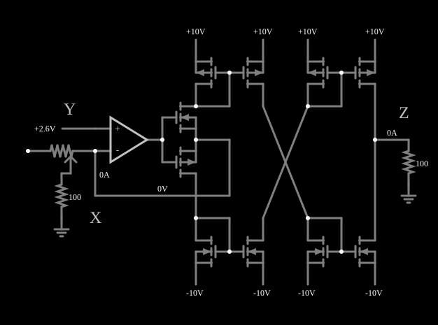

# Implementação de um CCII- com amp-op e MOSFETs

<!-- navegacao:inicio -->
[Índice](README.md) · [Anterior: CCII+ Implementation](cc2imp.md) · [Próximo: Current Amplifier](cciamp.md)
<!-- navegacao:fim -->

## Objetivo

Mostrar a implementação de um **CCII$-$** com amp-op e espelhos de corrente de MOSFETs: a corrente de $Z$ tem o sinal oposto ao da de $X$.

## O circuito

<!-- esquema:inicio -->

<!-- esquema:fim -->

Igual ao exemplo *CCII+ Implementation*, com um espelho de corrente a mais, que inverte o sentido da corrente copiada. Agora $V_Y = 2{,}64\ \text{V}$ (ajustável de $-4$ a $4\ \text{V}$), o potenciômetro de $500\ \Omega$ está em outra posição e a carga de $Z$ é um resistor de $100\ \Omega$.

<!-- componentes:inicio -->
| N.º | Tipo | Elemento | Valores |
|----:|------|----------|---------|
| 0 | `OpAmpElm` | op-amp | Max Output (V) = 15; Min Output (V) = -15; Gain = 100k |
| 1 | `NMosfetElm` | MOSFET | Model = default-nodiode; Swap D/S = não |
| 2 | `PMosfetElm` | MOSFET | Model = default-nodiode; Swap D/S = não |
| 10 | `NMosfetElm` | MOSFET | Model = default-nodiode; Swap D/S = não |
| 11 | `NMosfetElm` | MOSFET | Model = default-nodiode; Swap D/S = não |
| 15 | `PMosfetElm` | MOSFET | Model = default-nodiode; Swap D/S = não |
| 16 | `PMosfetElm` | MOSFET | Model = default-nodiode; Swap D/S = não |
| 20 | `VarRailElm` | voltage source | Min Voltage = -4; Max Voltage = 4; Slider Text = Y Voltage |
| 21 | `PotElm` | potentiometer | Resistance (ohms) = 500; Slider Text = X Resistance; Show Values = não; Group Number (for linking) = 0 |
| 22 | `ResistorElm` | resistor | Resistance (ohms) = 100 |
| 23 | `GroundElm` | ground | Symbol = Earth |
| 24 | `RailElm` | voltage source | Voltage = 10; Waveform = D/C; DC Offset (V) = 0; Internal Resistance (ohms) = 0 |
| 25 | `RailElm` | voltage source | Voltage = 10; Waveform = D/C; DC Offset (V) = 0; Internal Resistance (ohms) = 0 |
| 26 | `RailElm` | voltage source | Voltage = -10; Waveform = D/C; DC Offset (V) = 0; Internal Resistance (ohms) = 0 |
| 27 | `RailElm` | voltage source | Voltage = -10; Waveform = D/C; DC Offset (V) = 0; Internal Resistance (ohms) = 0 |
| 30 | `PMosfetElm` | MOSFET | Model = default-nodiode; Swap D/S = não |
| 31 | `PMosfetElm` | MOSFET | Model = default-nodiode; Swap D/S = não |
| 36 | `NMosfetElm` | MOSFET | Model = default-nodiode; Swap D/S = não |
| 37 | `NMosfetElm` | MOSFET | Model = default-nodiode; Swap D/S = não |
| 46 | `RailElm` | voltage source | Voltage = -10; Waveform = D/C; DC Offset (V) = 0; Internal Resistance (ohms) = 0 |
| 47 | `RailElm` | voltage source | Voltage = -10; Waveform = D/C; DC Offset (V) = 0; Internal Resistance (ohms) = 0 |
| 48 | `RailElm` | voltage source | Voltage = 10; Waveform = D/C; DC Offset (V) = 0; Internal Resistance (ohms) = 0 |
| 49 | `RailElm` | voltage source | Voltage = 10; Waveform = D/C; DC Offset (V) = 0; Internal Resistance (ohms) = 0 |
| 50 | `ResistorElm` | resistor | Resistance (ohms) = 100 |
| 51 | `GroundElm` | ground | Symbol = Earth |
| 53 | `TextElm` | text | Text = Y; Size = 24; Draw Bar On Top = não; Color = #c0c0c0 |
| 54 | `TextElm` | text | Text = X; Size = 24; Draw Bar On Top = não; Color = #c0c0c0 |
| 55 | `TextElm` | text | Text = Z; Size = 24; Draw Bar On Top = não; Color = #c0c0c0 |
<!-- componentes:fim -->

## Símbolos e parâmetros

Os símbolos usados neste documento (definições completas no [glossário](../glossario-simbolos.md)):

| Símbolo | Nome | Significado | Unidade |
|---------|------|-------------|---------|
| $Z$ | impedância | oposição de um elemento à corrente alternada, na frequência considerada | Ω |
| $X$ | terminal X | entrada de corrente do conversor de corrente, que copia a tensão de $Y$ | — |
| $V_Y$ | tensão em Y | tensão do terminal $Y$ do conversor de corrente | V |
| $Y$ | terminal Y | entrada de tensão do conversor de corrente (corrente nula no ideal) | — |
| $V_X$ | tensão em X | tensão do terminal $X$, que segue $V_Y$ | V |
| $I_Y$ | corrente em Y | corrente que entra no terminal $Y$ (nula no conversor ideal) | A |
| $I_Z$ | corrente em Z | corrente que sai do terminal $Z$, igual a $\pm I_X$ | A |
| $I_X$ | corrente em X | corrente que entra no terminal $X$ do conversor de corrente | A |
| $V_Z$ | tensão zener | tensão em que o diodo zener regula | V |

## Teoria

O **transportador de corrente** de segunda geração (CCII, *second-generation current conveyor*) tem três terminais: $X$, $Y$ e $Z$. Idealmente,

$$V_X = V_Y,\qquad I_Y = 0,\qquad I_Z = \pm I_X,$$

isto é, a tensão em $Y$ (de entrada de alta impedância) é copiada em $X$ (de baixa impedância), e a corrente que flui em $X$ é copiada para $Z$ (saída de alta impedância), com o mesmo sinal no CCII$+$ e o oposto no CCII$-$. O elemento do simulador tem ganho de corrente $\pm 1$.

O amp-op mantém $V_X = V_Y$ e a corrente $I_X$ é copiada com o sinal invertido: $I_Z = -I_X$, de modo que $V_Z = -I_X\cdot 100\ \Omega$.

## Resultados esperados

O simulador dá:

- **Seguimento:** $V_X = 2{,}639945\ \text{V}$ para $V_Y = 2{,}640000\ \text{V}$.
- **Correntes:** $I_X = +18{,}578\ \text{mA}$ (no resistor do lado $X$) e $I_Z = -18{,}578\ \text{mA}$ (no resistor de carga).
- **Tensão de saída:** $V_Z = -1{,}858\ \text{V}$.

## O que observar

O sinal negativo de $V_Z$ mostra que o circuito se comporta como um CCII$-$. Compare com o exemplo anterior, em que o sinal é positivo.

## Limites do modelo

- O circuito usa mais espelhos de corrente que o CCII$+$ e, num circuito real, os erros de cada espelho se somam.
- Modelo de MOSFETs de primeira ordem.

## Referências

Sedra e Smith, *A second generation current conveyor and its applications*, IEEE Transactions on Circuit Theory 17 (1970); Toumazou, Lidgey e Haigh, *Analogue IC Design: The Current-Mode Approach*.

O circuito deste exemplo faz parte da coleção do simulador original de Paul Falstad e Iain Sharp (CircuitJS1); a explicação é deste projeto.
