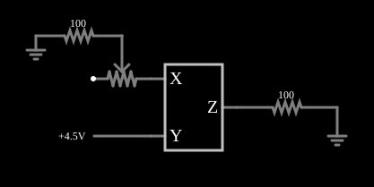

# Transportador de corrente CCII-

<!-- navegacao:inicio -->
[Índice](README.md) · [Anterior: CCII+](cc2.md) · [Próximo: Inductor Simulator](ccinductor.md)
<!-- navegacao:fim -->

## Objetivo

Mostrar o CCII$-$: como o CCII$+$ do exemplo anterior, mas a corrente de $Z$ tem o sinal **oposto** ao da de $X$, o que inverte a tensão na carga.

## O circuito

<!-- esquema:inicio -->

<!-- esquema:fim -->

O mesmo circuito do CCII$+$: $Y$ com $4{,}5\ \text{V}$, potenciômetro de $500\ \Omega$ (metade de $1\ \text{k}\Omega$) e resistor de $100\ \Omega$ em $X$ e resistor de $100\ \Omega$ em $Z$. Só o ganho de corrente do transportador é $-1$.

<!-- componentes:inicio -->
| N.º | Tipo | Elemento | Valores |
|----:|------|----------|---------|
| 0 | `CC2Elm` | CC2 |  |
| 1 | `ResistorElm` | resistor | Resistance (ohms) = 100 |
| 2 | `GroundElm` | ground | Symbol = Earth |
| 3 | `VarRailElm` | voltage source | Min Voltage = 0; Max Voltage = 5; Slider Text = Y Voltage |
| 4 | `PotElm` | potentiometer | Resistance (ohms) = 1k; Slider Text = X Resistance; Show Values = não; Group Number (for linking) = 0 |
| 5 | `ResistorElm` | resistor | Resistance (ohms) = 100 |
| 6 | `GroundElm` | ground | Symbol = Earth |
<!-- componentes:fim -->

## Símbolos e parâmetros

Os símbolos usados neste documento (definições completas no [glossário](../glossario-simbolos.md)):

| Símbolo | Nome | Significado | Unidade |
|---------|------|-------------|---------|
| $Z$ | impedância | oposição de um elemento à corrente alternada, na frequência considerada | Ω |
| $X$ | terminal X | entrada de corrente do conversor de corrente, que copia a tensão de $Y$ | — |
| $Y$ | terminal Y | entrada de tensão do conversor de corrente (corrente nula no ideal) | — |
| $V_X$ | tensão em X | tensão do terminal $X$, que segue $V_Y$ | V |
| $V_Y$ | tensão em Y | tensão do terminal $Y$ do conversor de corrente | V |
| $I_Y$ | corrente em Y | corrente que entra no terminal $Y$ (nula no conversor ideal) | A |
| $I_Z$ | corrente em Z | corrente que sai do terminal $Z$, igual a $\pm I_X$ | A |
| $I_X$ | corrente em X | corrente que entra no terminal $X$ do conversor de corrente | A |
| $V_Z$ | tensão zener | tensão em que o diodo zener regula | V |

## Teoria

O **transportador de corrente** de segunda geração (CCII, *second-generation current conveyor*) tem três terminais: $X$, $Y$ e $Z$. Idealmente,

$$V_X = V_Y,\qquad I_Y = 0,\qquad I_Z = \pm I_X,$$

isto é, a tensão em $Y$ (de entrada de alta impedância) é copiada em $X$ (de baixa impedância), e a corrente que flui em $X$ é copiada para $Z$ (saída de alta impedância), com o mesmo sinal no CCII$+$ e o oposto no CCII$-$. O elemento do simulador tem ganho de corrente $\pm 1$.

Com $I_X = 7{,}5\ \text{mA}$ saindo de $X$, a corrente $I_Z = -I_X = -7{,}5\ \text{mA}$ e $V_Z = -7{,}5\ \text{mA}\cdot 100\ \Omega = -0{,}75\ \text{V}$.

## Resultados esperados

O simulador dá $V_X = V_Y = 4{,}5\ \text{V}$, $I_X = 7{,}5\ \text{mA}$ e $V_Z = -0{,}750\ \text{V}$, com $I_Z = -7{,}5\ \text{mA}$: o negativo de $V_Z$ do CCII$+$.

## O que observar

Compare com o exemplo anterior: tudo é igual, menos o sinal de $V_Z$. A inversão de corrente é o que permite fazer circuitos de ganho negativo e integradores sem inversores.

## Limites do modelo

- O ganho $-1$ é ideal; a precisão do espelho de corrente de um CCII$-$ real é limitada pelo casamento dos transistores.

## Referências

Sedra e Smith, *A second generation current conveyor and its applications*, IEEE Transactions on Circuit Theory 17 (1970); Toumazou, Lidgey e Haigh, *Analogue IC Design: The Current-Mode Approach*.

O circuito deste exemplo faz parte da coleção do simulador original de Paul Falstad e Iain Sharp (CircuitJS1); a explicação é deste projeto.
