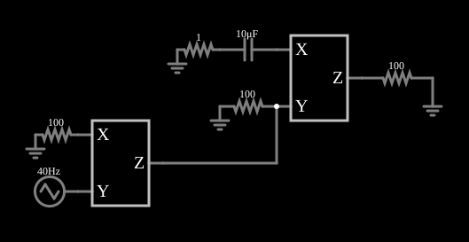

# Diferenciador de corrente com transportador de corrente

<!-- navegacao:inicio -->
[Índice](README.md) · [Anterior: VCCS](ccvccs.md) · [Próximo: Current Integrator](ccint.md)
<!-- navegacao:fim -->

## Objetivo

Mostrar um **diferenciador**: um capacitor no terminal $X$ de um transportador de corrente dá, em $Z$, uma corrente proporcional à **derivada** da tensão de entrada.

## O circuito

<!-- esquema:inicio -->

<!-- esquema:fim -->

Uma onda triangular de $5\ \text{V}$ de pico e $40\ \text{Hz}$ alimenta $Y$. No terminal $X$ há um capacitor de $10\ \mu\text{F}$ em série com um resistor de $1\ \Omega$ para a terra, e em $Z$ um resistor de $100\ \Omega$. Um segundo transportador serve para ver a tensão de entrada no osciloscópio.

<!-- componentes:inicio -->
| N.º | Tipo | Elemento | Valores |
|----:|------|----------|---------|
| 0 | `CC2Elm` | CC2 |  |
| 1 | `CapacitorElm` | capacitor | Capacitance (F) = 10μ; Trapezoidal Approximation = sim; Initial Voltage (on Reset) = 1m; Series Resistance = 0 |
| 2 | `ResistorElm` | resistor | Resistance (ohms) = 1 |
| 3 | `GroundElm` | ground | Symbol = Earth |
| 4 | `ResistorElm` | resistor | Resistance (ohms) = 100 |
| 5 | `GroundElm` | ground | Symbol = Earth |
| 6 | `CC2Elm` | CC2 |  |
| 7 | `ResistorElm` | resistor | Resistance (ohms) = 100 |
| 8 | `GroundElm` | ground | Symbol = Earth |
| 10 | `ResistorElm` | resistor | Resistance (ohms) = 100 |
| 11 | `GroundElm` | ground | Symbol = Earth |
| 12 | `RailElm` | triangle gen | Max Voltage = 5; Waveform = Triangle; DC Offset (V) = 0; Internal Resistance (ohms) = 0; Show Voltage = não; Frequency (Hz) = 40; Phase Offset (degrees) = 90 |
<!-- componentes:fim -->

## Teoria

O **transportador de corrente** de segunda geração (CCII, *second-generation current conveyor*) tem três terminais: $X$, $Y$ e $Z$. Idealmente,

$$V_X = V_Y,\qquad I_Y = 0,\qquad I_Z = \pm I_X,$$

isto é, a tensão em $Y$ (de entrada de alta impedância) é copiada em $X$ (de baixa impedância), e a corrente que flui em $X$ é copiada para $Z$ (saída de alta impedância), com o mesmo sinal no CCII$+$ e o oposto no CCII$-$. O elemento do simulador tem ganho de corrente $\pm 1$.

$V_X = V_Y = v_{in}$, e a corrente no capacitor em $X$ é $I_X = C\thinspace dv_{in}/dt$, copiada em $Z$. Numa onda triangular de $5\ \text{V}$ de pico e $40\ \text{Hz}$ a inclinação vale $dv/dt = \pm 4\cdot 5\ \text{V}\cdot 40\ \text{Hz} = \pm 800\ \text{V/s}$, então

$$I_Z = C\thinspace\frac{dv}{dt} = 10\ \mu\text{F}\cdot 800\ \text{V/s} = 8\ \text{mA}\quad\Rightarrow\quad V_Z = 8\ \text{mA}\cdot 100\ \Omega = 0{,}8\ \text{V}.$$

A derivada de uma triangular é uma onda quadrada.

## Resultados esperados

O simulador dá, em regime permanente:

- **Corrente no capacitor e em $Z$:** onda quadrada de $\pm 8{,}000\ \text{mA}$.
- **Tensão em $Z$:** onda quadrada de $-0{,}800\ \text{V}$ a $+0{,}800\ \text{V}$.
- **Entrada:** triangular de $5\ \text{V}$ de pico.

## O que observar

Compare os dois osciloscópios: a entrada é uma triangular e a saída, uma quadrada, em fase com a inclinação da entrada. Aumente a frequência e a amplitude da quadrada cresce na mesma proporção, o que mostra o ganho de um diferenciador crescendo com a frequência.

## Limites do modelo

- O diferenciador amplifica o ruído de alta frequência; um circuito real tem um resistor em série com o capacitor para limitar o ganho (o de $1\ \Omega$ aqui o faz de forma mínima).
- O transportador é ideal, sem limite de banda.

## Referências

Sedra e Smith, *A second generation current conveyor and its applications*, IEEE Transactions on Circuit Theory 17 (1970); Toumazou, Lidgey e Haigh, *Analogue IC Design: The Current-Mode Approach*.

O circuito deste exemplo faz parte da coleção do simulador original de Paul Falstad e Iain Sharp (CircuitJS1); a explicação é deste projeto.
