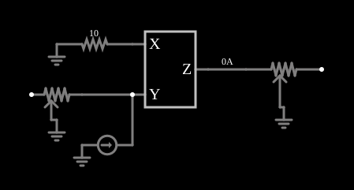

# Amplificador de corrente com transportador de corrente

<!-- navegacao:inicio -->
[Índice](README.md) · [Anterior: CCII- Implementation](cc2impn.md) · [Próximo: VCCS](ccvccs.md)
<!-- navegacao:fim -->

## Objetivo

Mostrar um **amplificador de corrente**: uma corrente de entrada pequena é multiplicada por uma razão de resistores, com ganho ajustável, e entregue a uma carga.

## O circuito

<!-- esquema:inicio -->

<!-- esquema:fim -->

Uma fonte de corrente de $10\ \text{mA}$ passa por um potenciômetro de $100\ \Omega$ (*Multiplier*, em $72{,}77\ \Omega$), que está ligado a $Y$. O terminal $X$ é ligado à terra por um resistor de $10\ \Omega$. A saída $Z$ alimenta outro potenciômetro de $100\ \Omega$ (*Z Resistance*, em $32{,}18\ \Omega$).

<!-- componentes:inicio -->
| N.º | Tipo | Elemento | Valores |
|----:|------|----------|---------|
| 0 | `CC2Elm` | CC2 |  |
| 1 | `CurrentElm` | current source | Current (A) = 10m; Max Voltage (V, 0=unlimited) = 0 |
| 2 | `GroundElm` | ground | Symbol = Earth |
| 4 | `ResistorElm` | resistor | Resistance (ohms) = 10 |
| 5 | `GroundElm` | ground | Symbol = Earth |
| 6 | `GroundElm` | ground | Symbol = Earth |
| 8 | `PotElm` | potentiometer | Resistance (ohms) = 100; Slider Text = Multiplier; Show Values = não; Group Number (for linking) = 0 |
| 9 | `PotElm` | potentiometer | Resistance (ohms) = 100; Slider Text = Z Resistance; Show Values = não; Group Number (for linking) = 0 |
| 10 | `GroundElm` | ground | Symbol = Earth |
<!-- componentes:fim -->

## Teoria

O **transportador de corrente** de segunda geração (CCII, *second-generation current conveyor*) tem três terminais: $X$, $Y$ e $Z$. Idealmente,

$$V_X = V_Y,\qquad I_Y = 0,\qquad I_Z = \pm I_X,$$

isto é, a tensão em $Y$ (de entrada de alta impedância) é copiada em $X$ (de baixa impedância), e a corrente que flui em $X$ é copiada para $Z$ (saída de alta impedância), com o mesmo sinal no CCII$+$ e o oposto no CCII$-$. O elemento do simulador tem ganho de corrente $\pm 1$.

A tensão em $Y$ é $V_Y = I_{in}R_m = 10\ \text{mA}\cdot 72{,}77\ \Omega = 0{,}7277\ \text{V}$. $X$ copia essa tensão e a corrente em $X$ é $I_X = V_Y/R_X = 0{,}7277\ \text{V}/10\ \Omega = 72{,}77\ \text{mA}$, copiada em $Z$. O ganho de corrente é

$$\frac{I_Z}{I_{in}} = \frac{R_m}{R_X} = \frac{72{,}77}{10} = 7{,}277,$$

e a tensão na carga é $V_Z = I_Z R_Z = 72{,}77\ \text{mA}\cdot 32{,}18\ \Omega = 2{,}342\ \text{V}$.

## Resultados esperados

O simulador dá $V_Y = 0{,}7277\ \text{V}$, $I_X = I_Z = 72{,}77\ \text{mA}$ e $V_Z = 2{,}3417\ \text{V}$, valores da teoria.

## O que observar

Mova o cursor *Multiplier*: a corrente de saída muda na mesma proporção que a resistência, e o ganho vai de $0$ a $10$. Mude a carga *Z Resistance*: a corrente de saída não muda, só a tensão sobre a carga.

## Limites do modelo

- O ganho vale enquanto a tensão $V_Z$ se mantiver numa faixa em que o transportador real é linear; o ideal do simulador não tem essa limitação.
- A corrente de entrada não é medida pelo próprio circuito: a fonte de corrente a impõe.

## Referências

Sedra e Smith, *A second generation current conveyor and its applications*, IEEE Transactions on Circuit Theory 17 (1970); Toumazou, Lidgey e Haigh, *Analogue IC Design: The Current-Mode Approach*.

O circuito deste exemplo faz parte da coleção do simulador original de Paul Falstad e Iain Sharp (CircuitJS1); a explicação é deste projeto.
