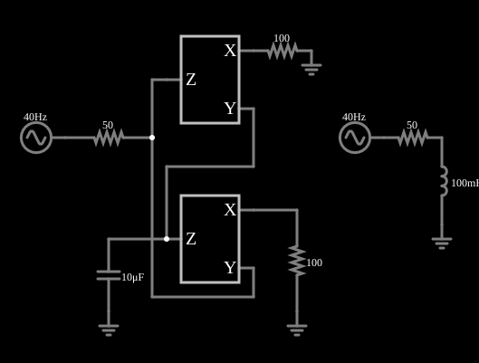

# Simulação de indutor com transportadores de corrente

<!-- navegacao:inicio -->
[Índice](README.md) · [Anterior: CCII-](cc2n.md) · [Próximo: CCII+ Implementation](cc2imp.md)
<!-- navegacao:fim -->

## Objetivo

Mostrar que dois transportadores de corrente, dois resistores e **um capacitor** se comportam, vistos de um terminal, como um **indutor** de $0{,}1\ \text{H}$, sem nenhuma bobina.

## O circuito

<!-- esquema:inicio -->

<!-- esquema:fim -->

Dois circuitos iguais recebem a mesma fonte senoidal de $5\ \text{V}$ de pico e $40\ \text{Hz}$, cada um por um resistor de $50\ \Omega$:

- **De cima:** um CCII$+$ e um CCII$-$, dois resistores de $100\ \Omega$ e um capacitor de $10\ \mu\text{F}$ fazem o papel do indutor.
- **De baixo:** um indutor real de $100\ \text{mH}$, para comparação.

Dois osciloscópios mostram a corrente em cada resistor.

<!-- componentes:inicio -->
| N.º | Tipo | Elemento | Valores |
|----:|------|----------|---------|
| 0 | `CC2Elm` | CC2 |  |
| 1 | `CC2Elm` | CC2 |  |
| 2 | `RailElm` | A/C source | Max Voltage = 5; Waveform = A/C; DC Offset (V) = 0; Internal Resistance (ohms) = 0; Show Voltage = não; Frequency (Hz) = 40; Phase Offset (degrees) = 0 |
| 3 | `ResistorElm` | resistor | Resistance (ohms) = 50 |
| 4 | `RailElm` | A/C source | Max Voltage = 5; Waveform = A/C; DC Offset (V) = 0; Internal Resistance (ohms) = 0; Show Voltage = não; Frequency (Hz) = 40; Phase Offset (degrees) = 0 |
| 5 | `ResistorElm` | resistor | Resistance (ohms) = 50 |
| 6 | `InductorElm` | inductor | Inductance (H) = 100m; Trapezoidal Approximation = sim; Initial Current (on Reset) (A) = 0; Saturation Current (A) (0=none) = 0 |
| 7 | `GroundElm` | ground | Symbol = Earth |
| 10 | `ResistorElm` | resistor | Resistance (ohms) = 100 |
| 11 | `GroundElm` | ground | Symbol = Earth |
| 16 | `ResistorElm` | resistor | Resistance (ohms) = 100 |
| 17 | `GroundElm` | ground | Symbol = Earth |
| 22 | `CapacitorElm` | capacitor | Capacitance (F) = 10μ; Trapezoidal Approximation = sim; Initial Voltage (on Reset) = 1m; Series Resistance = 0 |
| 23 | `GroundElm` | ground | Symbol = Earth |
<!-- componentes:fim -->

## Teoria

O **transportador de corrente** de segunda geração (CCII, *second-generation current conveyor*) tem três terminais: $X$, $Y$ e $Z$. Idealmente,

$$V_X = V_Y,\qquad I_Y = 0,\qquad I_Z = \pm I_X,$$

isto é, a tensão em $Y$ (de entrada de alta impedância) é copiada em $X$ (de baixa impedância), e a corrente que flui em $X$ é copiada para $Z$ (saída de alta impedância), com o mesmo sinal no CCII$+$ e o oposto no CCII$-$. O elemento do simulador tem ganho de corrente $\pm 1$.

O arranjo de dois transportadores com os resistores $R_1$ e $R_2$ e o capacitor $C$ tem impedância de entrada

$$Z_{in} = s\,C R_1 R_2\quad\Rightarrow\quad L_{sim} = C R_1 R_2 = 10\ \mu\text{F}\cdot 100\ \Omega\cdot 100\ \Omega = 0{,}1\ \text{H}.$$

Com o resistor de $50\ \Omega$ em série, a impedância do circuito é $|Z| = \sqrt{50^2 + (2\pi\cdot 40\cdot 0{,}1)^2} = \sqrt{2500 + 25{,}13^2} = 55{,}96\ \Omega$ e a corrente de pico é $5/55{,}96 = 89{,}4\ \text{mA}$.

## Resultados esperados

O simulador dá, nos dois circuitos, **os mesmos valores**:

- **Corrente de pico:** $89{,}35\ \text{mA}$ (teoria: $89{,}4\ \text{mA}$); valor eficaz de $63{,}18\ \text{mA}$.
- **Comparação instante a instante:** em $t = 12{,}5\ \text{ms}$ as duas correntes são $40{,}189\ \text{mA}$ em ambos os circuitos.
- **Capacitor:** a tensão de pico nele é de $8{,}93\ \text{V}$.

## O que observar

Os dois osciloscópios mostram curvas idênticas. A vantagem de simular o indutor: um capacitor de $10\ \mu\text{F}$ ocupa muito menos que uma bobina de $0{,}1\ \text{H}$ em um circuito integrado.

## Limites do modelo

- Os transportadores são ideais; a faixa de frequência em que o circuito se comporta como indutor num CCII real é limitada pela banda do transportador.
- O indutor simulado tem um dos terminais ligado à terra (é um indutor aterrado, não flutuante).

## Referências

Sedra e Smith, *A second generation current conveyor and its applications*, IEEE Transactions on Circuit Theory 17 (1970); Toumazou, Lidgey e Haigh, *Analogue IC Design: The Current-Mode Approach*.

O circuito deste exemplo faz parte da coleção do simulador original de Paul Falstad e Iain Sharp (CircuitJS1); a explicação é deste projeto.
