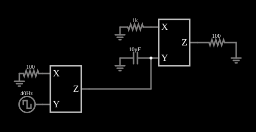

# Integrador de corrente com transportador de corrente

<!-- navegacao:inicio -->
[Índice](README.md) · [Anterior: Current Differentiator](ccdiff.md) · [Próximo: Current-Controlled Voltage Source](ccitov.md)
<!-- navegacao:fim -->

## Objetivo

Mostrar um **integrador**: a corrente proporcional à tensão de entrada carrega um capacitor, e a tensão no capacitor é a **integral** da entrada.

## O circuito

<!-- esquema:inicio -->

<!-- esquema:fim -->

Uma onda quadrada de $\pm 5\ \text{V}$ e $40\ \text{Hz}$ alimenta, por um resistor de $100\ \Omega$, o terminal $X$ de um primeiro transportador. A corrente copiada em $Z$ carrega um capacitor de $10\ \mu\text{F}$. Um segundo transportador, com $Y$ ligado ao capacitor e um resistor de $1\ \text{k}\Omega$ em $X$, copia a tensão do capacitor para um resistor de $100\ \Omega$ na saída (um *buffer*, que não carrega o capacitor).

<!-- componentes:inicio -->
| N.º | Tipo | Elemento | Valores |
|----:|------|----------|---------|
| 0 | `CC2Elm` | CC2 |  |
| 1 | `GroundElm` | ground | Symbol = Earth |
| 2 | `ResistorElm` | resistor | Resistance (ohms) = 100 |
| 3 | `GroundElm` | ground | Symbol = Earth |
| 4 | `CC2Elm` | CC2 |  |
| 5 | `ResistorElm` | resistor | Resistance (ohms) = 100 |
| 6 | `GroundElm` | ground | Symbol = Earth |
| 8 | `GroundElm` | ground | Symbol = Earth |
| 9 | `RailElm` | square wave gen | Max Voltage = 5; Waveform = Square Wave; DC Offset (V) = 0; Internal Resistance (ohms) = 0; Show Voltage = não; Specify As = Frequency/Duty Cycle; Frequency (Hz) = 40; Phase Offset (degrees) = 90; Duty Cycle = 50; Rise/Fall Time (s) = 0 |
| 11 | `CapacitorElm` | capacitor | Capacitance (F) = 10μ; Trapezoidal Approximation = sim; Initial Voltage (on Reset) = 1m; Series Resistance = 0 |
| 12 | `ResistorElm` | resistor | Resistance (ohms) = 1k |
<!-- componentes:fim -->

## Teoria

O **transportador de corrente** de segunda geração (CCII, *second-generation current conveyor*) tem três terminais: $X$, $Y$ e $Z$. Idealmente,

$$V_X = V_Y,\qquad I_Y = 0,\qquad I_Z = \pm I_X,$$

isto é, a tensão em $Y$ (de entrada de alta impedância) é copiada em $X$ (de baixa impedância), e a corrente que flui em $X$ é copiada para $Z$ (saída de alta impedância), com o mesmo sinal no CCII$+$ e o oposto no CCII$-$. O elemento do simulador tem ganho de corrente $\pm 1$.

A corrente que entra é $i = v_{in}/R = \pm 5\ \text{V}/100\ \Omega = \pm 50\ \text{mA}$ e é copiada para o capacitor:

$$v_C(t) = \frac{1}{C}\int i\thinspace dt = \frac{1}{RC}\int v_{in}\thinspace dt,\qquad RC = 100\ \Omega\cdot 10\ \mu\text{F} = 1\ \text{ms}.$$

Com a entrada constante em $\pm 5\ \text{V}$, a tensão varia com a inclinação $\pm 5\ \text{V/ms}$: a integral de uma quadrada é uma triangular. Em meio período ($12{,}5\ \text{ms}$) a variação é de $62{,}5\ \text{V}$. O segundo transportador copia essa tensão para $Z$ pelo resistor de $1\ \text{k}\Omega$ de $X$ e pelo de $100\ \Omega$ de saída, dividindo-a por $10$.

## Resultados esperados

O simulador dá:

- **Inclinação da tensão no capacitor:** $5{,}000\ \text{V}$ por milissegundo (em $2\ \text{ms}$ a $4\ \text{ms}$, de $-15{,}77\ \text{V}$ a $-25{,}77\ \text{V}$, e entre $12{,}5\ \text{ms}$ e $15\ \text{ms}$ ela sobe $12{,}5\ \text{V}$).
- **Excursão em regime permanente:** de $-37{,}02\ \text{V}$ a $+25{,}45\ \text{V}$, $62{,}5\ \text{V}$ de pico a pico.
- **Saída** (a décima parte): de $-3{,}70\ \text{V}$ a $+2{,}55\ \text{V}$.

## O que observar

O osciloscópio de entrada mostra uma quadrada e o de saída, uma triangular: a derivada da triangular é a quadrada e a integral da quadrada é a triangular. O valor médio da tensão no capacitor ($-5{,}8\ \text{V}$) é uma constante de integração, que depende do instante em que a integral começa.

## Limites do modelo

- O integrador ideal não tem resistência de fuga; o resistor de $1\ \text{k}\Omega$ do *buffer* não carrega o capacitor porque está na entrada $X$ de outro transportador.
- A excursão de dezenas de volts é irreal para um circuito integrado; vem das correntes de $50\ \text{mA}$ escolhidas para o exemplo.
- Um integrador sem realimentação acumula qualquer corrente contínua parasita, que o leva à saturação.

## Referências

Sedra e Smith, *A second generation current conveyor and its applications*, IEEE Transactions on Circuit Theory 17 (1970); Toumazou, Lidgey e Haigh, *Analogue IC Design: The Current-Mode Approach*.

O circuito deste exemplo faz parte da coleção do simulador original de Paul Falstad e Iain Sharp (CircuitJS1); a explicação é deste projeto.
