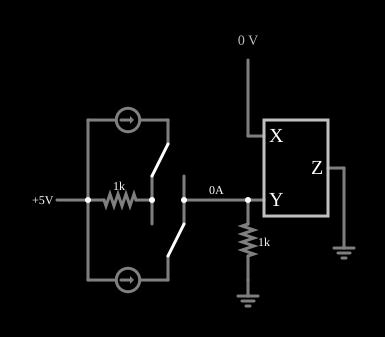

# Fonte de tensão controlada por corrente

<!-- navegacao:inicio -->
[Índice](README.md) · [Anterior: Current Integrator](ccint.md)
<!-- navegacao:fim -->

## Objetivo

Mostrar uma **fonte de tensão controlada por corrente** (CCVS): a corrente de entrada, escolhida por chaves, vira uma tensão proporcional na saída, o que faz da combinação um conversor corrente–tensão.

## O circuito

<!-- esquema:inicio -->

<!-- esquema:fim -->

Duas fontes de corrente, de $1\ \text{mA}$ e de $2\ \text{mA}$, são ligadas por duas chaves de duas posições ao terminal $X$ de um CCII$+$, cada uma ou à entrada ou a uma ramificação lateral de $5\ \text{V}$ e $1\ \text{k}\Omega$. A saída $Z$ alimenta um resistor de $1\ \text{k}\Omega$. Um osciloscópio mostra a tensão de saída.

<!-- componentes:inicio -->
| N.º | Tipo | Elemento | Valores |
|----:|------|----------|---------|
| 0 | `Switch2Elm` | switch (SPDT) | Momentary Switch = não; Group Number (for linking) = 0; # of Throws = 2; Keyboard Shortcut = ; On Resistance (ohms) = 0 |
| 1 | `Switch2Elm` | switch (SPDT) | Momentary Switch = não; Group Number (for linking) = 0; # of Throws = 2; Keyboard Shortcut = ; On Resistance (ohms) = 0 |
| 4 | `ResistorElm` | resistor | Resistance (ohms) = 1k |
| 5 | `CurrentElm` | current source | Current (A) = 1m; Max Voltage (V, 0=unlimited) = 0 |
| 6 | `CurrentElm` | current source | Current (A) = 2m; Max Voltage (V, 0=unlimited) = 0 |
| 7 | `OutputElm` | output | Show Voltage = sim; Scale = Auto |
| 9 | `ResistorElm` | resistor | Resistance (ohms) = 1k |
| 10 | `GroundElm` | ground | Symbol = Earth |
| 11 | `CC2Elm` | CC2 |  |
| 12 | `GroundElm` | ground | Symbol = Earth |
| 13 | `RailElm` | voltage source | Voltage = 5; Waveform = D/C; DC Offset (V) = 0; Internal Resistance (ohms) = 0 |
<!-- componentes:fim -->

## Teoria

O **transportador de corrente** de segunda geração (CCII, *second-generation current conveyor*) tem três terminais: $X$, $Y$ e $Z$. Idealmente,

$$V_X = V_Y,\qquad I_Y = 0,\qquad I_Z = \pm I_X,$$

isto é, a tensão em $Y$ (de entrada de alta impedância) é copiada em $X$ (de baixa impedância), e a corrente que flui em $X$ é copiada para $Z$ (saída de alta impedância), com o mesmo sinal no CCII$+$ e o oposto no CCII$-$. O elemento do simulador tem ganho de corrente $\pm 1$.

A corrente em $X$ é a soma das fontes ligadas à entrada, $I_X = I_1 + I_2$, e $V_Z = I_Z R_Z = I_X\cdot 1\ \text{k}\Omega$: a **transresistência** é $1\ \text{k}\Omega$ ($1\ \text{V/mA}$).

## Resultados esperados

O simulador dá, para as quatro combinações das chaves:

| Fonte de $1\ \text{mA}$ | Fonte de $2\ \text{mA}$ | $I_X$ | $V_{saída}$ |
|:---:|:---:|---:|---:|
| desligada | ligada (estado inicial) | $2\ \text{mA}$ | $2{,}000\ \text{V}$ |
| ligada | ligada | $3\ \text{mA}$ | $3{,}000\ \text{V}$ |
| ligada | desligada | $1\ \text{mA}$ | $1{,}000\ \text{V}$ |
| desligada | desligada | $0$ | $0\ \text{V}$ |

## O que observar

Acione as chaves e veja a tensão de saída tomar os valores $0$, $1$, $2$ e $3\ \text{V}$: um conversor digital–analógico de dois bits, de pesos $1\ \text{mA}$ e $2\ \text{mA}$, com saída de $1\ \text{V/mA}$.

## Limites do modelo

- O CCII$+$ é ideal, com resistência nula em $X$; num circuito real a queda em $X$ alteraria as correntes.
- As fontes de corrente são ideais e podem ser ligadas a qualquer tensão.

## Referências

Sedra e Smith, *A second generation current conveyor and its applications*, IEEE Transactions on Circuit Theory 17 (1970); Toumazou, Lidgey e Haigh, *Analogue IC Design: The Current-Mode Approach*.

O circuito deste exemplo faz parte da coleção do simulador original de Paul Falstad e Iain Sharp (CircuitJS1); a explicação é deste projeto.
