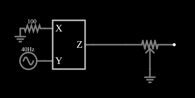

# Fonte de corrente controlada por tensão

<!-- navegacao:inicio -->
[Índice](README.md) · [Anterior: Current Amplifier](cciamp.md) · [Próximo: Current Differentiator](ccdiff.md)
<!-- navegacao:fim -->

## Objetivo

Mostrar uma **fonte de corrente controlada por tensão** (VCCS): uma tensão de entrada dá uma corrente proporcional na saída, que não depende da carga.

## O circuito

<!-- esquema:inicio -->

<!-- esquema:fim -->

Uma fonte senoidal de $5\ \text{V}$ de pico e $40\ \text{Hz}$ (fase de $90^\circ$) alimenta $Y$. O terminal $X$ é ligado à terra por um resistor de $100\ \Omega$. A saída $Z$ alimenta um potenciômetro de $200\ \Omega$ (*Resistance*, em $105{,}9\ \Omega$).

<!-- componentes:inicio -->
| N.º | Tipo | Elemento | Valores |
|----:|------|----------|---------|
| 0 | `CC2Elm` | CC2 |  |
| 1 | `ResistorElm` | resistor | Resistance (ohms) = 100 |
| 2 | `GroundElm` | ground | Symbol = Earth |
| 3 | `RailElm` | A/C source | Max Voltage = 5; Waveform = A/C; DC Offset (V) = 0; Internal Resistance (ohms) = 0; Show Voltage = não; Frequency (Hz) = 40; Phase Offset (degrees) = 90 |
| 4 | `PotElm` | potentiometer | Resistance (ohms) = 200; Slider Text = Resistance; Show Values = não; Group Number (for linking) = 0 |
| 5 | `GroundElm` | ground | Symbol = Earth |
<!-- componentes:fim -->

## Teoria

O **transportador de corrente** de segunda geração (CCII, *second-generation current conveyor*) tem três terminais: $X$, $Y$ e $Z$. Idealmente,

$$V_X = V_Y,\qquad I_Y = 0,\qquad I_Z = \pm I_X,$$

isto é, a tensão em $Y$ (de entrada de alta impedância) é copiada em $X$ (de baixa impedância), e a corrente que flui em $X$ é copiada para $Z$ (saída de alta impedância), com o mesmo sinal no CCII$+$ e o oposto no CCII$-$. O elemento do simulador tem ganho de corrente $\pm 1$.

$V_X = V_Y = v_{in}$ e $I_X = v_{in}/100\ \Omega$, copiada em $Z$: a transcondutância é

$$g_m = \frac{I_Z}{v_{in}} = \frac{1}{R_X} = 10\ \text{mA/V},$$

independentemente da carga em $Z$. A tensão na carga é $v_Z = g_m v_{in} R_Z$.

## Resultados esperados

O simulador dá:

- **Corrente em $X$ (e em $Z$):** pico de $50{,}0\ \text{mA}$ para a entrada de $5\ \text{V}$ de pico ($10\ \text{mA/V}$).
- **Tensão em $Z$:** pico de $5{,}297\ \text{V}$ ($50\ \text{mA}\cdot 105{,}9\ \Omega$).

## O que observar

Mude a resistência do potenciômetro de carga: a tensão em $Z$ muda proporcionalmente, mas a corrente é a mesma, a marca de uma fonte de corrente.

## Limites do modelo

- A fonte é ideal e não tem limite de tensão: com uma carga muito grande o simulador entregaria tensões irreais; um transportador real satura.

## Referências

Sedra e Smith, *A second generation current conveyor and its applications*, IEEE Transactions on Circuit Theory 17 (1970); Toumazou, Lidgey e Haigh, *Analogue IC Design: The Current-Mode Approach*.

O circuito deste exemplo faz parte da coleção do simulador original de Paul Falstad e Iain Sharp (CircuitJS1); a explicação é deste projeto.
