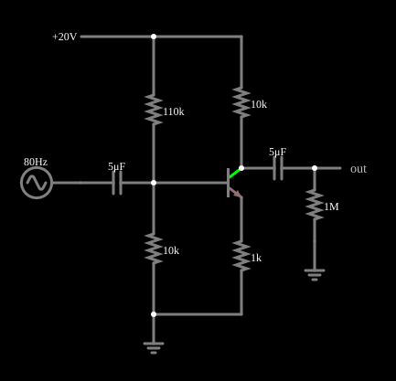

# Amplificador de emissor comum

<!-- navegacao:inicio -->
[Índice](README.md) · [Anterior: Emitter Follower](follower.md) · [Próximo: Unity-Gain Phase Splitter](phasesplit.md)
<!-- navegacao:fim -->

## Objetivo

Mostrar o amplificador de emissor comum, o estágio básico de amplificação de tensão com transistor: o sinal é amplificado e **invertido**.

## O circuito

<!-- esquema:inicio -->

<!-- esquema:fim -->

A alimentação é de $20\ \text{V}$. Um divisor de $110\ \text{k}\Omega$ e $10\ \text{k}\Omega$ polariza a base; o coletor tem um resistor de $10\ \text{k}\Omega$ e o emissor, de $1\ \text{k}\Omega$ (sem capacitor em paralelo). O sinal de entrada ($0{,}5\ \text{V}$ de pico, $80\ \text{Hz}$) entra pela base por um capacitor de $5\ \mu\text{F}$, e a saída sai do coletor por outro capacitor de $5\ \mu\text{F}$, para uma carga de $1\ \text{M}\Omega$.

<!-- componentes:inicio -->
| N.º | Tipo | Elemento | Valores |
|----:|------|----------|---------|
| 1 | `ResistorElm` | resistor | Resistance (ohms) = 110k |
| 2 | `ResistorElm` | resistor | Resistance (ohms) = 10k |
| 3 | `NTransistorElm` | transistor | Beta/hFE = 100; Swap E/C = não; Draw Circle = não; Model = default |
| 5 | `GroundElm` | ground | Symbol = Earth |
| 6 | `RailElm` | voltage source | Voltage = 20; Waveform = D/C; DC Offset (V) = 0; Internal Resistance (ohms) = 0 |
| 7 | `ResistorElm` | resistor | Resistance (ohms) = 10k |
| 8 | `ResistorElm` | resistor | Resistance (ohms) = 1k |
| 9 | `CapacitorElm` | capacitor | Capacitance (F) = 5μ; Trapezoidal Approximation = sim; Initial Voltage (on Reset) = 1m; Series Resistance = 0 |
| 10 | `RailElm` | A/C source | Max Voltage = 500m; Waveform = A/C; DC Offset (V) = 0; Internal Resistance (ohms) = 0; Show Voltage = não; Frequency (Hz) = 80; Phase Offset (degrees) = 0 |
| 11 | `CapacitorElm` | capacitor | Capacitance (F) = 5μ; Trapezoidal Approximation = sim; Initial Voltage (on Reset) = 1m; Series Resistance = 0 |
| 12 | `OutputElm` | output | Show Voltage = não |
| 13 | `ResistorElm` | resistor | Resistance (ohms) = 1M |
| 14 | `GroundElm` | ground | Symbol = Earth |
<!-- componentes:fim -->

## Teoria

O transistor bipolar do simulador (modelo "default") segue o modelo de Ebers–Moll, com $V_{BE}$ e $V_{BC}$ as tensões base-emissor e base-coletor (para um NPN):

$$I_C = I_s\left(e^{V_{BE}/V_T} - e^{V_{BC}/V_T}\right) - \frac{I_s}{\beta_R}\left(e^{V_{BC}/V_T} - 1\right),\qquad I_B = \frac{I_s}{\beta}\left(e^{V_{BE}/V_T} - 1\right) + \frac{I_s}{\beta_R}\left(e^{V_{BC}/V_T} - 1\right),$$

com $I_s = 10^{-13}\ \text{A}$, $\beta = 100$, $\beta_R = 1$ e $V_T = 25{,}865\ \text{mV}$; sem efeito Early, sem capacitâncias e sem resistências série. Na **região ativa** ($V_{BE} \approx 0{,}65$ a $0{,}75\ \text{V}$, junção base-coletor com polarização inversa) isso se reduz a $I_C = \beta I_B = I_s\,e^{V_{BE}/V_T}$, com transcondutância $g_m = I_C/V_T$ e resistência de emissor $r_e = V_T/I_E$. O PNP é o complementar, com todas as tensões e correntes invertidas.

## Resultados esperados

**Polarização.** O divisor fixa a base em $V_B \approx 20\cdot 10/120 = 1{,}67\ \text{V}$ (menos o efeito da corrente de base); o emissor fica $V_{BE}$ abaixo, e a corrente de emissor é $I_E \approx (V_B - V_{BE})/R_E$. O coletor fica em $V_C = V_{CC} - R_C I_C$.

**Ganho de pequenos sinais.** Para uma variação $v_b$ na base, a corrente do coletor varia $i_c = g_m\,v_{be}$, e a tensão de saída é

$$A_v = \frac{v_c}{v_b} = -\frac{R_C\,\|\,R_L}{r_e + R_E} \approx -\frac{R_C}{R_E}\quad (R_E \gg r_e),$$

negativo (inversão de fase). Com o resistor de emissor sem desacoplamento, o ganho depende pouco do transistor (realimentação negativa) e é mais linear, à custa de menor ganho.

## O que observar

Em regime (de $0{,}05$ a $0{,}1\ \text{s}$), a integração numérica independente dá: corrente de emissor $I_E = 0.976\ \text{mA}$ (média da queda em $R_E$), tensão de coletor média $10.33\ \text{V}$, $r_e = V_T/I_E = 26.5\ \Omega$. O sinal de entrada na base ($1{,}0\ \text{V}$ pico a pico) vira $9.57\ \text{V}$ pico a pico no coletor, um ganho de tensão de $9.53$ (invertido), em acordo com a previsão $R_C\,\|\,R_L/(r_e + R_E) = 9{,}9\ \text{k}\Omega/1026\ \Omega = 9.64$ (a pequena diferença vem da distorção e da corrente de base). A saída, depois do capacitor de acoplamento (carga de $1\ \text{M}\Omega$), varia entre $-4.56$ e $5.01\ \text{V}$, centrada em zero (o capacitor bloqueia a componente contínua). As verificações conferem o máximo e o mínimo no coletor, a corrente (queda média em $R_E$), os extremos da tensão de base e os da saída (tolerância de 1%).

## Limites do modelo

- A saída é uma réplica **invertida** da entrada, cerca de $9{,}6$ vezes maior.
- O capacitor de saída remove a tensão contínua do coletor, e a saída oscila em torno de zero.
- Aumente $R_C$: o ganho aumenta, mas o ponto de operação sobe e a saída pode ceifar; diminua $R_E$: o ganho cresce e a distorção também.

## Referências

O ganho de $9{,}6$ é baixo para um transistor (o resistor de emissor sem desacoplamento o limita); com um capacitor em paralelo com $R_E$ o ganho subiria muito, mas dependeria do ponto de operação. O modelo não tem capacitâncias, e a resposta em baixas frequências é limitada só pelos capacitores de acoplamento ($f_c = 1/(2\pi R C)$ de alguns Hz).

O circuito deste exemplo faz parte da coleção do simulador original de Paul Falstad e Iain Sharp (CircuitJS1); a explicação é deste projeto.
