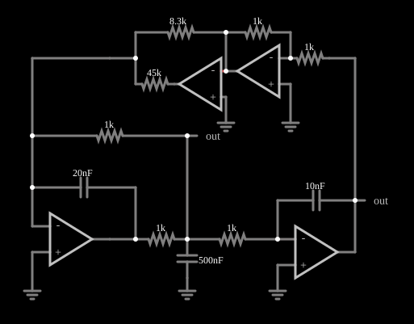

# Circuito caótico 1

<!-- navegacao:inicio -->
[Índice](README.md) · [Anterior: Chua](chua.md) · [Próximo: Chaos 2](chaos2.md)
<!-- navegacao:fim -->

## Objetivo

Mostrar um circuito caótico construído apenas com amplificadores operacionais, resistores e capacitores, em que a não linearidade vem da saturação dos próprios operacionais.

## O circuito

<!-- esquema:inicio -->

<!-- esquema:fim -->

Quatro amplificadores operacionais formam uma cadeia de integradores e somadores, com capacitores de $10\ \text{nF}$, $20\ \text{nF}$ e $500\ \text{nF}$ e resistores de $1\ \text{k}\Omega$ a $45\ \text{k}\Omega$; os sinais voltam por um ramo com resistor de $8{,}3\ \text{k}\Omega$. Dois osciloscópios XY mostram os retratos de fase e dois elementos de saída identificam as variáveis plotadas.

<!-- componentes:inicio -->
| N.º | Tipo | Elemento | Valores |
|----:|------|----------|---------|
| 3 | `ResistorElm` | resistor | Resistance (ohms) = 8.3k |
| 4 | `OpAmpElm` | op-amp | Max Output (V) = 15; Min Output (V) = -15; Gain = 100k |
| 5 | `ResistorElm` | resistor | Resistance (ohms) = 45k |
| 6 | `GroundElm` | ground | Symbol = Earth |
| 7 | `OpAmpElm` | op-amp | Max Output (V) = 15; Min Output (V) = -15; Gain = 100k |
| 9 | `ResistorElm` | resistor | Resistance (ohms) = 1k |
| 10 | `ResistorElm` | resistor | Resistance (ohms) = 1k |
| 12 | `GroundElm` | ground | Symbol = Earth |
| 13 | `OpAmpElm` | op-amp | Max Output (V) = 15; Min Output (V) = -15; Gain = 100k |
| 16 | `CapacitorElm` | capacitor | Capacitance (F) = 20n; Trapezoidal Approximation = sim; Initial Voltage (on Reset) = 1m; Series Resistance = 0 |
| 19 | `ResistorElm` | resistor | Resistance (ohms) = 1k |
| 20 | `ResistorElm` | resistor | Resistance (ohms) = 1k |
| 22 | `CapacitorElm` | capacitor | Capacitance (F) = 500n; Trapezoidal Approximation = sim; Initial Voltage (on Reset) = 1m; Series Resistance = 0 |
| 23 | `GroundElm` | ground | Symbol = Earth |
| 24 | `GroundElm` | ground | Symbol = Earth |
| 25 | `ResistorElm` | resistor | Resistance (ohms) = 1k |
| 26 | `OpAmpElm` | op-amp | Max Output (V) = 15; Min Output (V) = -15; Gain = 100k |
| 29 | `CapacitorElm` | capacitor | Capacitance (F) = 10n; Trapezoidal Approximation = sim; Initial Voltage (on Reset) = 1m; Series Resistance = 0 |
| 30 | `GroundElm` | ground | Symbol = Earth |
| 35 | `OutputElm` | output | Show Voltage = não |
| 36 | `OutputElm` | output | Show Voltage = não |
<!-- componentes:fim -->

## Teoria

Um sistema contínuo precisa de **pelo menos três** variáveis de estado e de uma não linearidade para ser caótico. Aqui as variáveis são as tensões nos capacitores dos integradores, e a não linearidade vem do limite de saída dos operacionais (quando um deles satura em $\pm 15\ \text{V}$, a sua realimentação muda). Em cada região (nenhum operacional saturado, um saturado, etc.), o sistema é linear e tem uma dinâmica (autovalores) diferente; a trajetória é "dobrada" cada vez que passa de uma região para outra.

Os integradores com constantes de tempo diferentes ($RC$ de $10\ \mu\text{s}$ a $500\ \mu\text{s}$ no circuito, com $1\ \text{k}\Omega$ e capacitores de $10\ \text{nF}$ a $500\ \text{nF}$) dão ao sistema escalas de tempo separadas, comuns em circuitos caóticos.

## Resultados esperados

As tensões dos integradores variam de forma irregular, sempre dentro de uma faixa limitada. Os retratos de fase XY mostram a trajetória preenchendo uma região em torno de pontos de equilíbrio instáveis.

Este documento não traz verificações numéricas (`sem-verificacao`): em regime caótico nenhum valor é reprodutível.

## O que observar

- Deixe o circuito rodar e veja nos osciloscópios XY a figura se formar: ela se repete em forma, mas não em sequência.
- Reinicie algumas vezes: as condições iniciais mudam um pouco (por exemplo, a tensão inicial de um capacitor), e a trajetória é outra, enquanto o retrato de fase final é parecido.
- Em um circuito físico, o ruído dos componentes teria o mesmo efeito.

## Limites do modelo

O comportamento caótico é extremamente sensível às condições iniciais, ao passo de tempo e à precisão numérica: uma trajetória simulada **não** é reprodutível ponto a ponto, nem em outro simulador nem em outra versão deste, e só as propriedades estatísticas e geométricas do atrator (a forma do retrato de fase, as faixas de tensão) têm significado. Os retratos de fase descritos neste documento são os esperados pela teoria destes sistemas e pela estrutura do circuito; não foram comparados, aqui, com uma captura do simulador. Os componentes (operacionais, diodos) são ideais, sem ruído, que num circuito real é parte do que alimenta o caos. A não linearidade é a saturação do modelo de operacional, que é instantânea; em um componente real, ela depende da alimentação e do *slew rate*.

## Referências

- S. H. Strogatz, *Nonlinear Dynamics and Chaos*, Westview Press.
- J. C. Sprott, *Elegant Chaos: Algebraically Simple Chaotic Flows*, World Scientific.

O circuito deste exemplo faz parte da coleção do simulador original de Paul Falstad e Iain Sharp (CircuitJS1); a explicação é deste projeto.
