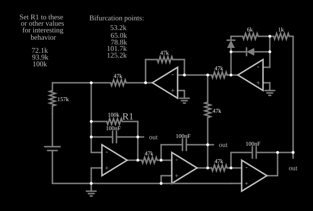

# Circuito caótico 2 (dobramento de período)

<!-- navegacao:inicio -->
[Índice](README.md) · [Anterior: Chaos 1](chaos1.md) · [Próximo: Jerk](jerk.md)
<!-- navegacao:fim -->

## Objetivo

Mostrar um circuito caótico no qual a mudança de um único resistor ($R_1$) leva o sistema, passo a passo, de uma oscilação periódica ao caos pelos dobramentos de período, e permite procurar os pontos de bifurcação.

## O circuito

<!-- esquema:inicio -->

<!-- esquema:fim -->

Três amplificadores operacionais integradores (resistores de $47\ \text{k}\Omega$, capacitores de $100\ \text{nF}$) fecham uma malha de terceira ordem. A realimentação passa por um resistor ajustável $R_1$ (de $100\ \text{k}\Omega$ ao abrir) e por uma rede com um amplificador operacional e dois diodos, que introduz a não linearidade. Uma fonte de $0{,}25\ \text{V}$ polariza o circuito. Três osciloscópios XY mostram as tensões dos integradores. O próprio circuito traz, em textos, os valores de $R_1$ de interesse: **pontos de bifurcação** em $53{,}2$, $65{,}0$, $78{,}8$, $101{,}7$ e $125{,}2\ \text{k}\Omega$ e comportamento interessante em $72{,}1$, $93{,}9$ e $100\ \text{k}\Omega$.

<!-- componentes:inicio -->
| N.º | Tipo | Elemento | Valores |
|----:|------|----------|---------|
| 0 | `OpAmpElm` | op-amp | Max Output (V) = 15; Min Output (V) = -15; Gain = 100k |
| 1 | `OpAmpElm` | op-amp | Max Output (V) = 15; Min Output (V) = -15; Gain = 100k |
| 2 | `OpAmpElm` | op-amp | Max Output (V) = 15; Min Output (V) = -15; Gain = 100k |
| 3 | `ResistorElm` | resistor | Resistance (ohms) = 47k |
| 4 | `ResistorElm` | resistor | Resistance (ohms) = 47k |
| 15 | `CapacitorElm` | capacitor | Capacitance (F) = 100n; Trapezoidal Approximation = sim; Initial Voltage (on Reset) = 1m; Series Resistance = 0 |
| 16 | `CapacitorElm` | capacitor | Capacitance (F) = 100n; Trapezoidal Approximation = sim; Initial Voltage (on Reset) = 1m; Series Resistance = 0 |
| 17 | `CapacitorElm` | capacitor | Capacitance (F) = 100n; Trapezoidal Approximation = sim; Initial Voltage (on Reset) = 1m; Series Resistance = 0 |
| 20 | `ResistorElm` | resistor | Resistance (ohms) = 1k |
| 21 | `ResistorElm` | resistor | Resistance (ohms) = 6k |
| 22 | `OpAmpElm` | op-amp | Max Output (V) = 15; Min Output (V) = -15; Gain = 100k |
| 23 | `DiodeElm` | diode | Model = default |
| 24 | `DiodeElm` | diode | Model = default |
| 28 | `VoltageElm` | voltage source | Voltage = 250m; Waveform = D/C; DC Offset (V) = 0; Internal Resistance (ohms) = 0; Show Voltage = não; Circle Symbol = não |
| 29 | `ResistorElm` | resistor | Resistance (ohms) = 157k |
| 32 | `OpAmpElm` | op-amp | Max Output (V) = 15; Min Output (V) = -15; Gain = 100k |
| 33 | `ResistorElm` | resistor | Resistance (ohms) = 47k |
| 34 | `ResistorElm` | resistor | Resistance (ohms) = 47k |
| 38 | `ResistorElm` | resistor | Resistance (ohms) = 47k |
| 40 | `ResistorElm` | resistor | Resistance (ohms) = 47k |
| 41 | `GroundElm` | ground | Symbol = Earth |
| 42 | `GroundElm` | ground | Symbol = Earth |
| 43 | `GroundElm` | ground | Symbol = Earth |
| 46 | `OutputElm` | output | Show Voltage = não |
| 47 | `OutputElm` | output | Show Voltage = não |
| 48 | `OutputElm` | output | Show Voltage = não |
| 49 | `ResistorElm` | resistor | Resistance (ohms) = 100k |
| 50 | `TextElm` | text | Text = Set R1 to these; Size = 15; Draw Bar On Top = não; Color = #c0c0c0 |
| 51 | `TextElm` | text | Text = or other values; Size = 15; Draw Bar On Top = não; Color = #c0c0c0 |
| 52 | `TextElm` | text | Text = R1; Size = 20; Draw Bar On Top = não; Color = #c0c0c0 |
| 53 | `TextElm` | text | Text = for interesting; Size = 15; Draw Bar On Top = não; Color = #c0c0c0 |
| 54 | `TextElm` | text | Text = behavior; Size = 15; Draw Bar On Top = não; Color = #c0c0c0 |
| 55 | `TextElm` | text | Text = 72.1k; Size = 15; Draw Bar On Top = não; Color = #c0c0c0 |
| 56 | `TextElm` | text | Text = 93.9k; Size = 15; Draw Bar On Top = não; Color = #c0c0c0 |
| 57 | `TextElm` | text | Text = 100k; Size = 15; Draw Bar On Top = não; Color = #c0c0c0 |
| 58 | `TextElm` | text | Text = Bifurcation points:; Size = 15; Draw Bar On Top = não; Color = #c0c0c0 |
| 59 | `TextElm` | text | Text = 53.2k; Size = 15; Draw Bar On Top = não; Color = #c0c0c0 |
| 60 | `TextElm` | text | Text = 65.0k; Size = 15; Draw Bar On Top = não; Color = #c0c0c0 |
| 61 | `TextElm` | text | Text = 78.8k; Size = 15; Draw Bar On Top = não; Color = #c0c0c0 |
| 62 | `TextElm` | text | Text = 101.7k; Size = 15; Draw Bar On Top = não; Color = #c0c0c0 |
| 63 | `TextElm` | text | Text = 125.2k; Size = 15; Draw Bar On Top = não; Color = #c0c0c0 |
<!-- componentes:fim -->

## Teoria

Em um sistema com um parâmetro de controle (aqui $R_1$), o comportamento muda de forma qualitativa em valores críticos, chamados **pontos de bifurcação**. A rota mais comum para o caos é a cascata de dobramentos de período: um ciclo de período $T$ perde a estabilidade e dá lugar a um de período $2T$, depois $4T$, $8T$, ..., com intervalos cada vez menores do parâmetro; as distâncias entre bifurcações sucessivas decrescem com a razão universal de Feigenbaum:

$$\delta = \lim_{n\to\infty}\frac{r_n - r_{n-1}}{r_{n+1} - r_n} \approx 4{,}669.$$

No retrato de fase, um ciclo de período $2T$ aparece como uma curva que dá duas voltas antes de se fechar.

## Resultados esperados

Com $R_1 = 100\ \text{k}\Omega$ o circuito está em um dos valores que o arquivo marca como de interesse. Valores abaixo e acima dos pontos de bifurcação listados dão comportamentos periódicos de períodos diferentes ou caos. Os pontos listados no circuito ($53{,}2$ a $125{,}2\ \text{k}\Omega$) são do autor do exemplo, e não foram verificados aqui.

Este documento não traz verificações numéricas (`sem-verificacao`): em regime caótico nenhum valor é reprodutível.

## O que observar

- Ajuste $R_1$ (clicando no resistor e editando o valor) para cada um dos valores do texto do circuito e observe os retratos de fase: curvas de uma, duas e quatro voltas e, depois, regiões preenchidas.
- Perto de um ponto de bifurcação, o sistema demora para se acomodar: espere o transitório passar antes de olhar para o retrato de fase.
- Entre as bifurcações podem existir "janelas" periódicas dentro da região caótica.

## Limites do modelo

O comportamento caótico é extremamente sensível às condições iniciais, ao passo de tempo e à precisão numérica: uma trajetória simulada **não** é reprodutível ponto a ponto, nem em outro simulador nem em outra versão deste, e só as propriedades estatísticas e geométricas do atrator (a forma do retrato de fase, as faixas de tensão) têm significado. Os retratos de fase descritos neste documento são os esperados pela teoria destes sistemas e pela estrutura do circuito; não foram comparados, aqui, com uma captura do simulador. Os componentes (operacionais, diodos) são ideais, sem ruído, que num circuito real é parte do que alimenta o caos. Os valores de bifurcação são do arquivo original; não foram verificados neste projeto, e o resultado de uma simulação pode divergir deles se o passo de tempo mudar.

## Referências

- S. H. Strogatz, *Nonlinear Dynamics and Chaos*, Westview Press.
- J. C. Sprott, *Elegant Chaos: Algebraically Simple Chaotic Flows*, World Scientific.

O circuito deste exemplo faz parte da coleção do simulador original de Paul Falstad e Iain Sharp (CircuitJS1); a explicação é deste projeto.
