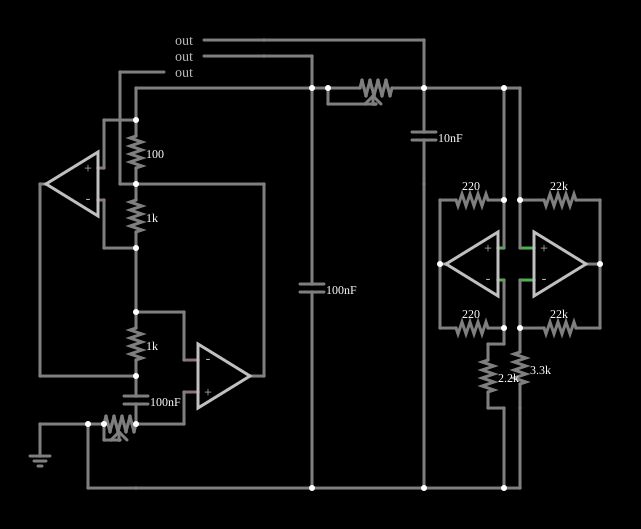

# Circuito de Chua

<!-- navegacao:inicio -->
[Índice](README.md) · [Anterior: Vilnius](vilnius.md) · [Próximo: Chaos 1](chaos1.md)
<!-- navegacao:fim -->

## Objetivo

Mostrar o circuito de Chua, o primeiro circuito eletrônico simples com comportamento caótico comprovado, que produz o atrator de "duplo rolo" (*double scroll*). O exemplo o realiza com amplificadores operacionais: um girador no lugar do indutor e um resistor não linear feito com dois operacionais.

## O circuito

<!-- esquema:inicio -->

<!-- esquema:fim -->

O circuito tem três elementos de armazenamento de energia: dois capacitores ($100\ \text{nF}$ e $10\ \text{nF}$) e um indutor, que aqui é **simulado** por um girador com um operacional, resistores de $100\ \Omega$ e $1\ \text{k}\Omega$ e um capacitor de $100\ \text{nF}$. Entre os dois capacitores há um resistor ajustável $R$ (um potenciômetro de $2{,}5\ \text{k}\Omega$ de nome "R"). A não linearidade é um **resistor de Chua**, composto por dois amplificadores operacionais com resistores de $220\ \Omega$, $22\ \text{k}\Omega$, $3{,}3\ \text{k}\Omega$ e $2{,}2\ \text{k}\Omega$, cuja característica $I\text{-}V$ é linear por partes, com inclinação negativa perto da origem. Um segundo potenciômetro "R10" ajusta o girador. Três elementos de saída e três osciloscópios XY mostram as tensões.

<!-- componentes:inicio -->
| N.º | Tipo | Elemento | Valores |
|----:|------|----------|---------|
| 0 | `OpAmpElm` | op-amp | Max Output (V) = 15; Min Output (V) = -15; Gain = 100k |
| 1 | `OpAmpElm` | op-amp | Max Output (V) = 15; Min Output (V) = -15; Gain = 100k |
| 2 | `ResistorElm` | resistor | Resistance (ohms) = 220 |
| 3 | `ResistorElm` | resistor | Resistance (ohms) = 22k |
| 4 | `ResistorElm` | resistor | Resistance (ohms) = 22k |
| 5 | `ResistorElm` | resistor | Resistance (ohms) = 220 |
| 17 | `ResistorElm` | resistor | Resistance (ohms) = 3.3k |
| 24 | `ResistorElm` | resistor | Resistance (ohms) = 2.2k |
| 25 | `CapacitorElm` | capacitor | Capacitance (F) = 10n; Trapezoidal Approximation = sim; Initial Voltage (on Reset) = 1m; Series Resistance = 0 |
| 26 | `CapacitorElm` | capacitor | Capacitance (F) = 100n; Trapezoidal Approximation = sim; Initial Voltage (on Reset) = 1m; Series Resistance = 0 |
| 32 | `ResistorElm` | resistor | Resistance (ohms) = 100 |
| 33 | `ResistorElm` | resistor | Resistance (ohms) = 1k |
| 34 | `OpAmpElm` | op-amp | Max Output (V) = 15; Min Output (V) = -15; Gain = 100k |
| 39 | `OpAmpElm` | op-amp | Max Output (V) = 15; Min Output (V) = -15; Gain = 100k |
| 43 | `ResistorElm` | resistor | Resistance (ohms) = 1k |
| 46 | `CapacitorElm` | capacitor | Capacitance (F) = 100n; Trapezoidal Approximation = sim; Initial Voltage (on Reset) = 1m; Series Resistance = 0 |
| 55 | `GroundElm` | ground | Symbol = Earth |
| 57 | `OutputElm` | output | Show Voltage = não |
| 58 | `OutputElm` | output | Show Voltage = não |
| 59 | `OutputElm` | output | Show Voltage = não |
| 65 | `PotElm` | potentiometer | Resistance (ohms) = 2.5k; Slider Text = R; Show Values = não; Group Number (for linking) = 0 |
| 66 | `PotElm` | potentiometer | Resistance (ohms) = 2.5k; Slider Text = R10; Show Values = não; Group Number (for linking) = 0 |
<!-- componentes:fim -->

## Teoria

O circuito de Chua obedece a três equações (variáveis: as tensões $v_1$ e $v_2$ nos capacitores e a corrente $i_L$ no indutor):

$$C_1\frac{dv_1}{dt} = \frac{v_2 - v_1}{R} - g(v_1),\quad C_2\frac{dv_2}{dt} = \frac{v_1 - v_2}{R} + i_L,\quad L\frac{di_L}{dt} = -v_2,$$

onde $g(v)$ é a característica do resistor de Chua, linear por partes:

$$g(v) = m_0\,v + \tfrac{1}{2}(m_1 - m_0)\left(|v + B_p| - |v - B_p|\right),\qquad m_0,\,m_1 < 0.$$

A inclinação negativa fornece a energia que mantém a oscilação, e as inclinações mudam fora da região central, o que dobra a trajetória de volta. Variando $R$ (a "resistência de acoplamento"), o circuito passa por equilíbrios, ciclos periódicos, dobramentos de período, o atrator espiral de Chua e, por fim, o atrator de duplo rolo, formado por duas "asas" ao redor dos dois pontos de equilíbrio externos, entre as quais a trajetória alterna de forma irregular.

## Resultados esperados

Com o potenciômetro "R" em $61{,}9\%$ da escala ($1{,}55\ \text{k}\Omega$), valor da ordem do que se usa nas realizações com estes componentes para obter o atrator de duplo rolo, espera-se que os retratos de fase XY mostrem a figura de duas asas e que $v_1$ alterne entre valores positivos e negativos de modo irregular.

Este documento não traz verificações numéricas (`sem-verificacao`): em regime caótico nenhum valor é reprodutível.

## O que observar

- Os osciloscópios XY desenham aos poucos as duas asas do atrator; a trajetória passa de uma asa para a outra em instantes imprevisíveis.
- Gire o potenciômetro "R": em realizações semelhantes do circuito de Chua, com valores altos a oscilação é periódica (um ciclo); ao diminuir $R$ aparecem ciclos de período dobrado, depois o caos, e por fim a trajetória pode escapar para a saturação dos operacionais.
- O circuito mostra que a presença de um elemento linear por partes com inclinação negativa, junto de três elementos de armazenamento, basta para o caos.

## Limites do modelo

O comportamento caótico é extremamente sensível às condições iniciais, ao passo de tempo e à precisão numérica: uma trajetória simulada **não** é reprodutível ponto a ponto, nem em outro simulador nem em outra versão deste, e só as propriedades estatísticas e geométricas do atrator (a forma do retrato de fase, as faixas de tensão) têm significado. Os retratos de fase descritos neste documento são os esperados pela teoria destes sistemas e pela estrutura do circuito; não foram comparados, aqui, com uma captura do simulador. Os componentes (operacionais, diodos) são ideais, sem ruído, que num circuito real é parte do que alimenta o caos. O indutor simulado por girador tem uma extremidade aterrada e limitada em corrente e em banda, o que modifica o atrator em relação ao circuito com indutor real.

## Referências

- S. H. Strogatz, *Nonlinear Dynamics and Chaos*, Westview Press.
- M. P. Kennedy, "Robust op amp realization of Chua's circuit", *Frequenz*, 46, 1992.
- L. O. Chua, "The double scroll family", *IEEE Transactions on Circuits and Systems*, 33, 1986.

O circuito deste exemplo faz parte da coleção do simulador original de Paul Falstad e Iain Sharp (CircuitJS1); a explicação é deste projeto.
