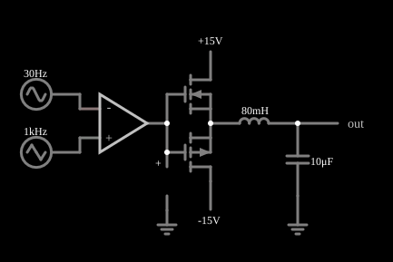

# Amplificador classe D

<!-- navegacao:inicio -->
[Índice](README.md) · [Anterior: Log Amplifier](logconvert.md)
<!-- navegacao:fim -->

## Objetivo

Mostrar o princípio do amplificador classe D: um comparador transforma o sinal de áudio em uma onda de largura de pulso variável (PWM) que comanda um estágio de saída que só chaveia, e um filtro passa-baixas LC recupera o sinal de áudio amplificado. Como os transistores ficam ou cortados ou saturados, a dissipação é pequena.

## O circuito

<!-- esquema:inicio -->

<!-- esquema:fim -->

Um amplificador operacional sem realimentação, de ganho muito alto, atua como comparador entre um sinal de áudio (senoide de $30\ \text{Hz}$ e amplitude $1{,}001\ \text{V}$) e uma onda triangular de $1\ \text{kHz}$ e $1\ \text{V}$ de pico. A saída do comparador, que vai de $-15$ a $+15\ \text{V}$, aciona as portas de dois MOSFETs (um NMOS ligado à alimentação de $+15\ \text{V}$ e um PMOS ligado à de $-15\ \text{V}$) ligados em série, e o ponto entre eles alimenta um filtro LC ($80\ \text{mH}$ e $10\ \mu\text{F}$). A tensão no capacitor é a saída. Três osciloscópios mostram o áudio de entrada, a saída do comparador e a saída filtrada.

<!-- componentes:inicio -->
| N.º | Tipo | Elemento | Valores |
|----:|------|----------|---------|
| 0 | `OpAmpElm` | op-amp | Max Output (V) = 15; Min Output (V) = -15; Gain = 100k |
| 1 | `PMosfetElm` | MOSFET | Model = default; Swap D/S = não |
| 2 | `NMosfetElm` | MOSFET | Model = default; Swap D/S = não |
| 7 | `RailElm` | voltage source | Voltage = 15; Waveform = D/C; DC Offset (V) = 0; Internal Resistance (ohms) = 0 |
| 8 | `InductorElm` | inductor | Inductance (H) = 80m; Trapezoidal Approximation = sim; Initial Current (on Reset) (A) = 0; Saturation Current (A) (0=none) = 0 |
| 9 | `CapacitorElm` | capacitor | Capacitance (F) = 10μ; Trapezoidal Approximation = sim; Initial Voltage (on Reset) = 1m; Series Resistance = 0 |
| 10 | `GroundElm` | ground | Symbol = Earth |
| 12 | `OutputElm` | output | Show Voltage = não |
| 15 | `RailElm` | triangle gen | Max Voltage = 1; Waveform = Triangle; DC Offset (V) = 0; Internal Resistance (ohms) = 0; Show Voltage = não; Frequency (Hz) = 1k; Phase Offset (degrees) = 0 |
| 16 | `RailElm` | A/C source | Max Voltage = 1; Waveform = A/C; DC Offset (V) = 0; Internal Resistance (ohms) = 0; Show Voltage = não; Frequency (Hz) = 30; Phase Offset (degrees) = 0 |
| 17 | `RailElm` | voltage source | Voltage = -15; Waveform = D/C; DC Offset (V) = 0; Internal Resistance (ohms) = 0 |
| 18 | `GroundElm` | ground | Symbol = Earth |
| 19 | `ProbeElm` | voltmeter | Show Voltage = não; Value = Voltage; Scale = Auto; Use Circle Symbol = não; Series Resistance (0 = infinite) = 0 |
<!-- componentes:fim -->

## Teoria

Comparar o áudio $v_a(t)$ com uma triangular $v_t(t)$ de frequência muito mais alta (a portadora) produz pulsos cujo **ciclo de trabalho** $D(t)$ varia com o áudio. Se $v_t$ vai de $-V_p$ a $+V_p$,

$$D(t) = \frac{1}{2}\left(1 \mp \frac{v_a(t)}{V_p}\right), \qquad \overline{v}_\text{PWM} = V_\text{CC}\,(2D-1) = \mp\,V_\text{CC}\,\frac{v_a}{V_p},$$

onde o sinal superior ($-$) vale para este exemplo, em que o comparador inverte (a saída fica em $-15\ \text{V}$ quando o áudio está acima da triangular). A média da onda PWM sobre um período da portadora é, portanto, proporcional ao áudio. O filtro LC de segunda ordem, com frequência de corte

$$f_c = \frac{1}{2\pi\sqrt{LC}} = \frac{1}{2\pi\sqrt{0{,}08 \times 10^{-5}}} \approx 178\ \text{Hz},$$

deixa passar os $30\ \text{Hz}$ do áudio e atenua a portadora de $1\ \text{kHz}$ em cerca de $30\ \text{dB}$. Os transistores só conduzem em corte ou em saturação (chaves), por isso o rendimento é alto.

O estágio de saída do exemplo usa um NMOS na parte de cima e um PMOS na de baixo; cada um funciona como seguidor de fonte e só conduz enquanto a porta está pelo menos $V_t = 1{,}5\ \text{V}$ acima (NMOS) ou abaixo (PMOS) da fonte. A saída do estágio, portanto, não chega aos $\pm 15\ \text{V}$, e sim a cerca de $\pm(15 - 1{,}5) = \pm 13{,}5\ \text{V}$.

## Resultados esperados

Depois do regime transitório (em torno de $0{,}3\ \text{s}$):

| Grandeza | Valor |
|----------|------:|
| Saída do comparador | alterna entre $-15\ \text{V}$ e $+15\ \text{V}$ a cada período de $1\ \text{ms}$ |
| Saída filtrada, máximo em um período do áudio | $+13{,}48\ \text{V}$ |
| Saída filtrada, mínimo | $-13{,}47\ \text{V}$ |
| Saída filtrada, valor médio | $0{,}0004\ \text{V}$ |

O áudio de $1\ \text{V}$ de pico sai com cerca de $13{,}5\ \text{V}$ de pico: o ganho de tensão é próximo de $13$, um pouco abaixo de $15$ por causa do limite $V_\text{CC} - V_t$ dos seguidores de fonte. As verificações conferem os extremos do comparador em um período da portadora e os extremos e o valor médio da saída em um período do áudio.

## O que observar

- No osciloscópio do comparador a saída fica em $-15\ \text{V}$ quando o áudio está acima da triangular e em $+15\ \text{V}$ quando está abaixo: os pulsos positivos são largos quando o áudio é negativo e estreitos quando ele é positivo.
- A saída filtrada é uma senoide de $30\ \text{Hz}$ com uma ondulação pequena da portadora, **invertida** em relação ao áudio de entrada: em $t = 0{,}308\ \text{s}$ o áudio está em $+1{,}0\ \text{V}$ e a saída em $-13{,}4\ \text{V}$, e em $t = 0{,}325\ \text{s}$ é o contrário.
- A saída oscila bastante nos primeiros instantes (o filtro LC não tem amortecimento), antes de se acomodar.

## Limites do modelo

O filtro LC não tem carga: sem resistência de carga o circuito é pouco amortecido e a saída tem um transitório longo e ressonância próxima de $178\ \text{Hz}$. Num amplificador real há tempo morto entre as chaves (para evitar curto de alimentação), um alto-falante como carga, realimentação para melhorar a linearidade e uma frequência de chaveamento bem maior ($300\ \text{kHz}$ ou mais). Os MOSFETs do modelo não têm capacitâncias parasitas.

## Referências

- A. S. Sedra e K. C. Smith, *Microeletrônica*, Pearson.
- P. Horowitz e W. Hill, *The Art of Electronics*, Cambridge University Press.
- W. G. Jung, *Op Amp Applications Handbook*, Newnes.

O circuito deste exemplo faz parte da coleção do simulador original de Paul Falstad e Iain Sharp (CircuitJS1); a explicação é deste projeto.
