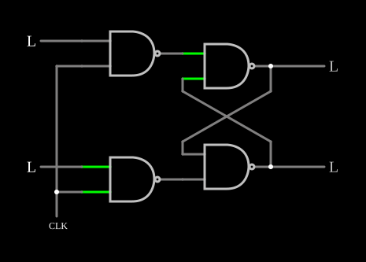

# Flip-flop SR com relógio

<!-- navegacao:inicio -->
[Índice](README.md) · [Anterior: SR Flip-Flop](nandff.md) · [Próximo: Master-Slave Flip-Flop](masterslaveff.md)
<!-- navegacao:fim -->

## Objetivo

Mostrar como um sinal de **relógio** controla quando um latch SR pode mudar: as entradas só têm efeito enquanto o relógio está alto.

## O circuito

<!-- esquema:inicio -->

<!-- esquema:fim -->

O [SR Flip-Flop](nandff.md) de duas NANDs (saídas $Q$, elemento 8, e $\overline{Q}$, elemento 9) recebe as entradas através de duas NANDs de controle. Cada NAND de controle combina um botão momentâneo, $S$ (elemento 15) ou $R$ (elemento 16), que fica em $0$ e vai a $5\ \text{V}$ enquanto pressionado, com o relógio, uma onda quadrada de $100\ \text{Hz}$ (alta nos primeiros $5\ \text{ms}$ de cada período). O exemplo abre com $Q = 0$.

<!-- componentes:inicio -->
| N.º | Tipo | Elemento | Valores |
|----:|------|----------|---------|
| 0 | `NandGateElm` | NAND gate | # of Inputs = 2; High Logic Voltage = 5; Schmitt Inputs = não; Invert Inputs = não; Propagation Delay (s) = 0; DeMorgan's Symbol = não |
| 1 | `NandGateElm` | NAND gate | # of Inputs = 2; High Logic Voltage = 5; Schmitt Inputs = não; Invert Inputs = não; Propagation Delay (s) = 0; DeMorgan's Symbol = não |
| 8 | `LogicOutputElm` | logic output | Threshold = 2.5; Current Required = não; Numeric = não; Ternary = não |
| 9 | `LogicOutputElm` | logic output | Threshold = 2.5; Current Required = não; Numeric = não; Ternary = não |
| 10 | `NandGateElm` | NAND gate | # of Inputs = 2; High Logic Voltage = 5; Schmitt Inputs = não; Invert Inputs = não; Propagation Delay (s) = 0; DeMorgan's Symbol = não |
| 11 | `NandGateElm` | NAND gate | # of Inputs = 2; High Logic Voltage = 5; Schmitt Inputs = não; Invert Inputs = não; Propagation Delay (s) = 0; DeMorgan's Symbol = não |
| 15 | `LogicInputElm` | logic input | Momentary Switch = sim; High Logic Voltage = 5; Low Voltage = 0; Numeric = não; Ternary = não; Keyboard Shortcut =  |
| 16 | `LogicInputElm` | logic input | Momentary Switch = sim; High Logic Voltage = 5; Low Voltage = 0; Numeric = não; Ternary = não; Keyboard Shortcut =  |
| 17 | `RailElm` | square wave gen | Max Voltage = 2.5; Waveform = Square Wave; DC Offset (V) = 2.5; Internal Resistance (ohms) = 0; Show Voltage = não; Specify As = Frequency/Duty Cycle; Frequency (Hz) = 100; Phase Offset (degrees) = 0; Duty Cycle = 50; Rise/Fall Time (s) = 0 |
<!-- componentes:fim -->

## Teoria

As NANDs de controle dão $\overline{S \cdot CLK}$ e $\overline{R \cdot CLK}$: com o relógio baixo, as duas saem em $1$ e o latch guarda o estado; com o relógio alto, elas passam $\overline{S}$ e $\overline{R}$ ao latch, que funciona como o latch SR comum, agora com entradas ativas em nível alto:

| $CLK$ | $S$ | $R$ | $Q$ |
|----:|----:|----:|------|
| 0 | – | – | guarda |
| 1 | 0 | 0 | guarda |
| 1 | 1 | 0 | 1 |
| 1 | 0 | 1 | 0 |
| 1 | 1 | 1 | proibido |

É um latch **sensível ao nível**: durante todo o tempo em que o relógio está alto, mudanças em $S$ e $R$ chegam à saída. Para mudar só num instante, é preciso o [Master-Slave Flip-Flop](masterslaveff.md) ou o [Edge-Triggered D Flip-Flop](edgedff.md).

## Resultados esperados

O simulador confirma:

- $S$ pressionado em $t = 0$, com o relógio alto: $Q = 5\ \text{V}$ em $3\ \text{ms}$;
- $S$ pressionado em $t = 6\ \text{ms}$, com o relógio baixo: $Q$ continua em $0$ em $8\ \text{ms}$ e só vai a $5\ \text{V}$ quando o relógio sobe de novo, em $10\ \text{ms}$ (lido em $10{,}5\ \text{ms}$);
- depois de um *set* no início, $Q$ fica em $5\ \text{V}$ durante a fase baixa; um pulso em $R$ de $10{,}5$ a $11{,}5\ \text{ms}$ (relógio alto) leva $Q$ a $0$.

## O que observar

Pressione $S$ ou $R$ com o relógio baixo e veja que nada acontece até a fase alta seguinte. O exemplo tem osciloscópios com o relógio, as entradas e a saída.

## Limites do modelo

- Portas ideais e sem atraso; o caso $S = R = 1$ com o relógio caindo deixaria um latch real num estado indefinido.

## Referências

Mano e Ciletti, *Digital Design*, capítulo sobre latches e flip-flops; Wakerly, *Digital Design: Principles and Practices*.

O circuito deste exemplo faz parte da coleção do simulador original de Paul Falstad e Iain Sharp (CircuitJS1); a explicação é deste projeto.
