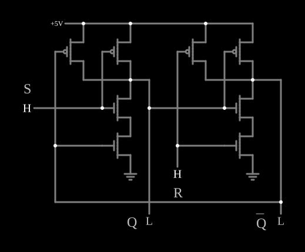
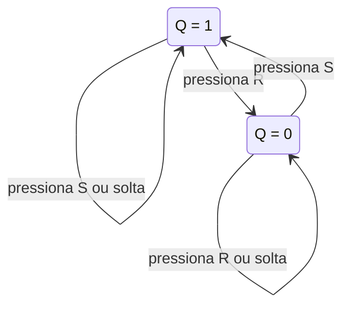

# Flip-flop CMOS (latch SR)

<!-- navegacao:inicio -->
[Índice](README.md) · [Anterior: CMOS XOR](cmosxor.md) · [Próximo: CMOS Master-Slave Flip-Flop](cmosmsff.md)
<!-- navegacao:fim -->

## Objetivo

Mostrar o elemento de memória mais simples: duas portas NAND CMOS em **realimentação cruzada** formam um *latch* SR, que guarda um bit enquanto houver alimentação.

## O circuito

<!-- esquema:inicio -->

<!-- esquema:fim -->

Há duas [CMOS NAND](cmosnand.md) de quatro transistores (modelo padrão digital, alimentação de $5\ \text{V}$). A saída de cada uma vai a uma entrada da outra. A outra entrada de cada porta é um botão momentâneo, $\overline{S}$ (elemento 15) e $\overline{R}$ (elemento 36), que fica em $5\ \text{V}$ e vai a $0$ enquanto está pressionado. As saídas são $Q$ (elemento 44) e $\overline{Q}$ (elemento 45). O exemplo abre com $Q = 1$.

<!-- componentes:inicio -->
| N.º | Tipo | Elemento | Valores |
|----:|------|----------|---------|
| 0 | `PMosfetElm` | MOSFET | Model = default-digital; Swap D/S = não |
| 1 | `NMosfetElm` | MOSFET | Model = default-digital; Swap D/S = não |
| 4 | `NMosfetElm` | MOSFET | Model = default-digital; Swap D/S = não |
| 6 | `GroundElm` | ground | Symbol = Earth |
| 8 | `PMosfetElm` | MOSFET | Model = default-digital; Swap D/S = não |
| 12 | `RailElm` | voltage source | Voltage = 5; Waveform = D/C; DC Offset (V) = 0; Internal Resistance (ohms) = 0 |
| 15 | `LogicInputElm` | logic input | Momentary Switch = sim; High Logic Voltage = 5; Low Voltage = 0; Numeric = não; Ternary = não; Keyboard Shortcut =  |
| 20 | `PMosfetElm` | MOSFET | Model = default-digital; Swap D/S = não |
| 21 | `PMosfetElm` | MOSFET | Model = default-digital; Swap D/S = não |
| 30 | `NMosfetElm` | MOSFET | Model = default-digital; Swap D/S = não |
| 31 | `NMosfetElm` | MOSFET | Model = default-digital; Swap D/S = não |
| 35 | `GroundElm` | ground | Symbol = Earth |
| 36 | `LogicInputElm` | logic input | Momentary Switch = sim; High Logic Voltage = 5; Low Voltage = 0; Numeric = não; Ternary = não; Keyboard Shortcut =  |
| 44 | `LogicOutputElm` | logic output | Threshold = 2.5; Current Required = não; Numeric = não; Ternary = não |
| 45 | `LogicOutputElm` | logic output | Threshold = 2.5; Current Required = não; Numeric = não; Ternary = não |
| 46 | `TextElm` | text | Text = R; Size = 24; Draw Bar On Top = não; Color = #c0c0c0 |
| 47 | `TextElm` | text | Text = S; Size = 24; Draw Bar On Top = não; Color = #c0c0c0 |
| 48 | `TextElm` | text | Text = Q; Size = 24; Draw Bar On Top = não; Color = #c0c0c0 |
| 49 | `TextElm` | text | Text = Q; Size = 24; Draw Bar On Top = sim; Color = #c0c0c0 |
<!-- componentes:fim -->

## Teoria

Com as duas entradas em $1$ (botões soltos), cada NAND funciona como um inversor da saída da outra: dois inversores em anel têm **dois estados estáveis**, $Q = 1, \overline{Q} = 0$ ou $Q = 0, \overline{Q} = 1$, e ficam no que estiverem. As entradas são ativas em nível baixo:

| $\overline{S}$ | $\overline{R}$ | $Q$ | $\overline{Q}$ | |
|----:|----:|----:|----:|------|
| 1 | 1 | $Q$ | $\overline{Q}$ | guarda |
| 0 | 1 | 1 | 0 | *set* |
| 1 | 0 | 0 | 1 | *reset* |
| 0 | 0 | 1 | 1 | proibido |

Pressionar $\overline{S}$ força a saída da sua NAND a $1$, independentemente da outra entrada; essa saída, realimentada, mantém o estado depois de o botão ser solto. O estado "ambos pressionados" dá $Q = \overline{Q} = 1$ e, ao soltar os dois ao mesmo tempo, o estado final é imprevisível.

## Resultados esperados

O simulador confirma a tabela: no início $Q = 5\ \text{V}$ e $\overline{Q} = 0$; pressionar $\overline{R}$ leva $Q$ a $0$, e $Q$ **continua** em $0$ (com $\overline{Q} = 5\ \text{V}$) depois de o botão ser solto; pressionar e soltar $\overline{S}$ em seguida volta $Q$ a $5\ \text{V}$. Com os dois botões pressionados, as duas saídas ficam em $5\ \text{V}$. A corrente da alimentação fica entre $85$ e $150\ \text{nA}$ (só fugas) em qualquer estado.

## O que observar

Pressione e solte os botões e repare que o estado permanece depois de soltar: é memória. Um latch com relés faz o mesmo em [Relay Flip-Flop](relayff.md); a versão com relógio está em [CMOS Master-Slave Flip-Flop](cmosmsff.md).

## Limites do modelo

- Sem capacitâncias nem atrasos, soltar os dois botões no mesmo passo de simulação não produz a metaestabilidade de um latch real; o resultado é decidido pela ordem de cálculo.
- Os botões são ideais, sem repique; num botão real o repique é exatamente o que um latch SR é usado para eliminar.

## Referências

Weste e Harris, *CMOS VLSI Design*, capítulo sobre circuitos sequenciais; Sedra e Smith, *Microelectronic Circuits*, capítulo sobre latches e flip-flops.

O circuito deste exemplo faz parte da coleção do simulador original de Paul Falstad e Iain Sharp (CircuitJS1); a explicação é deste projeto.
