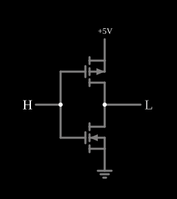

# Inversor CMOS

<!-- navegacao:inicio -->
[Índice](README.md) · [Anterior: Common-Source Amplifier](mosfetamp.md) · [Próximo: CMOS Inverter (w/capacitance)](cmosinvertercap.md)
<!-- navegacao:fim -->

## Objetivo

Mostrar o **inversor CMOS**, a célula básica da lógica digital moderna: um PMOS e um NMOS complementares formam uma porta cuja saída é o inverso da entrada e que, em regime, **não consome corrente** (só a de fuga), pois um dos dois transistores está sempre cortado.

## O circuito

<!-- esquema:inicio -->

<!-- esquema:fim -->

Um PMOS liga a saída a $+5\ \text{V}$ e um NMOS liga a saída à terra; as portas dos dois estão ligadas à entrada (uma entrada lógica, que o usuário alterna entre $0$ e $5\ \text{V}$ com um clique) e os drenos estão ligados à saída (uma saída lógica com limiar de $2{,}5\ \text{V}$). Os dois transistores usam o modelo padrão sem diodo de corpo.

<!-- componentes:inicio -->
| N.º | Tipo | Elemento | Valores |
|----:|------|----------|---------|
| 0 | `PMosfetElm` | MOSFET | Model = default-nodiode; Swap D/S = não |
| 1 | `NMosfetElm` | MOSFET | Model = default-nodiode; Swap D/S = não |
| 6 | `LogicInputElm` | logic input | Momentary Switch = não; High Logic Voltage = 5; Low Voltage = 0; Numeric = não; Ternary = não; Keyboard Shortcut =  |
| 7 | `LogicOutputElm` | logic output | Threshold = 2.5; Current Required = não; Numeric = não; Ternary = não |
| 8 | `RailElm` | voltage source | Voltage = 5; Waveform = D/C; DC Offset (V) = 0; Internal Resistance (ohms) = 0 |
| 9 | `GroundElm` | ground | Symbol = Earth |
<!-- componentes:fim -->

## Teoria

Com os dois transistores no modelo de lei quadrática de [n-MOSFET](nmosfet.md) ($\beta = 0{,}02\ \text{A/V}^2$, $|V_t| = 1{,}5\ \text{V}$, $\lambda = 0$):

- **Entrada em $5\ \text{V}$ (alta):** $V_{GS,n} = 5\ \text{V}$ liga o NMOS; $V_{SG,p} = 0$ corta o PMOS. A saída é puxada para a terra, $V_{out} \approx 0$.
- **Entrada em $0\ \text{V}$ (baixa):** o PMOS liga e o NMOS corta, e a saída é puxada para $+5\ \text{V}$.

Em regime, o transistor que conduz está no triodo e a sua corrente é limitada pelo outro, cortado: só circula a fuga. Na transição, o **limiar de comutação** $V_M$ é a entrada em que as duas correntes de saturação se igualam:

$$\tfrac12\beta_n (V_M - V_{tn})^2 = \tfrac12\beta_p (V_{DD} - V_M - |V_{tp}|)^2 \ \Rightarrow\ V_M = \frac{V_{DD}}{2} = 2{,}5\ \text{V}$$

para transistores simétricos. Perto de $V_M$, os dois conduzem ao mesmo tempo, o que dá um pico de corrente de curto-circuito: $I_{pico} = \tfrac12\beta(V_M - V_t)^2 = 10\ \text{mA}$.

## Resultados esperados

O simulador dá, com a entrada em $5\ \text{V}$, a saída em $\approx 1\ \mu\text{V}$ (zero lógico) e, com a entrada em $0\ \text{V}$, em $4{,}999999\ \text{V}$ (um lógico). Nos dois casos a corrente da alimentação é $50\ \text{nA}$, a fuga do transistor cortado ($10^{-8}\ \text{S} \cdot 5\ \text{V}$): a potência estática é de $250\ \text{nW}$. As verificações conferem a saída nos dois estados e a corrente da alimentação. Trocando a entrada por uma fonte contínua (valores medidos no simulador, fora das verificações automáticas), a característica de transferência segue a teoria:

| $V_{in}$ (V) | $V_{out}$ (V) | $I_{alim}$ |
|-------------:|--------------:|-----------:|
| $0$ a $1{,}5$ | $5{,}00$ | $\approx 0$ |
| $2{,}0$ | $4{,}914$ | $2{,}5\ \text{mA}$ |
| $2{,}4$ | $4{,}532$ | $8{,}1\ \text{mA}$ |
| $2{,}5$ | transição | $10\ \text{mA}$ |
| $2{,}6$ | $0{,}468$ | $8{,}1\ \text{mA}$ |
| $3{,}0$ | $0{,}086$ | $2{,}5\ \text{mA}$ |
| $3{,}5$ a $5$ | $0$ | $\approx 0$ |

O pico de $10\ \text{mA}$ em $V_{in} = 2{,}5\ \text{V}$ concorda com a previsão ($\tfrac12 \cdot 0{,}02 \cdot 1^2$), e a corrente em $2{,}4\ \text{V}$ e $2{,}6\ \text{V}$ é $0{,}01 \cdot 0{,}9^2 = 8{,}1\ \text{mA}$. A transição é muito abrupta: com $\lambda = 0$ o ganho no limiar é infinito (a queda ocorre num único valor de $V_{in}$).

## O que observar

Clique na entrada lógica e veja a saída inverter, com a corrente de alimentação em quase zero nos dois estados: esse é o ponto da lógica CMOS, em que a energia é gasta só na comutação. As variações com capacitâncias estão em [CMOS Inverter (w/capacitance)](cmosinvertercap.md) e em [CMOS Inverter (slow transition)](cmosinverterslow.md).

## Limites do modelo

- Os dois transistores têm o mesmo $\beta$ e o mesmo $|V_t|$, o que dá $V_M = 2{,}5\ \text{V}$; num processo real o PMOS é menos condutor e é feito mais largo para equilibrar.
- Com $\lambda = 0$ a transição é um degrau ideal; num inversor real a curva tem inclinação finita (ganho de dezenas).
- A corrente de fuga de $50\ \text{nA}$ vem do modelo; a de um transistor real é muito menor, e cresce com a temperatura e para tensões de limiar baixas.
- A comutação é instantânea (sem capacitâncias).

## Referências

Sedra e Smith, *Microelectronic Circuits*, capítulo sobre o inversor CMOS e a lógica CMOS; Weste e Harris, *CMOS VLSI Design*, capítulos sobre o inversor e sobre portas de transmissão.

O circuito deste exemplo faz parte da coleção do simulador original de Paul Falstad e Iain Sharp (CircuitJS1); a explicação é deste projeto.
