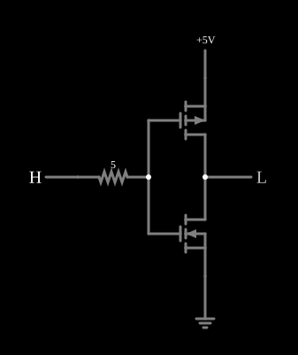

# Inversor CMOS com capacitâncias de porta

<!-- navegacao:inicio -->
[Índice](README.md) · [Anterior: CMOS Inverter](cmosinverter.md) · [Próximo: CMOS Inverter (slow transition)](cmosinverterslow.md)
<!-- navegacao:fim -->

## Objetivo

Mostrar o que as capacitâncias dos transistores acrescentam ao [inversor CMOS](cmosinverter.md): a comutação deixa de ser instantânea, aparece um **atraso de propagação**, a saída sofre um *overshoot* e um *undershoot* por acoplamento capacitivo (efeito Miller), e a alimentação passa a fornecer picos de corrente a cada transição.

## O circuito

<!-- esquema:inicio -->

<!-- esquema:fim -->

É o inversor CMOS (um PMOS e um NMOS) com o modelo `mosfet-with-capacitance`: $V_t = 1{,}5\ \text{V}$, $\beta = 0{,}02\ \text{A/V}^2$ e **capacitâncias porta-fonte e porta-dreno de $10\ \text{pF}$** cada. A entrada passa por um resistor de $5\ \Omega$ antes das portas, e a alimentação de $5\ \text{V}$ tem resistência interna de $5\ \Omega$. O passo de tempo é de $1\ \text{ps}$.

<!-- componentes:inicio -->
| N.º | Tipo | Elemento | Valores |
|----:|------|----------|---------|
| 0 | `PMosfetElm` | MOSFET | Model = mosfet-with-capacitance; Swap D/S = não |
| 1 | `NMosfetElm` | MOSFET | Model = mosfet-with-capacitance; Swap D/S = não |
| 3 | `LogicOutputElm` | logic output | Threshold = 2.5; Current Required = não; Numeric = não; Ternary = não |
| 9 | `RailElm` | voltage source | Voltage = 5; Waveform = D/C; DC Offset (V) = 0; Internal Resistance (ohms) = 5 |
| 10 | `LogicInputElm` | logic input | Momentary Switch = não; High Logic Voltage = 5; Low Voltage = 0; Numeric = não; Ternary = não; Keyboard Shortcut =  |
| 11 | `GroundElm` | ground | Symbol = Earth |
| 12 | `ResistorElm` | resistor | Resistance (ohms) = 5 |
<!-- componentes:fim -->

## Teoria

A capacitância da porta precisa ser carregada pela fonte do sinal: o resistor de entrada e as quatro capacitâncias de $10\ \text{pF}$ formam uma constante de tempo da ordem de $\tau \approx R(C_{gs} + C_{gd})_{total} \approx 5\ \Omega \cdot 40\ \text{pF} = 0{,}2\ \text{ns}$ (a capacitância porta-dreno age com o seu valor multiplicado pelo ganho do estágio, o **efeito Miller**).

Além do atraso, $C_{gd}$ liga diretamente a entrada à saída. Quando a entrada dá um degrau, uma fração da variação aparece na saída pelo divisor capacitivo antes de o transistor reagir (*feedthrough*): uma subida na entrada empurra a saída para cima e uma descida a empurra para baixo, para além dos trilhos, até que os transistores recuperem o controle.

A energia por transição é $E \approx Q\,V_{DD}$, em que $Q$ é a carga tirada da alimentação (carga das capacitâncias mais a corrente de curto-circuito durante a comutação).

## Resultados esperados

Ao abrir o exemplo, os capacitores partem descarregados e a entrada está em nível alto: a saída sobe até $3{,}95\ \text{V}$ por acoplamento (a alimentação fornece um pico de $0{,}94\ \text{A}$) e depois cai a zero: ela passa por $2{,}5\ \text{V}$ em $0{,}52\ \text{ns}$ (a porta passou por $2{,}5\ \text{V}$ em $20\ \text{ps}$, então o atraso de propagação é de cerca de $0{,}50\ \text{ns}$), e cai de $90\%$ a $10\%$ em $1{,}27\ \text{ns}$ (a $10\%$). Em regime a saída é $\approx 0$. Baixando a entrada em $t = 20\ \text{ns}$ (valores do simulador): a saída **desce a $-2{,}94\ \text{V}$** (*undershoot*, abaixo da terra) antes de subir, passa por $2{,}5\ \text{V}$ em $21{,}77\ \text{ns}$ (atraso de propagação de $1{,}77\ \text{ns}$ a partir de $20{,}06\ \text{ns}$, quando a porta cruza $2{,}5\ \text{V}$), tem tempo de subida de $10\%$ a $90\%$ de $1{,}5\ \text{ns}$ (de $21{,}24$ a $22{,}74\ \text{ns}$) e chega a $5\ \text{V}$. A alimentação fornece um pico de $0{,}25\ \text{A}$ e, no intervalo de $20\ \text{ns}$, uma carga de $0{,}22\ \text{nC}$, ou $\approx 1{,}1\ \text{nJ}$ por transição. As verificações conferem o máximo da saída na partida, o nível final, o pico de corrente da partida e, depois da transição, o máximo, o mínimo e o pico de corrente da alimentação e o nível a $24\ \text{ns}$, ainda em $4{,}95\ \text{V}$, a caminho de $5\ \text{V}$ (tolerância de $1\%$, ou $0{,}2\%$ neste último).

## O que observar

A saída não é um degrau limpo: há um pico espúrio antes da transição, e a transição de subida é mais lenta que a de descida. Para testar: reduza as capacitâncias (editando o modelo) e veja o atraso, o *undershoot* e o pico de corrente diminuírem; aumente o resistor de entrada e veja o atraso crescer (a porta demora mais a carregar).

## Limites do modelo

- As capacitâncias $C_{gs}$ e $C_{gd}$ do modelo são constantes; num MOSFET real elas variam com a região de operação e a tensão, e existem também as de junção ($C_{db}$, $C_{sb}$).
- Não há diodo de corpo neste modelo, de modo que o *undershoot* de $-2{,}9\ \text{V}$ não é limitado (num circuito real, o diodo de junção o prenderia em cerca de $-0{,}7\ \text{V}$).
- A assimetria dos atrasos ($0{,}5\ \text{ns}$ na descida, $1{,}8\ \text{ns}$ na subida) é do circuito simulado; este documento não a deduz analiticamente.
- Os tempos e a carga são medidos no simulador (interpolação linear de amostras de $1\ \text{ps}$) e não fazem parte das verificações automáticas.

## Referências

Sedra e Smith, *Microelectronic Circuits*, capítulo sobre o inversor CMOS e a lógica CMOS; Weste e Harris, *CMOS VLSI Design*, capítulos sobre o inversor e sobre portas de transmissão.

O circuito deste exemplo faz parte da coleção do simulador original de Paul Falstad e Iain Sharp (CircuitJS1); a explicação é deste projeto.
