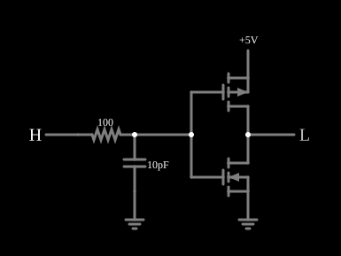

# Inversor CMOS com transição lenta

<!-- navegacao:inicio -->
[Índice](README.md) · [Anterior: CMOS Inverter (w/capacitance)](cmosinvertercap.md) · [Próximo: CMOS Transmission Gate](cmostransgate.md)
<!-- navegacao:fim -->

## Objetivo

Mostrar a **corrente de curto-circuito** do inversor CMOS: quando a entrada demora a atravessar a faixa em que os dois transistores conduzem, a alimentação fornece uma corrente que não vai à carga, o que é o principal desperdício de energia das portas CMOS com entradas lentas.

## O circuito

<!-- esquema:inicio -->

<!-- esquema:fim -->

É o [inversor CMOS](cmosinverter.md) (modelo padrão, sem diodo de corpo), com a entrada ligada a um **filtro RC** de $100\ \Omega$ e $10\ \text{pF}$ ($\tau = 1\ \text{ns}$), de modo que a tensão de porta varia de forma exponencial e lenta. A saída tem apenas a saída lógica (sem carga capacitiva). O passo de tempo é de $0{,}3\ \text{ps}$. Três osciloscópios mostram a tensão da porta e as correntes dos dois transistores.

<!-- componentes:inicio -->
| N.º | Tipo | Elemento | Valores |
|----:|------|----------|---------|
| 0 | `PMosfetElm` | MOSFET | Model = default-nodiode; Swap D/S = não |
| 1 | `NMosfetElm` | MOSFET | Model = default-nodiode; Swap D/S = não |
| 6 | `LogicOutputElm` | logic output | Threshold = 2.5; Current Required = não; Numeric = não; Ternary = não |
| 7 | `RailElm` | voltage source | Voltage = 5; Waveform = D/C; DC Offset (V) = 0; Internal Resistance (ohms) = 0 |
| 8 | `GroundElm` | ground | Symbol = Earth |
| 10 | `CapacitorElm` | capacitor | Capacitance (F) = 10p; Trapezoidal Approximation = sim; Initial Voltage (on Reset) = 1m; Series Resistance = 0 |
| 11 | `GroundElm` | ground | Symbol = Earth |
| 12 | `ResistorElm` | resistor | Resistance (ohms) = 100 |
| 13 | `LogicInputElm` | logic input | Momentary Switch = não; High Logic Voltage = 5; Low Voltage = 0; Numeric = não; Ternary = não; Keyboard Shortcut =  |
<!-- componentes:fim -->

## Teoria

A tensão de porta ao descer é $v_G(t) = 5\,e^{-t/\tau}$ e cruza a região de transição $|v_G - 2{,}5\ \text{V}| \lesssim 0{,}5\ \text{V}$ em um tempo da ordem de $\tau$. Enquanto $|V_t| < v_G < V_{DD} - |V_t|$, isto é, de $1{,}5\ \text{V}$ a $3{,}5\ \text{V}$, os dois transistores conduzem e há um caminho direto da alimentação à terra. Pela característica de [Inversor CMOS](cmosinverter.md), a corrente vale $\tfrac12\beta(v_G - V_t)^2$ do NMOS (enquanto ele está saturado) e chega ao máximo de

$$I_{pico} = \tfrac12 \cdot 0{,}02 \cdot (2{,}5 - 1{,}5)^2 = 10\ \text{mA}$$

no limiar, $v_G = 2{,}5\ \text{V}$. A carga que passa nesse caminho é $Q = \int I\,dt$, e a energia perdida por transição é $V_{DD}\,Q$. Quanto mais lenta a entrada, maior a carga.

## Resultados esperados

Com a entrada em nível alto, o circuito está em repouso: saída em zero e corrente da alimentação de $50\ \text{nA}$ (fuga). Em $t = 10\ \text{ns}$ a entrada passa a nível baixo, e a porta decai com $\tau = 1\ \text{ns}$: $v_G = 5\,e^{-2} = 0{,}677\ \text{V}$ em $12\ \text{ns}$. A porta cruza $2{,}5\ \text{V}$ em $10{,}693\ \text{ns}$ ($\tau\ln 2 = 0{,}693\ \text{ns}$ depois da transição) e a saída cruza $2{,}5\ \text{V}$ no mesmo instante, em menos de $1\ \text{ps}$ de diferença, já que não há carga capacitiva na saída: a comutação da saída é instantânea no modelo. A alimentação fornece um pico de $10{,}00\ \text{mA}$, o previsto, e a carga total que atravessa o caminho de curto-circuito é de $2{,}7\ \text{pC}$ (energia de $13{,}6\ \text{pJ}$ por transição). A saída termina em $5\ \text{V}$. As verificações conferem a fuga antes da transição, a tensão da porta em $12\ \text{ns}$, o pico de corrente e o nível final da saída (tolerância de $0{,}5\%$ a $1\%$).

## O que observar

Nos osciloscópios, a tensão da porta desce em curva exponencial e a corrente dos transistores aparece como um pulso curto de $10\ \text{mA}$ no instante em que $v_G$ cruza $2{,}5\ \text{V}$; fora dele, a corrente é nula. Para testar: aumente o capacitor da entrada (ou o resistor) e veja a carga do pulso crescer, pois os dois transistores ficam ligados por mais tempo; reduza-os e veja o pulso diminuir até quase desaparecer.

## Limites do modelo

- Com $\lambda = 0$ e $\beta_n = \beta_p$, a região em que os dois conduzem é simétrica em torno de $2{,}5\ \text{V}$ e o pico de corrente é de exatamente $10\ \text{mA}$; num inversor real, ele depende de $\lambda$ e do casamento dos transistores.
- O modelo não tem capacitâncias nos transistores; a energia total de uma transição real inclui a carga da carga capacitiva ($C_L V_{DD}^2$), que é separada da perda por curto-circuito.
- A carga ($2{,}7\ \text{pC}$) e a energia são integrais numéricas das amostras de $0{,}3\ \text{ps}$ do simulador e não fazem parte das verificações automáticas.

## Referências

Sedra e Smith, *Microelectronic Circuits*, capítulo sobre o inversor CMOS e a lógica CMOS; Weste e Harris, *CMOS VLSI Design*, capítulos sobre o inversor e sobre portas de transmissão.

O circuito deste exemplo faz parte da coleção do simulador original de Paul Falstad e Iain Sharp (CircuitJS1); a explicação é deste projeto.
