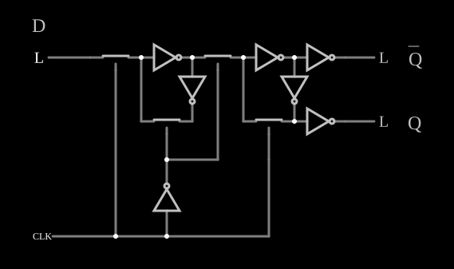
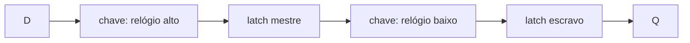

# Flip-flop mestre-escravo CMOS

<!-- navegacao:inicio -->
[Índice](README.md) · [Anterior: CMOS Flip-Flop](cmosff.md)
<!-- navegacao:fim -->

## Objetivo

Mostrar como se constrói um **flip-flop D sensível à borda** com chaves CMOS e inversores: dois *latches* em série, o mestre e o escravo, transparentes em fases opostas do relógio. A saída só muda na **borda de descida** do relógio.

## O circuito

<!-- esquema:inicio -->

<!-- esquema:fim -->

O relógio é uma onda quadrada de $0$ a $5\ \text{V}$ e $100\ \text{Hz}$ (alta nos primeiros $5\ \text{ms}$ de cada período), e um inversor gera o seu complemento. Há quatro chaves analógicas (resistência de $20\ \Omega$ ligadas, $10\ \text{G}\Omega$ desligadas), que fazem o papel de portas de transmissão CMOS:

- **Mestre:** uma chave, ligada com o relógio alto, leva a entrada $D$ (elemento 22) a um par de inversores; uma segunda chave, ligada com o relógio baixo, fecha o anel de realimentação desse par.
- **Escravo:** uma chave, ligada com o relógio baixo, leva a saída do mestre a outro par de inversores; uma quarta chave, ligada com o relógio alto, fecha o anel do escravo.

Dois inversores de saída acionam $\overline{Q}$ (elemento 23) e $Q$ (elemento 24). O exemplo abre com $D = 0$.

<!-- componentes:inicio -->
| N.º | Tipo | Elemento | Valores |
|----:|------|----------|---------|
| 0 | `AnalogSwitchElm` | analog switch | Normally closed = não; On Resistance (ohms) = 20; Off Resistance (ohms) = 10G; Pulldown Resistor = não; Threshold = 2.5 |
| 2 | `AnalogSwitchElm` | analog switch | Normally closed = não; On Resistance (ohms) = 20; Off Resistance (ohms) = 10G; Pulldown Resistor = não; Threshold = 2.5 |
| 3 | `InverterElm` | inverter | Slew Rate (V/ns) = 200μ; High Logic Voltage = 5; DeMorgan's Symbol = não |
| 4 | `InverterElm` | inverter | Slew Rate (V/ns) = 200μ; High Logic Voltage = 5; DeMorgan's Symbol = não |
| 5 | `AnalogSwitchElm` | analog switch | Normally closed = não; On Resistance (ohms) = 20; Off Resistance (ohms) = 10G; Pulldown Resistor = não; Threshold = 2.5 |
| 6 | `AnalogSwitchElm` | analog switch | Normally closed = não; On Resistance (ohms) = 20; Off Resistance (ohms) = 10G; Pulldown Resistor = não; Threshold = 2.5 |
| 8 | `InverterElm` | inverter | Slew Rate (V/ns) = 200μ; High Logic Voltage = 5; DeMorgan's Symbol = não |
| 9 | `InverterElm` | inverter | Slew Rate (V/ns) = 200μ; High Logic Voltage = 5; DeMorgan's Symbol = não |
| 10 | `InverterElm` | inverter | Slew Rate (V/ns) = 500m; High Logic Voltage = 5; DeMorgan's Symbol = não |
| 11 | `InverterElm` | inverter | Slew Rate (V/ns) = 500m; High Logic Voltage = 5; DeMorgan's Symbol = não |
| 15 | `InverterElm` | inverter | Slew Rate (V/ns) = 500m; High Logic Voltage = 5; DeMorgan's Symbol = não |
| 21 | `RailElm` | square wave gen | Max Voltage = 2.5; Waveform = Square Wave; DC Offset (V) = 2.5; Internal Resistance (ohms) = 0; Show Voltage = não; Specify As = Frequency/Duty Cycle; Frequency (Hz) = 100; Phase Offset (degrees) = 0; Duty Cycle = 50; Rise/Fall Time (s) = 0 |
| 22 | `LogicInputElm` | logic input | Momentary Switch = não; High Logic Voltage = 5; Low Voltage = 0; Numeric = não; Ternary = não; Keyboard Shortcut =  |
| 23 | `LogicOutputElm` | logic output | Threshold = 2.5; Current Required = não; Numeric = não; Ternary = não |
| 24 | `LogicOutputElm` | logic output | Threshold = 2.5; Current Required = não; Numeric = não; Ternary = não |
| 25 | `TextElm` | text | Text = D; Size = 24; Draw Bar On Top = não; Color = #c0c0c0 |
| 26 | `TextElm` | text | Text = Q; Size = 24; Draw Bar On Top = sim; Color = #c0c0c0 |
| 27 | `TextElm` | text | Text = Q; Size = 24; Draw Bar On Top = não; Color = #c0c0c0 |
<!-- componentes:fim -->

## Teoria

As duas fases do relógio alternam o papel dos latches:

- **Relógio alto:** o mestre está **transparente** (a sua entrada segue $D$, o anel está aberto) e o escravo está **fechado** (anel fechado, isolado do mestre), guardando o valor anterior. A saída não muda.
- **Relógio baixo:** o mestre fecha e guarda o valor de $D$ do instante da borda de descida; o escravo fica transparente e copia esse valor para a saída.

Assim, $Q$ assume o valor que $D$ tinha na **borda de descida** e o mantém durante um período inteiro; mudanças em $D$ com o relógio alto só aparecem na borda seguinte. Como os dois latches nunca estão transparentes ao mesmo tempo, $D$ nunca atravessa o flip-flop de uma vez.

## Resultados esperados

O simulador dá, na primeira borda de descida ($t = 5\ \text{ms}$) com $D = 0$, $Q = 0$ e $\overline{Q} = 5\ \text{V}$ (lidos em $t = 9\ \text{ms}$). Com $D$ levado a $5\ \text{V}$ em $t = 11\ \text{ms}$ (relógio alto), $Q$ continua em $0$ em $t = 14\ \text{ms}$, e só passa a $5\ \text{V}$ depois da borda de descida de $t = 15\ \text{ms}$ (lido em $t = 16\ \text{ms}$, com $\overline{Q} = 0$). Antes da primeira borda de descida o escravo ainda não foi carregado, e as duas saídas ficam em $0$.

## O que observar

Mude $D$ com o relógio alto e com o relógio baixo, e veja que a saída só responde nas bordas de descida. O latch sem relógio está em [CMOS Flip-Flop](cmosff.md); flip-flops prontos aparecem na categoria de lógica sequencial.

## Limites do modelo

- As chaves analógicas são ideais e os inversores dos latches têm uma taxa de subida lenta ($200\ \mu\text{V/ns}$), escolhida para a comutação ser visível na animação; não há os tempos de *setup* e *hold* de um flip-flop real.
- No início da simulação, os latches começam num estado indefinido, que um circuito real resolveria por ruído ou com um sinal de *reset*.

## Referências

Weste e Harris, *CMOS VLSI Design*, capítulo sobre circuitos sequenciais (latches e flip-flops com portas de transmissão); Rabaey, Chandrakasan e Nikolić, *Digital Integrated Circuits*, capítulo sobre circuitos sequenciais.

O circuito deste exemplo faz parte da coleção do simulador original de Paul Falstad e Iain Sharp (CircuitJS1); a explicação é deste projeto.
