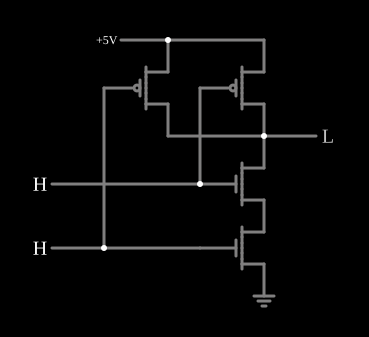

# Porta NAND CMOS

<!-- navegacao:inicio -->
[Índice](README.md) · [Anterior: CMOS Inverter](cmosinverter.md) · [Próximo: CMOS NOR](cmosnor.md)
<!-- navegacao:fim -->

## Objetivo

Mostrar a porta **NAND** em CMOS: dois NMOS **em série** puxam a saída para baixo e dois PMOS **em paralelo** a puxam para cima. As duas redes são complementares, e por isso, em regime, nunca há um caminho direto entre a alimentação e a terra.

## O circuito

<!-- esquema:inicio -->

<!-- esquema:fim -->

Dois PMOS (modelo padrão digital, $|V_t| = 1{,}5\ \text{V}$, $\beta = 0{,}02\ \text{A/V}^2$) ligam a saída a $5\ \text{V}$ em paralelo; dois NMOS do mesmo modelo ligam a saída à terra em série. Cada entrada lógica ($0$ ou $5\ \text{V}$) vai à porta de um PMOS e de um NMOS. O exemplo abre com as duas entradas em $5\ \text{V}$.

<!-- componentes:inicio -->
| N.º | Tipo | Elemento | Valores |
|----:|------|----------|---------|
| 0 | `PMosfetElm` | MOSFET | Model = default-digital; Swap D/S = não |
| 1 | `NMosfetElm` | MOSFET | Model = default-digital; Swap D/S = não |
| 4 | `LogicOutputElm` | logic output | Threshold = 2.5; Current Required = não; Numeric = não; Ternary = não |
| 5 | `NMosfetElm` | MOSFET | Model = default-digital; Swap D/S = não |
| 7 | `GroundElm` | ground | Symbol = Earth |
| 9 | `PMosfetElm` | MOSFET | Model = default-digital; Swap D/S = não |
| 13 | `RailElm` | voltage source | Voltage = 5; Waveform = D/C; DC Offset (V) = 0; Internal Resistance (ohms) = 0 |
| 16 | `LogicInputElm` | logic input | Momentary Switch = não; High Logic Voltage = 5; Low Voltage = 0; Numeric = não; Ternary = não; Keyboard Shortcut =  |
| 17 | `LogicInputElm` | logic input | Momentary Switch = não; High Logic Voltage = 5; Low Voltage = 0; Numeric = não; Ternary = não; Keyboard Shortcut =  |
<!-- componentes:fim -->

## Teoria

A rede de baixo conduz quando $A$ **e** $B$ estão altos (série de NMOS); a rede de cima conduz quando $A$ **ou** $B$ está baixo (paralelo de PMOS). Pelas leis de De Morgan, essas duas condições são complementares: sempre exatamente uma das redes conduz, e

$$Y = \overline{A \cdot B} = \overline{A} + \overline{B}.$$

A regra geral do CMOS é esta *dualidade*: série numa rede corresponde a paralelo na outra. Como uma das redes está sempre cortada, a corrente estática é só a fuga, como no [Inversor CMOS](cmosinverter.md).

## Resultados esperados

O simulador dá:

| $A$ (elemento 16) | $B$ (elemento 17) | Saída |
|----:|----:|------:|
| 1 | 1 | $3\ \mu\text{V}$ |
| 0 | 1 | $5{,}00\ \text{V}$ |
| 1 | 0 | $5{,}00\ \text{V}$ |
| 0 | 0 | $5{,}00\ \text{V}$ |

A corrente da alimentação é de $100\ \text{nA}$ com a saída baixa (a fuga dos dois PMOS cortados, $2 \cdot 10^{-8}\ \text{S} \cdot 5\ \text{V}$) e de $25$ a $50\ \text{nA}$ com a saída alta.

## O que observar

Clique nas entradas e repare que a corrente da alimentação fica sempre em nanoampères. Compare com a [NMOS NAND](nmosnand.md), que consome $1\ \text{mA}$ com a saída baixa, e com a [CMOS NOR](cmosnor.md), em que as redes trocam de forma.

## Limites do modelo

- Os PMOS e os NMOS têm o mesmo $\beta$; num processo real o PMOS é cerca de duas a três vezes menos condutor e é desenhado mais largo.
- A corrente de fuga vem da condutância mínima do modelo, maior que a de um transistor real.
- Sem capacitâncias, a comutação é instantânea e não há a corrente de carga da capacitância da saída, que é o consumo dominante do CMOS.

## Referências

Weste e Harris, *CMOS VLSI Design*, capítulo sobre portas CMOS estáticas; Sedra e Smith, *Microelectronic Circuits*, capítulo sobre lógica CMOS.

O circuito deste exemplo faz parte da coleção do simulador original de Paul Falstad e Iain Sharp (CircuitJS1); a explicação é deste projeto.
