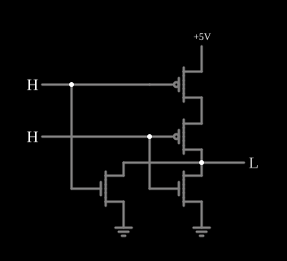

# Porta NOR CMOS

<!-- navegacao:inicio -->
[Índice](README.md) · [Anterior: CMOS NAND](cmosnand.md) · [Próximo: CMOS XOR](cmosxor.md)
<!-- navegacao:fim -->

## Objetivo

Mostrar a porta **NOR** em CMOS, a dual da [CMOS NAND](cmosnand.md): dois PMOS **em série** puxam a saída para cima e dois NMOS **em paralelo** a puxam para baixo.

## O circuito

<!-- esquema:inicio -->

<!-- esquema:fim -->

Dois PMOS (modelo padrão digital, $|V_t| = 1{,}5\ \text{V}$, $\beta = 0{,}02\ \text{A/V}^2$) estão empilhados entre $5\ \text{V}$ e a saída; dois NMOS do mesmo modelo ligam a saída à terra em paralelo. Cada entrada lógica ($0$ ou $5\ \text{V}$) vai à porta de um PMOS e de um NMOS. O exemplo abre com as duas entradas em $5\ \text{V}$.

<!-- componentes:inicio -->
| N.º | Tipo | Elemento | Valores |
|----:|------|----------|---------|
| 0 | `PMosfetElm` | MOSFET | Model = default-digital; Swap D/S = não |
| 2 | `RailElm` | voltage source | Voltage = 5; Waveform = D/C; DC Offset (V) = 0; Internal Resistance (ohms) = 0 |
| 3 | `PMosfetElm` | MOSFET | Model = default-digital; Swap D/S = não |
| 6 | `NMosfetElm` | MOSFET | Model = default-digital; Swap D/S = não |
| 7 | `LogicOutputElm` | logic output | Threshold = 2.5; Current Required = não; Numeric = não; Ternary = não |
| 8 | `NMosfetElm` | MOSFET | Model = default-digital; Swap D/S = não |
| 11 | `GroundElm` | ground | Symbol = Earth |
| 12 | `GroundElm` | ground | Symbol = Earth |
| 16 | `LogicInputElm` | logic input | Momentary Switch = não; High Logic Voltage = 5; Low Voltage = 0; Numeric = não; Ternary = não; Keyboard Shortcut =  |
| 17 | `LogicInputElm` | logic input | Momentary Switch = não; High Logic Voltage = 5; Low Voltage = 0; Numeric = não; Ternary = não; Keyboard Shortcut =  |
<!-- componentes:fim -->

## Teoria

A rede de baixo conduz quando $A$ **ou** $B$ está alto (NMOS em paralelo); a de cima só conduz quando $A$ **e** $B$ estão baixos (PMOS em série). As condições são complementares, e

$$Y = \overline{A + B} = \overline{A} \cdot \overline{B}.$$

Com dois PMOS em série, a subida da saída é mais fraca que a descida; como o PMOS já é o transistor mais lento num processo real, a NOR CMOS é menos favorável que a NAND, e as bibliotecas de células preferem a NAND.

## Resultados esperados

O simulador dá a saída em $0$ (menos de $1\ \mu\text{V}$) sempre que uma entrada está alta, e em $5{,}00\ \text{V}$ com as duas entradas baixas:

| $A$ (elemento 16) | $B$ (elemento 17) | Saída |
|----:|----:|------:|
| 1 | 1 | $0$ |
| 0 | 1 | $0$ |
| 1 | 0 | $0$ |
| 0 | 0 | $5{,}00\ \text{V}$ |

Com a saída alta, a corrente da alimentação é de $100\ \text{nA}$ (a fuga dos dois NMOS cortados); nos outros estados, de $25$ a $50\ \text{nA}$.

## O que observar

Clique nas entradas e compare a estrutura com a da [CMOS NAND](cmosnand.md): onde uma tem série, a outra tem paralelo.

## Limites do modelo

- PMOS e NMOS com o mesmo $\beta$ escondem a assimetria real, que penaliza os PMOS em série.
- Sem capacitâncias, a comutação é instantânea.

## Referências

Weste e Harris, *CMOS VLSI Design*, capítulo sobre portas CMOS estáticas; Sedra e Smith, *Microelectronic Circuits*, capítulo sobre lógica CMOS.

O circuito deste exemplo faz parte da coleção do simulador original de Paul Falstad e Iain Sharp (CircuitJS1); a explicação é deste projeto.
