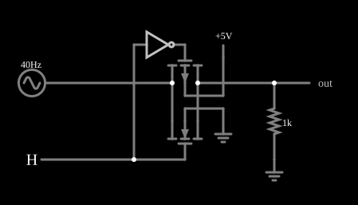

# Porta de transmissão CMOS

<!-- navegacao:inicio -->
[Índice](README.md) · [Anterior: CMOS Inverter (slow transition)](cmosinverterslow.md) · [Próximo: CMOS Multiplexer](mux.md)
<!-- navegacao:fim -->

## Objetivo

Mostrar a **porta de transmissão CMOS**: um PMOS e um NMOS em paralelo formam uma chave analógica controlada por um sinal lógico, que deixa passar sinais em toda a faixa de $0$ a $5\ \text{V}$, o que um MOSFET sozinho não consegue.

## O circuito

<!-- esquema:inicio -->

<!-- esquema:fim -->

Um NMOS e um PMOS (modelo padrão com diodo de corpo) têm os dreno e fonte ligados em paralelo, entre uma fonte senoidal de $0$ a $5\ \text{V}$ ($2{,}5\ \text{V}$ de pico sobre $2{,}5\ \text{V}$ de nível contínuo, $40\ \text{Hz}$) e uma carga de $1\ \text{k}\Omega$ ligada à terra. A porta do NMOS recebe o controle, uma entrada lógica (alta = ligado), e a do PMOS recebe o controle invertido por um inversor.

<!-- componentes:inicio -->
| N.º | Tipo | Elemento | Valores |
|----:|------|----------|---------|
| 1 | `RailElm` | A/C source | Max Voltage = 2.5; Waveform = A/C; DC Offset (V) = 2.5; Internal Resistance (ohms) = 0; Show Voltage = não; Frequency (Hz) = 40; Phase Offset (degrees) = 0 |
| 2 | `ResistorElm` | resistor | Resistance (ohms) = 1k |
| 3 | `GroundElm` | ground | Symbol = Earth |
| 4 | `OutputElm` | output | Show Voltage = não |
| 6 | `InverterElm` | inverter | Slew Rate (V/ns) = 500m; High Logic Voltage = 5; DeMorgan's Symbol = não |
| 7 | `LogicInputElm` | logic input | Momentary Switch = não; High Logic Voltage = 5; Low Voltage = 0; Numeric = não; Ternary = não; Keyboard Shortcut =  |
| 10 | `RailElm` | voltage source | Voltage = 5; Waveform = D/C; DC Offset (V) = 0; Internal Resistance (ohms) = 0 |
| 12 | `GroundElm` | ground | Symbol = Earth |
| 18 | `PMosfetElm` | MOSFET | Model = default-body; Swap D/S = não |
| 19 | `NMosfetElm` | MOSFET | Model = default-body; Swap D/S = não |
<!-- componentes:fim -->

## Teoria

Um NMOS passa bem o nível baixo, mas não passa tensões acima de $V_{DD} - V_t = 3{,}5\ \text{V}$ (corta); um PMOS faz o inverso, só conduzindo acima de $|V_t| = 1{,}5\ \text{V}$. Em paralelo, um deles sempre conduz. Com a porta ligada ($V_{DD}$ no NMOS, $0$ no PMOS), a resistência de cada um no triodo para $V_{DS}$ pequeno é

$$R_n = \frac{1}{\beta\,(V_{DD} - V_{in} - V_t)}, \qquad R_p = \frac{1}{\beta\,(V_{in} - |V_t|)}, \qquad R_{on} = R_n \parallel R_p,$$

válidas onde cada transistor conduz. Na faixa em que os dois conduzem ($1{,}5\ \text{V} < V_{in} < 3{,}5\ \text{V}$) a soma das condutâncias é constante:

$$\frac{1}{R_{on}} = \beta\,(V_{DD} - 2V_t) \ \Rightarrow\ R_{on} = \frac{1}{0{,}02 \cdot 2} = 25\ \Omega.$$

Nos extremos, só um conduz: $R_{on}(0\ \text{V}) = 1/(0{,}02 \cdot 3{,}5) = 14{,}3\ \Omega$. Por isso $R_{on}$ varia menos que a de um transistor só.

## Resultados esperados

Com a porta ligada e a entrada em $2{,}503\ \text{V}$ ($t = 12{,}5\ \text{ms}$), a saída é $2{,}442\ \text{V}$: a queda de $61\ \text{mV}$ com $2{,}44\ \text{mA}$ dá $R_{on} = 25\ \Omega$, o previsto. Ao longo de um ciclo, a saída vai de $0$ a $4{,}929\ \text{V}$ ($5\ \text{V}$ menos $71\ \text{mV}$ de queda), com corrente máxima de $4{,}93\ \text{mA}$. A resistência de ligado, calculada a cada instante como $(V_{in} - V_{out})/I$, é de $25{,}0\ \Omega$ para a entrada entre $1{,}5$ e $3{,}5\ \text{V}$ e cai a $15{,}5\ \Omega$ perto de $0\ \text{V}$ e a $15{,}2\ \Omega$ perto de $5\ \text{V}$ (mínimo $14{,}4\ \Omega$), conforme a fórmula. Com a porta desligada (entrada lógica baixa), a saída é de apenas $0{,}22\ \text{mV}$ (fuga de $0{,}22\ \mu\text{A}$ na carga). As verificações conferem a saída nos dois estados e o máximo, o mínimo e o pico de corrente (tolerância de $0{,}5\%$).

## O que observar

No osciloscópio a saída copia a entrada, quase sem distorção, quando a porta está ligada; clique na entrada lógica e a saída vai a zero. Para testar: aumente a carga para $100\ \Omega$ e veja a queda aumentar (divisor $R_{on}/(R_{on}+R_L)$); troque a porta por um só NMOS (desligando o PMOS) e veja a saída ficar achatada acima de $\approx 3{,}5\ \text{V}$.

## Limites do modelo

- Não há capacitâncias nem injeção de carga: numa chave real, o chaveamento deposita uma carga no nó de saída, e a distorção cresce com a frequência.
- A resistência de ligado vale $25\ \Omega$ por causa de $\beta = 0{,}02\ \text{A/V}^2$; num processo real ela depende da razão $W/L$ e é maior.
- O efeito de corpo (o limiar aumenta quando a fonte sobe acima do substrato) faz a resistência real variar mais que a deste modelo.
- A resistência de ligado calculada ponto a ponto é uma medida do simulador e não faz parte das verificações automáticas.

## Referências

Sedra e Smith, *Microelectronic Circuits*, capítulo sobre o inversor CMOS e a lógica CMOS; Weste e Harris, *CMOS VLSI Design*, capítulos sobre o inversor e sobre portas de transmissão.

O circuito deste exemplo faz parte da coleção do simulador original de Paul Falstad e Iain Sharp (CircuitJS1); a explicação é deste projeto.
