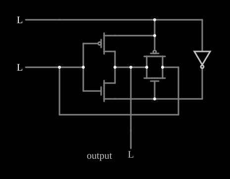

# Porta XOR CMOS

<!-- navegacao:inicio -->
[Índice](README.md) · [Anterior: CMOS NOR](cmosnor.md) · [Próximo: CMOS Flip-Flop](cmosff.md)
<!-- navegacao:fim -->

## Objetivo

Mostrar uma porta **OU-exclusivo** CMOS feita com poucos transistores: um inversor cujas "alimentações" são o sinal $A$ e o seu complemento, e uma porta de transmissão que deixa passar $B$. São quatro transistores e um inversor, contra os doze de uma XOR feita com portas NAND.

## O circuito

<!-- esquema:inicio -->

<!-- esquema:fim -->

A entrada $A$ (elemento 16) vai a um inversor lógico (elemento 19), que gera $\overline{A}$. Os quatro MOSFETs são do modelo padrão digital ($|V_t| = 1{,}5\ \text{V}$, $\beta = 0{,}02\ \text{A/V}^2$):

- um PMOS e um NMOS (elementos 0 e 1) formam um inversor da entrada $B$ (elemento 17), mas a fonte do PMOS está em $A$ e a do NMOS em $\overline{A}$, em vez de $5\ \text{V}$ e terra;
- um PMOS com a porta em $A$ e um NMOS com a porta em $\overline{A}$ (elementos 6 e 7) formam uma **porta de transmissão** entre $B$ e a saída.

As saídas do inversor e da porta de transmissão estão ligadas à saída lógica. O exemplo abre com as duas entradas em $0$.

<!-- componentes:inicio -->
| N.º | Tipo | Elemento | Valores |
|----:|------|----------|---------|
| 0 | `PMosfetElm` | MOSFET | Model = default-digital; Swap D/S = não |
| 1 | `NMosfetElm` | MOSFET | Model = default-digital; Swap D/S = não |
| 6 | `PMosfetElm` | MOSFET | Model = default-digital; Swap D/S = não |
| 7 | `NMosfetElm` | MOSFET | Model = default-digital; Swap D/S = não |
| 16 | `LogicInputElm` | logic input | Momentary Switch = não; High Logic Voltage = 5; Low Voltage = 0; Numeric = não; Ternary = não; Keyboard Shortcut =  |
| 17 | `LogicInputElm` | logic input | Momentary Switch = não; High Logic Voltage = 5; Low Voltage = 0; Numeric = não; Ternary = não; Keyboard Shortcut =  |
| 19 | `InverterElm` | inverter | Slew Rate (V/ns) = 500m; High Logic Voltage = 5; DeMorgan's Symbol = não |
| 24 | `LogicOutputElm` | logic output | Threshold = 2.5; Current Required = não; Numeric = não; Ternary = não |
| 26 | `TextElm` | text | Text = output; Size = 20; Draw Bar On Top = não; Color = #c0c0c0 |
<!-- componentes:fim -->

## Teoria

- **$A = 1$:** o inversor tem $5\ \text{V}$ na fonte do PMOS e $0$ na do NMOS, e funciona como um inversor normal: a saída é $\overline{B}$. A porta de transmissão está desligada (PMOS com porta alta, NMOS com porta baixa).
- **$A = 0$:** a porta de transmissão liga e copia $B$ para a saída. O inversor tem as "alimentações" trocadas ($0$ no PMOS, $5\ \text{V}$ no NMOS) e não conduz em nenhum dos estados de $B$: os seus transistores não podem fazer subir ou descer a saída para além do que a porta de transmissão impõe.

Logo

$$Y = A\,\overline{B} + \overline{A}\,B = A \oplus B.$$

A porta de transmissão (ver [CMOS Transmission Gate](cmostransgate.md)) passa bem tanto o $0$ (pelo NMOS) quanto o $1$ (pelo PMOS), e por isso os níveis de saída são completos.

## Resultados esperados

O simulador dá:

| $A$ | $B$ | Saída |
|----:|----:|------:|
| 0 | 0 | $1\ \mu\text{V}$ |
| 1 | 0 | $5{,}00\ \text{V}$ |
| 0 | 1 | $5{,}00\ \text{V}$ |
| 1 | 1 | $2\ \mu\text{V}$ |

## O que observar

Clique nas entradas e acompanhe qual dos dois caminhos aciona a saída: o inversor quando $A = 1$, a porta de transmissão quando $A = 0$. Esta mistura de lógica complementar e transistores de passagem é comum em somadores CMOS.

## Limites do modelo

- A entrada $B$ aciona diretamente a saída pela porta de transmissão: esta XOR não *regenera* o sinal nesse caminho, e numa cadeia longa a qualidade dos níveis se degradaria.
- O inversor que gera $\overline{A}$ é um elemento lógico ideal, não um par de transistores.
- Sem capacitâncias, a comutação é instantânea.

## Referências

Weste e Harris, *CMOS VLSI Design*, capítulo sobre lógica de transistores de passagem e portas de transmissão; Rabaey, Chandrakasan e Nikolić, *Digital Integrated Circuits*, capítulo sobre portas combinacionais.

O circuito deste exemplo faz parte da coleção do simulador original de Paul Falstad e Iain Sharp (CircuitJS1); a explicação é deste projeto.
