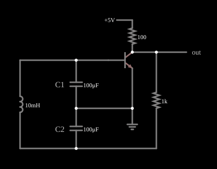

# Oscilador Colpitts

<!-- navegacao:inicio -->
[Índice](README.md) · [Próximo: Hartley Oscillator](hartley.md)
<!-- navegacao:fim -->

## Objetivo

Mostrar um oscilador LC de transistor, o **oscilador Colpitts**: um amplificador de emissor comum cujo circuito ressonante tem dois capacitores em série, e cuja tomada entre eles realimenta o sinal para a base. O circuito oscila sozinho, perto da frequência de ressonância do circuito LC, com uma amplitude fixada pelo próprio transistor.

## O circuito

<!-- esquema:inicio -->

<!-- esquema:fim -->

O transistor NPN ($\beta = 100$) tem o emissor ligado à terra, a alimentação de $5\ \text{V}$ chega ao coletor por um resistor de $100\ \Omega$ e a saída é tomada no coletor. O circuito ressonante tem um indutor de $10\ \text{mH}$ ligado entre a base e um nó inferior; entre os mesmos nós há dois capacitores de $100\ \mu\text{F}$ ($C_1$ e $C_2$) em série, cujo ponto médio é a terra, ou seja, o emissor. O coletor volta ao nó inferior por um resistor de $1\ \text{k}\Omega$, que fecha a malha de realimentação. O osciloscópio mostra a tensão no coletor.

<!-- componentes:inicio -->
| N.º | Tipo | Elemento | Valores |
|----:|------|----------|---------|
| 0 | `InductorElm` | inductor | Inductance (H) = 10m; Trapezoidal Approximation = sim; Initial Current (on Reset) (A) = 0; Saturation Current (A) (0=none) = 0 |
| 1 | `CapacitorElm` | capacitor | Capacitance (F) = 100μ; Trapezoidal Approximation = sim; Initial Voltage (on Reset) = 1m; Series Resistance = 0 |
| 2 | `NTransistorElm` | transistor | Beta/hFE = 100; Swap E/C = não; Draw Circle = não; Model = default |
| 3 | `CapacitorElm` | capacitor | Capacitance (F) = 100μ; Trapezoidal Approximation = sim; Initial Voltage (on Reset) = 1m; Series Resistance = 0 |
| 10 | `ResistorElm` | resistor | Resistance (ohms) = 1k |
| 12 | `ResistorElm` | resistor | Resistance (ohms) = 100 |
| 13 | `RailElm` | voltage source | Voltage = 5; Waveform = D/C; DC Offset (V) = 0; Internal Resistance (ohms) = 0 |
| 14 | `GroundElm` | ground | Symbol = Earth |
| 15 | `OutputElm` | output | Show Voltage = não |
| 16 | `TextElm` | text | Text = C1; Size = 16; Draw Bar On Top = não; Color = #c0c0c0 |
| 17 | `TextElm` | text | Text = C2; Size = 16; Draw Bar On Top = não; Color = #c0c0c0 |
<!-- componentes:fim -->

## Teoria

Um oscilador precisa de um amplificador e de uma realimentação positiva com ganho de malha de módulo igual ou maior que $1$ e fase total de $0^\circ$ (critério de Barkhausen). O estágio de emissor comum inverte a fase em $180^\circ$; o divisor capacitivo $C_1$–$C_2$ do circuito ressonante inverte mais $180^\circ$ na frequência de ressonância, e o sinal que chega à base é reforçado a cada ciclo.

A frequência é a do circuito LC com os dois capacitores em série:

$$C_{eq} = \frac{C_1 C_2}{C_1 + C_2} = 50\ \mu\text{F}, \qquad f_0 = \frac{1}{2\pi\sqrt{L\,C_{eq}}} = \frac{1}{2\pi\sqrt{10\ \text{mH} \cdot 50\ \mu\text{F}}} \approx 225{,}1\ \text{Hz}.$$

A razão $C_1/C_2$ define que fração da tensão do circuito ressonante volta à base; o ganho do transistor deve compensar essa atenuação. Quando a amplitude cresce, o transistor passa a saturar num extremo do ciclo e a cortar no outro, o que reduz o ganho médio a $1$ e **limita a amplitude**; a saída deixa de ser senoidal.

## Resultados esperados

O simulador dá uma oscilação estável de $217{,}37\ \text{Hz}$, $3{,}4\%$ abaixo dos $225{,}1\ \text{Hz}$ da fórmula: a fórmula vale para o circuito ressonante isolado, e aqui ele é carregado pelo transistor e pelos resistores de $1\ \text{k}\Omega$ e $100\ \Omega$, além de o transistor operar em grande sinal (conduz só em parte do ciclo). A tensão no coletor oscila entre $0{,}052\ \text{V}$ (transistor saturado) e $4{,}503\ \text{V}$, com um valor médio de cerca de $2{,}47\ \text{V}$ (o valor médio depende de quantos ciclos a janela contém). A oscilação já está em regime nos primeiros ciclos (o arquivo já traz as correntes e tensões de um circuito em oscilação), e a frequência é a mesma em $0{,}1\ \text{s}$ e em $0{,}6\ \text{s}$. As verificações conferem a frequência (em duas janelas) e o máximo e o mínimo da tensão do coletor.

## O que observar

No osciloscópio, uma onda periódica de cerca de $4{,}6\ \text{ms}$, não senoidal e quase quadrada: ela passa cerca de $32\%$ do período na faixa dos $10\%$ inferiores da excursão (transistor saturado) e $37\%$ na dos $10\%$ superiores (transistor cortado). Para testar: troque $L$ por $40\ \text{mH}$ e veja a frequência cair à metade ($1/\sqrt{4}$); mude $C_1$ ou $C_2$ e veja a frequência acompanhar $C_{eq}$; reduza o resistor de $1\ \text{k}\Omega$ de realimentação para $100\ \Omega$ ou aumente-o e veja a amplitude e a frequência mudarem.

## Limites do modelo

- A frequência calculada vale para pequenos sinais; em grande sinal, como aqui, ela difere alguns por cento.
- O transistor do modelo não tem capacitâncias, que num oscilador de rádio frequência somam-se a $C_1$ e $C_2$ e deslocam a frequência.
- Os valores de componentes ($100\ \mu\text{F}$, $10\ \text{mH}$) servem a uma demonstração de audiofrequência de poucos ciclos por décimo de segundo; osciladores de rádio usam capacitores de $\text{pF}$ e indutores de $\mu\text{H}$.
- A amplitude de regime não é prevista pela fórmula: ela depende da saturação do transistor.

## Referências

Sedra e Smith, *Microelectronic Circuits*, capítulo sobre osciladores senoidais (Colpitts e Hartley); Horowitz e Hill, *The Art of Electronics*, seção 5.x (osciladores LC).

O circuito deste exemplo faz parte da coleção do simulador original de Paul Falstad e Iain Sharp (CircuitJS1); a explicação é deste projeto.
