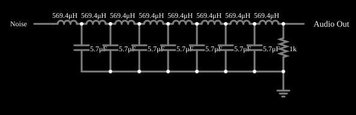

# Filtro pente

<!-- navegacao:inicio -->
[Índice](README.md) · [Anterior: Band-pass with Ringing](ringing.md)
<!-- navegacao:fim -->

## Objetivo

Mostrar um filtro em pente: uma resposta com várias bandas passantes igualmente espaçadas, que dá ao ruído um som "tonal".

## O circuito

<!-- esquema:inicio -->

<!-- esquema:fim -->

Sete seções LC iguais ($L = 569{,}4\ \mu\text{H}$, $C = 5{,}7\ \mu\text{F}$) mais um indutor adicional, alimentadas por um gerador de ruído de 5 V através de $1\ \text{k}\Omega$; a saída vai a uma saída de áudio (1 s, 8000 amostras por segundo).

<!-- componentes:inicio -->
| N.º | Tipo | Elemento | Valores |
|----:|------|----------|---------|
| 0 | `InductorElm` | inductor | Inductance (H) = 569.4μ; Trapezoidal Approximation = sim; Initial Current (on Reset) (A) = 0; Saturation Current (A) (0=none) = 0 |
| 1 | `InductorElm` | inductor | Inductance (H) = 569.4μ; Trapezoidal Approximation = sim; Initial Current (on Reset) (A) = 0; Saturation Current (A) (0=none) = 0 |
| 2 | `InductorElm` | inductor | Inductance (H) = 569.4μ; Trapezoidal Approximation = sim; Initial Current (on Reset) (A) = 0; Saturation Current (A) (0=none) = 0 |
| 3 | `InductorElm` | inductor | Inductance (H) = 569.4μ; Trapezoidal Approximation = sim; Initial Current (on Reset) (A) = 0; Saturation Current (A) (0=none) = 0 |
| 4 | `InductorElm` | inductor | Inductance (H) = 569.4μ; Trapezoidal Approximation = sim; Initial Current (on Reset) (A) = 0; Saturation Current (A) (0=none) = 0 |
| 5 | `InductorElm` | inductor | Inductance (H) = 569.4μ; Trapezoidal Approximation = sim; Initial Current (on Reset) (A) = 0; Saturation Current (A) (0=none) = 0 |
| 6 | `InductorElm` | inductor | Inductance (H) = 569.4μ; Trapezoidal Approximation = sim; Initial Current (on Reset) (A) = 0; Saturation Current (A) (0=none) = 0 |
| 7 | `CapacitorElm` | capacitor | Capacitance (F) = 5.7μ; Trapezoidal Approximation = sim; Initial Voltage (on Reset) = 1m; Series Resistance = 0 |
| 8 | `CapacitorElm` | capacitor | Capacitance (F) = 5.7μ; Trapezoidal Approximation = sim; Initial Voltage (on Reset) = 1m; Series Resistance = 0 |
| 9 | `CapacitorElm` | capacitor | Capacitance (F) = 5.7μ; Trapezoidal Approximation = sim; Initial Voltage (on Reset) = 1m; Series Resistance = 0 |
| 10 | `CapacitorElm` | capacitor | Capacitance (F) = 5.7μ; Trapezoidal Approximation = sim; Initial Voltage (on Reset) = 1m; Series Resistance = 0 |
| 11 | `CapacitorElm` | capacitor | Capacitance (F) = 5.7μ; Trapezoidal Approximation = sim; Initial Voltage (on Reset) = 1m; Series Resistance = 0 |
| 12 | `CapacitorElm` | capacitor | Capacitance (F) = 5.7μ; Trapezoidal Approximation = sim; Initial Voltage (on Reset) = 1m; Series Resistance = 0 |
| 13 | `CapacitorElm` | capacitor | Capacitance (F) = 5.7μ; Trapezoidal Approximation = sim; Initial Voltage (on Reset) = 1m; Series Resistance = 0 |
| 20 | `InductorElm` | inductor | Inductance (H) = 569.4μ; Trapezoidal Approximation = sim; Initial Current (on Reset) (A) = 0; Saturation Current (A) (0=none) = 0 |
| 21 | `ResistorElm` | resistor | Resistance (ohms) = 1k |
| 23 | `GroundElm` | ground | Symbol = Earth |
| 24 | `RailElm` | noise gen | Max Voltage = 5; Waveform = Noise; DC Offset (V) = 0; Internal Resistance (ohms) = 0; Show Voltage = não |
| 25 | `AudioOutputElm` | audio output | Duration (s) = 1; Sampling Rate = 8000 |
<!-- componentes:fim -->

## Teoria

Cada par LC ressoa em

$$f_0 = \frac{1}{2\pi\sqrt{LC}} = 2{,}79\ \text{kHz}.$$

Uma rede com várias seções iguais acopladas tem modos normais agrupados em torno de $f_0$ e, ao ser excitada por ruído branco, realça esses modos (picos) e atenua as frequências entre eles: daí a imagem de um "pente" na resposta em frequência.

## Resultados esperados

A frequência de ressonância de cada seção, $f_0 = 2{,}79\ \text{kHz}$, é calculada dos valores da tabela. Como a entrada é aleatória, as amplitudes não se repetem de uma execução para outra; o resultado é para ser ouvido, e a posição exata dos picos depende de como as seções estão ligadas, o que se vê no desenho do circuito.

## O que observar

- Ouça a saída: o ruído ganha um timbre metálico, com tons em torno de 2,8 kHz.
- Abra o circuito para ver como as seções se acoplam.

## Limites do modelo

Gerador de ruído e componentes ideais. A saída é áudio: não há verificação numérica porque a entrada é aleatória; a posição dos picos não é verificada pelo simulador neste documento.

## Referências

- P. Horowitz e W. Hill, *The Art of Electronics*, Cambridge University Press.
- A. S. Sedra e K. C. Smith, *Microeletrônica*, Pearson.

O circuito deste exemplo faz parte da coleção do simulador original de Paul Falstad e Iain Sharp (CircuitJS1); a explicação é deste projeto.
