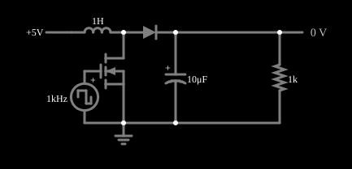

# Conversor elevador (boost)

<!-- navegacao:inicio -->
[Índice](README.md) · [Próximo: Buck Converter](conv-buck.md)
<!-- navegacao:fim -->

## Objetivo

Mostrar o conversor elevador (*boost*), que gera uma tensão contínua **maior** que a de entrada: o indutor armazena energia enquanto a chave está ligada e a entrega, somada à entrada, à saída quando a chave desliga.

## O circuito

<!-- esquema:inicio -->

<!-- esquema:fim -->

O MOSFET é comandado por uma fonte de onda quadrada de $1\ \text{kHz}$ (período $T = 1\ \text{ms}$) que vai de $0$ a $10\ \text{V}$; o circuito é alimentado com $5\ \text{V}$ e a carga é um resistor de $1\ \text{k}\Omega$ com um capacitor eletrolítico de filtro de $10\ \mu\text{F}$. O indutor de $1\ \text{H}$ liga a fonte de $5\ \text{V}$ a um nó, que o MOSFET pode levar à terra e que um diodo liga à carga. O ciclo de trabalho da fonte de comando é $D = 68\%$.

<!-- componentes:inicio -->
| N.º | Tipo | Elemento | Valores |
|----:|------|----------|---------|
| 0 | `NMosfetElm` | MOSFET | Model = default; Swap D/S = não |
| 1 | `RailElm` | voltage source | Voltage = 5; Waveform = D/C; DC Offset (V) = 0; Internal Resistance (ohms) = 0 |
| 3 | `InductorElm` | inductor | Inductance (H) = 1; Trapezoidal Approximation = sim; Initial Current (on Reset) (A) = 0; Saturation Current (A) (0=none) = 0 |
| 4 | `DiodeElm` | diode | Model = default |
| 7 | `GroundElm` | ground | Symbol = Earth |
| 8 | `ResistorElm` | resistor | Resistance (ohms) = 1k |
| 11 | `OutputElm` | output | Show Voltage = sim; Scale = Auto |
| 12 | `DCVoltageElm` | square wave gen | Max Voltage = 5; Waveform = Square Wave; DC Offset (V) = 5; Internal Resistance (ohms) = 0; Show Voltage = não; Specify As = Frequency/Duty Cycle; Frequency (Hz) = 1k; Phase Offset (degrees) = 0; Duty Cycle = 68; Rise/Fall Time (s) = 0 |
| 14 | `PolarCapacitorElm` | capacitor (polarized) | Capacitance (F) = 10μ; Trapezoidal Approximation = sim; Initial Voltage (on Reset) = 1m; Series Resistance = 0; Max Reverse Voltage = 1 |
<!-- componentes:fim -->

## Teoria

**Chave ligada** ($t < DT$): o MOSFET aterra o nó, o indutor fica sob $V_{in}$ e $i_L$ sobe com inclinação $V_{in}/L$, enquanto o capacitor sustenta a carga (o diodo está cortado). **Chave desligada**: a corrente do indutor passa pelo diodo para a saída; a tensão sobre o indutor é $V_{in} - V_{out}$ (negativa, porque $V_{out} > V_{in}$) e $i_L$ desce.

A tensão média nula sobre o indutor dá

$$V_{in}\,D\,T = (V_{out} - V_{in})\,(1-D)\,T \quad\Longrightarrow\quad V_{out} = \frac{V_{in}}{1 - D}.$$

A ondulação de corrente é $\Delta i_L = V_{in}\,D\,T/L$, e a de tensão de saída, $\Delta V_{out} \approx I_\text{saída}\,D\,T/C$. Com a queda do diodo, $V_{out} \approx V_{in}/(1-D) - V_D$.

## Resultados esperados

As tensões do exemplo ainda **derivam devagar** depois de $0{,}1\ \text{s}$ (da ordem de 1% a 5% em $1\ \text{s}$, porque os indutores de $1\ \text{H}$ e o capacitor formam um sistema de resposta lenta); os valores deste documento são os da janela de $0{,}9$ a $1{,}0\ \text{s}$ e servem para comparar com a teoria, que supõe regime permanente.

| Grandeza | Teoria | Simulador |
|----------|-------:|----------:|
| Tensão de saída (média) | $5/0{,}32 = 15{,}6\ \text{V}$; com o diodo, $\approx 15{,}0\ \text{V}$ | $14{,}40\ \text{V}$ (em $t = 0{,}1\ \text{s}$: $14{,}93\ \text{V}$) |
| Ondulação de corrente $\Delta i_L$ | $5\cdot 0{,}68\cdot 1\ \text{ms}/1\ \text{H} = 3{,}4\ \text{mA}$ | $3{,}19\ \text{mA}$ ($43{,}4$ a $46{,}6\ \text{mA}$) |
| Ondulação de tensão $\Delta V_{out}$ | $14{,}4\ \text{mA}\cdot 0{,}68\ \text{ms}/10\ \mu\text{F} = 0{,}98\ \text{V}$ | $0{,}97\ \text{V}$ ($13{,}9$ a $14{,}9\ \text{V}$) |
| Rendimento ($P_\text{saída}/P_\text{entrada}$) | — | $\approx 92\%$ ($5\ \text{V}\cdot 45{,}0\ \text{mA} = 225\ \text{mW}$ na entrada e $\approx 207\ \text{mW}$ na carga) |

A saída é $3$ vezes a tensão de entrada, e a corrente média no indutor ($45\ \text{mA}$) é maior que a da carga ($14{,}4\ \text{mA}$), como a conservação de potência exige. As verificações conferem a tensão média e os extremos da corrente.

## O que observar

- A tensão de saída tem uma ondulação visível de cerca de $1\ \text{V}$, porque a corrente da carga vem só do capacitor quando a chave está ligada.
- A saída é bem maior que a entrada; se a carga for retirada, a saída sobe sem limite (o boost não deve operar sem carga).
- Aproxime $D$ de $100\%$ e a saída teórica diverge: na prática as perdas a limitam. O ciclo de trabalho é o *Duty Cycle* da fonte de onda quadrada (clique duas vezes na fonte para editar). Nesta versão do arquivo o *slider* "Duty Cycle" do painel lateral está ligado ao campo de **frequência** da fonte, e não ao de ciclo de trabalho (um erro conhecido do exemplo), então a edição direta na fonte é o caminho seguro.

## Limites do modelo

Diodo e MOSFET com os modelos padrão do simulador (queda de $\approx 0{,}6\ \text{V}$ no diodo, resistência finita no MOSFET), sem resistência série do indutor ou do capacitor (que, num boost real, limita a tensão máxima quando $D \to 1$) e sem perdas de comutação. Os valores de $L$, $C$ e $f$ não são os de um conversor real.

## Referências

- R. W. Erickson e D. Maksimović, *Fundamentals of Power Electronics*, Springer.
- N. Mohan, T. M. Undeland e W. P. Robbins, *Power Electronics: Converters, Applications, and Design*, Wiley.
- M. H. Rashid, *Power Electronics: Circuits, Devices, and Applications*, Pearson.

O circuito deste exemplo faz parte da coleção do simulador original de Paul Falstad e Iain Sharp (CircuitJS1); a explicação é deste projeto.
