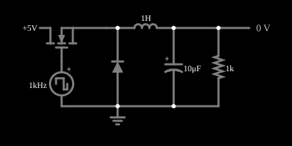

# Conversor abaixador (buck)

<!-- navegacao:inicio -->
[Índice](README.md) · [Anterior: Boost Converter](conv-boost.md) · [Próximo: Buck-Boost Converter](conv-buckboost.md)
<!-- navegacao:fim -->

## Objetivo

Mostrar o conversor abaixador (*buck*), que gera uma tensão contínua **menor** que a de entrada com um transistor chaveado, um diodo, um indutor e um capacitor, com rendimento muito maior que o de um regulador linear.

## O circuito

<!-- esquema:inicio -->

<!-- esquema:fim -->

O MOSFET é comandado por uma fonte de onda quadrada de $1\ \text{kHz}$ (período $T = 1\ \text{ms}$) que vai de $0$ a $10\ \text{V}$; o circuito é alimentado com $5\ \text{V}$ e a carga é um resistor de $1\ \text{k}\Omega$ com um capacitor eletrolítico de filtro de $10\ \mu\text{F}$. Um MOSFET liga a fonte de $5\ \text{V}$ a um nó, que um diodo de roda livre leva à terra; daí um indutor de $1\ \text{H}$ vai à carga. O ciclo de trabalho da fonte de comando é $D = 72\%$.

<!-- componentes:inicio -->
| N.º | Tipo | Elemento | Valores |
|----:|------|----------|---------|
| 0 | `RailElm` | voltage source | Voltage = 5; Waveform = D/C; DC Offset (V) = 0; Internal Resistance (ohms) = 0 |
| 1 | `NMosfetElm` | MOSFET | Model = default; Swap D/S = sim |
| 2 | `DCVoltageElm` | square wave gen | Max Voltage = 5; Waveform = Square Wave; DC Offset (V) = 5; Internal Resistance (ohms) = 0; Show Voltage = não; Specify As = Frequency/Duty Cycle; Frequency (Hz) = 1k; Phase Offset (degrees) = 0; Duty Cycle = 72; Rise/Fall Time (s) = 0 |
| 4 | `DiodeElm` | diode | Model = default |
| 6 | `InductorElm` | inductor | Inductance (H) = 1; Trapezoidal Approximation = sim; Initial Current (on Reset) (A) = 0; Saturation Current (A) (0=none) = 0 |
| 8 | `GroundElm` | ground | Symbol = Earth |
| 9 | `ResistorElm` | resistor | Resistance (ohms) = 1k |
| 12 | `OutputElm` | output | Show Voltage = sim; Scale = Auto |
| 13 | `PolarCapacitorElm` | capacitor (polarized) | Capacitance (F) = 10μ; Trapezoidal Approximation = sim; Initial Voltage (on Reset) = 1m; Series Resistance = 0; Max Reverse Voltage = 1 |
<!-- componentes:fim -->

## Teoria

**Chave ligada** ($t < DT$): o MOSFET conduz, o diodo está cortado e a tensão de entrada $V_{in}$ é aplicada ao indutor em série com a saída; a corrente $i_L$ sobe com inclinação $(V_{in} - V_{out})/L$. **Chave desligada**: o indutor mantém a corrente pelo diodo, e a tensão sobre ele é $-V_{out}$, de modo que $i_L$ desce com inclinação $-V_{out}/L$.

No regime permanente a tensão média sobre o indutor é nula:

$$(V_{in} - V_{out})\,D\,T = V_{out}\,(1 - D)\,T \quad\Longrightarrow\quad V_{out} = D\,V_{in}.$$

A ondulação de corrente no indutor é $\Delta i_L = \dfrac{(V_{in} - V_{out})\,D\,T}{L}$. Com a queda do diodo ($\approx 0{,}5\ \text{V}$) e do MOSFET, a saída é um pouco menor que $D\,V_{in}$.

## Resultados esperados

As tensões do exemplo ainda **derivam devagar** depois de $0{,}1\ \text{s}$ (da ordem de 1% a 5% em $1\ \text{s}$, porque os indutores de $1\ \text{H}$ e o capacitor formam um sistema de resposta lenta); os valores deste documento são os da janela de $0{,}9$ a $1{,}0\ \text{s}$ e servem para comparar com a teoria, que supõe regime permanente.

| Grandeza | Teoria | Simulador |
|----------|-------:|----------:|
| Tensão de saída (média) | $D\,V_{in} = 3{,}60\ \text{V}$ | $3{,}422\ \text{V}$ (ondulação de $14\ \text{mV}$) |
| Corrente média no indutor ($= V_{out}/R$) | $3{,}42\ \text{mA}$ | $3{,}422\ \text{mA}$ |
| Ondulação de corrente $\Delta i_L$ | $\dfrac{(5 - 3{,}42)\cdot 0{,}72\cdot 1\ \text{ms}}{1\ \text{H}} = 1{,}14\ \text{mA}$ | $1{,}10\ \text{mA}$ ($2{,}873$ a $3{,}969\ \text{mA}$) |

A saída fica $5\%$ abaixo de $D\,V_{in}$ por causa das quedas no diodo e no MOSFET. A corrente no indutor nunca chega a zero (modo de condução contínua). As verificações conferem a tensão média e os extremos da corrente.

## O que observar

- A corrente no indutor é uma triangular de $1\ \text{kHz}$ que sobe quando o MOSFET conduz e desce quando ele desliga, em torno do valor médio de $3{,}4\ \text{mA}$.
- A tensão de saída é quase constante: a ondulação de $14\ \text{mV}$ é filtrada pelo capacitor.
- Mudar o ciclo de trabalho muda a saída na mesma proporção ($V_{out} \approx D\,V_{in}$). O ciclo de trabalho é o *Duty Cycle* da fonte de onda quadrada (clique duas vezes na fonte para editar). Nesta versão do arquivo o *slider* "Duty Cycle" do painel lateral está ligado ao campo de **frequência** da fonte, e não ao de ciclo de trabalho (um erro conhecido do exemplo), então a edição direta na fonte é o caminho seguro.

## Limites do modelo

Componentes ideais, exceto o diodo e o MOSFET (modelos padrão do simulador, com queda de $\approx 0{,}5\ \text{V}$ e resistência finita), sem resistência série do indutor nem do capacitor, e sem *deadtime* nem perdas de comutação. O indutor de $1\ \text{H}$ e a frequência de $1\ \text{kHz}$ foram escolhidos para a simulação ficar visível, não para um projeto real (em que $L$ seria de microhenrys e $f$ de centenas de quilohertz).

## Referências

- R. W. Erickson e D. Maksimović, *Fundamentals of Power Electronics*, Springer.
- N. Mohan, T. M. Undeland e W. P. Robbins, *Power Electronics: Converters, Applications, and Design*, Wiley.
- M. H. Rashid, *Power Electronics: Circuits, Devices, and Applications*, Pearson.

O circuito deste exemplo faz parte da coleção do simulador original de Paul Falstad e Iain Sharp (CircuitJS1); a explicação é deste projeto.
