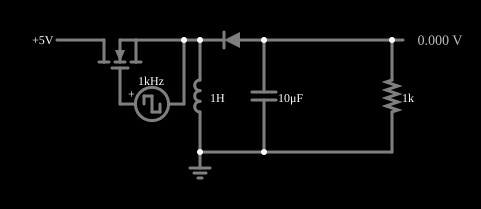

# Conversor abaixador-elevador (buck-boost)

<!-- navegacao:inicio -->
[Índice](README.md) · [Anterior: Buck Converter](conv-buck.md) · [Próximo: Ćuk Converter](conv-cuk.md)
<!-- navegacao:fim -->

## Objetivo

Mostrar o conversor abaixador-elevador (*buck-boost*), que gera uma tensão de **polaridade invertida** que pode ser maior ou menor, em módulo, que a de entrada, dependendo do ciclo de trabalho.

## O circuito

<!-- esquema:inicio -->

<!-- esquema:fim -->

O MOSFET é comandado por uma fonte de onda quadrada de $1\ \text{kHz}$ (período $T = 1\ \text{ms}$) que vai de $0$ a $10\ \text{V}$; o circuito é alimentado com $5\ \text{V}$ e a carga é um resistor de $1\ \text{k}\Omega$ com um capacitor eletrolítico de filtro de $10\ \mu\text{F}$. O MOSFET liga a fonte de $5\ \text{V}$ a um nó ao qual está ligado um indutor de $1\ \text{H}$, cuja outra ponta vai à terra; o diodo liga esse nó à saída, que tem o capacitor e a carga. O ciclo de trabalho da fonte de comando é $D = 56\%$. O osciloscópio mostra a saída e a corrente no indutor.

<!-- componentes:inicio -->
| N.º | Tipo | Elemento | Valores |
|----:|------|----------|---------|
| 0 | `NMosfetElm` | MOSFET | Model = default; Swap D/S = sim |
| 1 | `RailElm` | voltage source | Voltage = 5; Waveform = D/C; DC Offset (V) = 0; Internal Resistance (ohms) = 0 |
| 2 | `InductorElm` | inductor | Inductance (H) = 1; Trapezoidal Approximation = sim; Initial Current (on Reset) (A) = 0; Saturation Current (A) (0=none) = 0 |
| 3 | `DiodeElm` | diode | Model = default |
| 4 | `CapacitorElm` | capacitor | Capacitance (F) = 10μ; Trapezoidal Approximation = sim; Initial Voltage (on Reset) = 1m; Series Resistance = 0 |
| 6 | `GroundElm` | ground | Symbol = Earth |
| 7 | `ResistorElm` | resistor | Resistance (ohms) = 1k |
| 10 | `OutputElm` | output | Show Voltage = sim; Scale = V; Fixed Precision = sim |
| 14 | `VoltageElm` | square wave gen | Max Voltage = 5; Waveform = Square Wave; DC Offset (V) = 5; Internal Resistance (ohms) = 0; Show Voltage = não; Specify As = Frequency/Duty Cycle; Frequency (Hz) = 1k; Phase Offset (degrees) = 0; Duty Cycle = 56; Rise/Fall Time (s) = 0 |
<!-- componentes:fim -->

## Teoria

**Chave ligada**: a fonte $V_{in}$ fica sobre o indutor, que armazena energia ($i_L$ sobe com $V_{in}/L$), e o diodo está cortado. **Chave desligada**: o indutor entrega a corrente ao capacitor e à carga pelo diodo, em sentido tal que a saída fica **negativa** em relação à terra; a tensão sobre o indutor é $V_{out}$.

$$V_{in}\,D\,T = -V_{out}\,(1 - D)\,T \quad\Longrightarrow\quad V_{out} = -\frac{D}{1-D}\,V_{in}.$$

Para $D < 0{,}5$ o módulo da saída é menor que $V_{in}$ (abaixador); para $D > 0{,}5$ é maior (elevador). A ondulação de corrente é $\Delta i_L = V_{in}\,D\,T/L$.

## Resultados esperados

As tensões do exemplo ainda **derivam devagar** depois de $0{,}1\ \text{s}$ (da ordem de 1% a 5% em $1\ \text{s}$, porque os indutores de $1\ \text{H}$ e o capacitor formam um sistema de resposta lenta); os valores deste documento são os da janela de $0{,}9$ a $1{,}0\ \text{s}$ e servem para comparar com a teoria, que supõe regime permanente.

| Grandeza | Teoria | Simulador |
|----------|-------:|----------:|
| Tensão de saída (média) | $-\dfrac{0{,}56}{0{,}44}\,5 = -6{,}36\ \text{V}$ (com a queda do diodo, mais próxima de $-5{,}8\ \text{V}$) | $-5{,}679\ \text{V}$ (em $t = 0{,}1\ \text{s}$: $-5{,}84\ \text{V}$) |
| Ondulação de corrente $\Delta i_L$ | $5\cdot 0{,}56\cdot 1\ \text{ms}/1\ \text{H} = 2{,}8\ \text{mA}$ | $2{,}73\ \text{mA}$ (de $-14{,}3$ a $-11{,}5\ \text{mA}$) |

A saída é negativa e, com $D = 56\%$, ligeiramente maior em módulo que a entrada. O sinal negativo da corrente do indutor é o da convenção do simulador. As verificações conferem a tensão média e os extremos da corrente.

## O que observar

- Uma entrada positiva de $5\ \text{V}$ produz uma saída negativa de cerca de $-5{,}7\ \text{V}$: é a vantagem do circuito, quando se precisa de uma tensão negativa a partir de uma fonte única.
- O módulo da saída cruza o da entrada quando $D = 50\%$.
- Compare com o conversor Ćuk, que também inverte, mas tem corrente de entrada e de saída contínuas (menos ruído). O ciclo de trabalho é o *Duty Cycle* da fonte de onda quadrada (clique duas vezes na fonte para editar). Nesta versão do arquivo o *slider* "Duty Cycle" do painel lateral está ligado ao campo de **frequência** da fonte, e não ao de ciclo de trabalho (um erro conhecido do exemplo), então a edição direta na fonte é o caminho seguro.

## Limites do modelo

Diodo e MOSFET com os modelos padrão do simulador, indutor e capacitor sem resistência série e sem perdas de comutação; a queda do diodo é a principal razão da diferença para a fórmula ideal. A corrente de entrada do buck-boost é pulsada (só flui com a chave ligada), o que exigiria um filtro de entrada em um projeto real.

## Referências

- R. W. Erickson e D. Maksimović, *Fundamentals of Power Electronics*, Springer.
- N. Mohan, T. M. Undeland e W. P. Robbins, *Power Electronics: Converters, Applications, and Design*, Wiley.
- M. H. Rashid, *Power Electronics: Circuits, Devices, and Applications*, Pearson.

O circuito deste exemplo faz parte da coleção do simulador original de Paul Falstad e Iain Sharp (CircuitJS1); a explicação é deste projeto.
