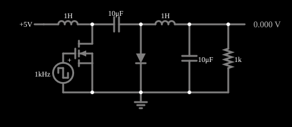

# Conversor Ćuk

<!-- navegacao:inicio -->
[Índice](README.md) · [Anterior: Buck-Boost Converter](conv-buckboost.md) · [Próximo: SEPIC Converter](conv-sepic.md)
<!-- navegacao:fim -->

## Objetivo

Mostrar o conversor Ćuk, que gera uma tensão de saída **negativa**, como o buck-boost, mas com um indutor na entrada e outro na saída, de modo que as correntes de entrada e de saída são contínuas (pouca ondulação). A energia é transferida por um capacitor.

## O circuito

<!-- esquema:inicio -->

<!-- esquema:fim -->

O MOSFET é comandado por uma fonte de onda quadrada de $1\ \text{kHz}$ (período $T = 1\ \text{ms}$) que vai de $0$ a $10\ \text{V}$; o circuito é alimentado com $5\ \text{V}$ e a carga é um resistor de $1\ \text{k}\Omega$ com um capacitor eletrolítico de filtro de $10\ \mu\text{F}$. O circuito tem um indutor de $1\ \text{H}$ na entrada, o MOSFET e o capacitor de acoplamento de $10\ \mu\text{F}$ no meio, um diodo e um segundo indutor de $1\ \text{H}$ na saída. O ciclo de trabalho é $D = 50\%$ (o valor padrão da fonte de onda quadrada, que o arquivo não altera).

<!-- componentes:inicio -->
| N.º | Tipo | Elemento | Valores |
|----:|------|----------|---------|
| 0 | `RailElm` | voltage source | Voltage = 5; Waveform = D/C; DC Offset (V) = 0; Internal Resistance (ohms) = 0 |
| 1 | `InductorElm` | inductor | Inductance (H) = 1; Trapezoidal Approximation = sim; Initial Current (on Reset) (A) = 0; Saturation Current (A) (0=none) = 0 |
| 2 | `CapacitorElm` | capacitor | Capacitance (F) = 10μ; Trapezoidal Approximation = sim; Initial Voltage (on Reset) = 1m; Series Resistance = 0 |
| 3 | `InductorElm` | inductor | Inductance (H) = 1; Trapezoidal Approximation = sim; Initial Current (on Reset) (A) = 0; Saturation Current (A) (0=none) = 0 |
| 4 | `DiodeElm` | diode | Model = default |
| 5 | `NMosfetElm` | MOSFET | Model = default; Swap D/S = não |
| 9 | `GroundElm` | ground | Symbol = Earth |
| 10 | `CapacitorElm` | capacitor | Capacitance (F) = 10μ; Trapezoidal Approximation = sim; Initial Voltage (on Reset) = 1m; Series Resistance = 0 |
| 12 | `ResistorElm` | resistor | Resistance (ohms) = 1k |
| 15 | `OutputElm` | output | Show Voltage = sim; Scale = V; Fixed Precision = sim |
| 16 | `DCVoltageElm` | square wave gen | Max Voltage = 5; Waveform = Square Wave; DC Offset (V) = 5; Internal Resistance (ohms) = 0; Show Voltage = não; Specify As = Frequency/Duty Cycle; Frequency (Hz) = 1k; Phase Offset (degrees) = 0; Duty Cycle = 50; Rise/Fall Time (s) = 0 |
<!-- componentes:fim -->

## Teoria

O capacitor de acoplamento $C_1$ carrega com a chave desligada (por $L_1$, pelo diodo) e descarrega com a chave ligada, enquanto o diodo está cortado. Em regime permanente, a tensão média sobre cada indutor é nula, e a de $C_1$ é $V_{in} + |V_{out}|$. Daí,

$$V_{out} = -\frac{D}{1-D}\,V_{in}.$$

Como $L_1$ está em série com a fonte e $L_2$ em série com a carga, ambas as correntes variam só pela ondulação de cada indutor, o que reduz o ruído de entrada e de saída. Com $D = 0{,}5$, $V_{out} = -V_{in} = -5\ \text{V}$ (ideal).

## Resultados esperados

As tensões do exemplo ainda **derivam devagar** depois de $0{,}1\ \text{s}$ (da ordem de 1% a 5% em $1\ \text{s}$, porque os indutores de $1\ \text{H}$ e o capacitor formam um sistema de resposta lenta); os valores deste documento são os da janela de $0{,}9$ a $1{,}0\ \text{s}$ e servem para comparar com a teoria, que supõe regime permanente.

| Grandeza | Teoria (ideal) | Simulador |
|----------|---------------:|----------:|
| Tensão de saída (média) | $-5{,}00\ \text{V}$ | $-4{,}388\ \text{V}$ ($-4{,}41\ \text{V}$ em $t = 0{,}1\ \text{s}$) |
| Ondulação de tensão | pequena | $31\ \text{mV}$ ($-4{,}404$ a $-4{,}372\ \text{V}$) |

A saída é $12\%$ menor em módulo que a ideal, por causa da queda do diodo e do MOSFET; a ondulação de saída é bem menor que a do boost ou do buck-boost com os mesmos componentes. As verificações conferem a tensão média e os dois extremos (tolerância de 2%).

## O que observar

- A tensão na saída é negativa e quase constante: a ondulação é de apenas alguns milivolts.
- Com $D = 80\%$ o módulo da saída teórica sobe a $20\ \text{V}$; com $D$ perto de $100\%$ ela diverge. Mudanças bruscas do ciclo de trabalho provocam transitórios oscilatórios grandes, porque o circuito é de quarta ordem e pouco amortecido.
- Edite o *Duty Cycle* da fonte de onda quadrada para variar a saída. O ciclo de trabalho é o *Duty Cycle* da fonte de onda quadrada (clique duas vezes na fonte para editar). Nesta versão do arquivo o *slider* "Duty Cycle" do painel lateral está ligado ao campo de **frequência** da fonte, e não ao de ciclo de trabalho (um erro conhecido do exemplo), então a edição direta na fonte é o caminho seguro.

## Limites do modelo

Diodo e MOSFET com os modelos padrão, indutores e capacitores sem resistências em série; as transitórias de mudança de ciclo de trabalho são oscilatórias (quarta ordem), e o exemplo não tem controle em malha fechada. Os valores de $L$, $C$ e $f$ são didáticos.

## Referências

- R. W. Erickson e D. Maksimović, *Fundamentals of Power Electronics*, Springer.
- N. Mohan, T. M. Undeland e W. P. Robbins, *Power Electronics: Converters, Applications, and Design*, Wiley.
- S. Ćuk e R. D. Middlebrook, "A new optimum topology switching DC-to-DC converter", *IEEE PESC Record*, 1977.

O circuito deste exemplo faz parte da coleção do simulador original de Paul Falstad e Iain Sharp (CircuitJS1); a explicação é deste projeto.
