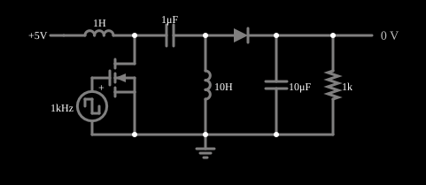

# Conversor SEPIC

<!-- navegacao:inicio -->
[Índice](README.md) · [Anterior: Ćuk Converter](conv-cuk.md)
<!-- navegacao:fim -->

## Objetivo

Mostrar o conversor SEPIC (*single-ended primary-inductor converter*), que produz uma tensão de saída **positiva** que pode ser maior ou menor que a de entrada, com a corrente de entrada contínua. É a alternativa de mesma polaridade ao buck-boost invertido.

## O circuito

<!-- esquema:inicio -->

<!-- esquema:fim -->

O MOSFET é comandado por uma fonte de onda quadrada de $1\ \text{kHz}$ (período $T = 1\ \text{ms}$) que vai de $0$ a $10\ \text{V}$; o circuito é alimentado com $5\ \text{V}$ e a carga é um resistor de $1\ \text{k}\Omega$ com um capacitor eletrolítico de filtro de $10\ \mu\text{F}$. O circuito tem um indutor de $1\ \text{H}$ na entrada, um capacitor de acoplamento de $1\ \mu\text{F}$, um segundo indutor de $10\ \text{H}$ (do nó após o capacitor de acoplamento à terra), um diodo e o capacitor e a carga de saída. O MOSFET está entre o nó do capacitor de acoplamento e a terra. O ciclo de trabalho é $D = 50\%$.

<!-- componentes:inicio -->
| N.º | Tipo | Elemento | Valores |
|----:|------|----------|---------|
| 0 | `RailElm` | voltage source | Voltage = 5; Waveform = D/C; DC Offset (V) = 0; Internal Resistance (ohms) = 0 |
| 1 | `InductorElm` | inductor | Inductance (H) = 1; Trapezoidal Approximation = sim; Initial Current (on Reset) (A) = 0; Saturation Current (A) (0=none) = 0 |
| 2 | `CapacitorElm` | capacitor | Capacitance (F) = 1μ; Trapezoidal Approximation = sim; Initial Voltage (on Reset) = 1m; Series Resistance = 0 |
| 3 | `InductorElm` | inductor | Inductance (H) = 10; Trapezoidal Approximation = sim; Initial Current (on Reset) (A) = 0; Saturation Current (A) (0=none) = 0 |
| 4 | `DiodeElm` | diode | Model = default |
| 5 | `NMosfetElm` | MOSFET | Model = default; Swap D/S = não |
| 9 | `GroundElm` | ground | Symbol = Earth |
| 10 | `CapacitorElm` | capacitor | Capacitance (F) = 10μ; Trapezoidal Approximation = sim; Initial Voltage (on Reset) = 1m; Series Resistance = 0 |
| 12 | `ResistorElm` | resistor | Resistance (ohms) = 1k |
| 15 | `OutputElm` | output | Show Voltage = sim; Scale = Auto |
| 16 | `DCVoltageElm` | square wave gen | Max Voltage = 5; Waveform = Square Wave; DC Offset (V) = 5; Internal Resistance (ohms) = 0; Show Voltage = não; Specify As = Frequency/Duty Cycle; Frequency (Hz) = 1k; Phase Offset (degrees) = 0; Duty Cycle = 50; Rise/Fall Time (s) = 0 |
<!-- componentes:fim -->

## Teoria

Com a chave ligada, o primeiro indutor $L_1$ é carregado pela entrada, e o segundo, $L_2$, pelo capacitor de acoplamento $C_1$; o diodo está cortado e o capacitor de saída alimenta a carga. Com a chave desligada, ambas as correntes passam pelo diodo para a saída e carregam $C_1$ e $C_\text{out}$. A tensão média em $C_1$ é $V_{in}$ e, em regime permanente,

$$V_{out} = \frac{D}{1-D}\,V_{in}.$$

Para $D < 0{,}5$ o conversor abaixa a tensão; para $D > 0{,}5$, eleva; em $D = 0{,}5$ a saída iguala a entrada.

## Resultados esperados

As tensões do exemplo ainda **derivam devagar** depois de $0{,}1\ \text{s}$ (da ordem de 1% a 5% em $1\ \text{s}$, porque os indutores de $1\ \text{H}$ e o capacitor formam um sistema de resposta lenta); os valores deste documento são os da janela de $0{,}9$ a $1{,}0\ \text{s}$ e servem para comparar com a teoria, que supõe regime permanente.

| Grandeza | Teoria (ideal) | Simulador |
|----------|---------------:|----------:|
| Tensão de saída (média) | $5{,}00\ \text{V}$ | $4{,}336\ \text{V}$ ($4{,}55\ \text{V}$ em $t = 0{,}1\ \text{s}$) |
| Ondulação de tensão de saída | pequena | $0{,}22\ \text{V}$ ($4{,}221$ a $4{,}440\ \text{V}$) |

A saída é $13\%$ menor que a ideal pelas quedas do diodo ($0{,}55\ \text{V}$ em $t = 0{,}1\ \text{s}$) e do MOSFET. As verificações conferem a tensão média e os dois extremos (tolerância de 2%).

## O que observar

- A saída é positiva, de mesmo sinal da entrada, e quase igual a ela em módulo: $D = 50\%$ é o ponto em que o SEPIC passa de abaixador a elevador.
- A corrente no indutor de entrada é contínua, o que facilita a filtragem do ruído na fonte.
- O capacitor de acoplamento isola a entrada da saída em corrente contínua: o SEPIC não tem a inversão do buck-boost, mas tem mais componentes. O ciclo de trabalho é o *Duty Cycle* da fonte de onda quadrada (clique duas vezes na fonte para editar). Nesta versão do arquivo o *slider* "Duty Cycle" do painel lateral está ligado ao campo de **frequência** da fonte, e não ao de ciclo de trabalho (um erro conhecido do exemplo), então a edição direta na fonte é o caminho seguro.

## Limites do modelo

Modelos padrão de diodo e MOSFET, sem resistências série nos indutores e capacitores, sem perdas de comutação. Os dois indutores são independentes (não acoplados em um só núcleo, como se faz em muitos SEPICs reais), e os valores são didáticos.

## Referências

- R. W. Erickson e D. Maksimović, *Fundamentals of Power Electronics*, Springer.
- N. Mohan, T. M. Undeland e W. P. Robbins, *Power Electronics: Converters, Applications, and Design*, Wiley.
- M. H. Rashid, *Power Electronics: Circuits, Devices, and Applications*, Pearson.

O circuito deste exemplo faz parte da coleção do simulador original de Paul Falstad e Iain Sharp (CircuitJS1); a explicação é deste projeto.
