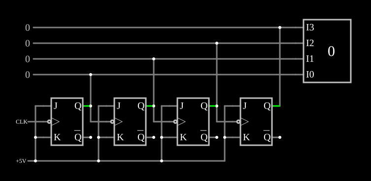

# Contador assíncrono (*ripple*) de 4 bits

<!-- navegacao:inicio -->
[Índice](README.md) · [Próximo: 8-Bit Ripple Counter](counter8.md)
<!-- navegacao:fim -->

## Objetivo

Mostrar o contador binário mais simples: flip-flops JK em modo de inversão, cada um acionado pela saída do anterior, contam de $0$ a $15$.

## O circuito

<!-- esquema:inicio -->

<!-- esquema:fim -->

Quatro flip-flops JK disparados pela borda de descida, com $J = K = 1$ (ligados a $5\ \text{V}$). O primeiro recebe o relógio, uma onda quadrada de $200\ \text{Hz}$; cada um dos seguintes recebe como relógio a saída $Q$ do anterior. As quatro saídas vão a saídas lógicas numéricas (elementos 38 a 35, do bit menos ao mais significativo) e a um mostrador decimal (elemento 39).

<!-- componentes:inicio -->
| N.º | Tipo | Elemento | Valores |
|----:|------|----------|---------|
| 0 | `JKFlipFlopElm` | JK flip-flop | High Logic Voltage = 5; Reset Pin = não; Positive Edge Triggered = não; Invert Reset = não |
| 1 | `JKFlipFlopElm` | JK flip-flop | High Logic Voltage = 5; Reset Pin = não; Positive Edge Triggered = não; Invert Reset = não |
| 2 | `JKFlipFlopElm` | JK flip-flop | High Logic Voltage = 5; Reset Pin = não; Positive Edge Triggered = não; Invert Reset = não |
| 3 | `JKFlipFlopElm` | JK flip-flop | High Logic Voltage = 5; Reset Pin = não; Positive Edge Triggered = não; Invert Reset = não |
| 29 | `RailElm` | square wave gen | Max Voltage = 2.5; Waveform = Square Wave; DC Offset (V) = 2.5; Internal Resistance (ohms) = 0; Show Voltage = não; Specify As = Frequency/Duty Cycle; Frequency (Hz) = 200; Phase Offset (degrees) = 0; Duty Cycle = 50; Rise/Fall Time (s) = 0 |
| 30 | `RailElm` | voltage source | Voltage = 5; Waveform = D/C; DC Offset (V) = 0; Internal Resistance (ohms) = 0 |
| 35 | `LogicOutputElm` | logic output | Threshold = 2.5; Current Required = não; Numeric = sim; Ternary = não |
| 36 | `LogicOutputElm` | logic output | Threshold = 2.5; Current Required = não; Numeric = sim; Ternary = não |
| 37 | `LogicOutputElm` | logic output | Threshold = 2.5; Current Required = não; Numeric = sim; Ternary = não |
| 38 | `LogicOutputElm` | logic output | Threshold = 2.5; Current Required = não; Numeric = sim; Ternary = não |
| 39 | `DecimalDisplayElm` | decimal display | High Logic Voltage = 5; Bit Order = MSB First; # of Bits = 4; Display Mode = Decimal |
<!-- componentes:fim -->

## Teoria

Com $J = K = 1$, cada [flip-flop JK](jkff.md) inverte a saída a cada borda de descida da sua entrada de relógio: divide a frequência por $2$. O bit $Q_0$ inverte a cada borda de descida do relógio; $Q_1$ inverte quando $Q_0$ desce de $1$ para $0$, isto é, quando o bit anterior "dá a volta" — exatamente a regra do vai-um da contagem binária. Com quatro estágios, a contagem vai de $0$ a $2^4 - 1 = 15$ e recomeça, e o bit $Q_k$ tem frequência $f/2^{k+1}$.

O defeito deste contador é que a mudança se propaga em **cascata** (*ripple*): na passagem de $7$ ($0111$) para $8$ ($1000$), cada flip-flop só muda depois do anterior, e por alguns instantes a saída passa por valores intermediários errados. O atraso total cresce com o número de bits. O [Synchronous Counter](synccounter.md) evita isso.

## Resultados esperados

As bordas de descida do relógio ocorrem em $2{,}5$, $7{,}5$, $12{,}5\ \text{ms}$, …; a contagem avança uma unidade em cada uma. O simulador mostra $15$ em $t = 1\ \text{ms}$ (o estado inicial dos flip-flops), $0$ em $4\ \text{ms}$, $8$ em $46{,}5\ \text{ms}$ e $15$ em $81{,}5\ \text{ms}$; um ciclo completo dura $16 \times 5 = 80\ \text{ms}$. As verificações conferem bits do mostrador nesses instantes.

## O que observar

Acompanhe nos osciloscópios as quatro saídas, cada uma com metade da frequência da anterior.

## Limites do modelo

- Os flip-flops não têm atraso de propagação, de modo que os estados intermediários da cascata não aparecem; num 7493 real eles duram dezenas de nanossegundos por estágio.

## Referências

Mano e Ciletti, *Digital Design*, capítulo sobre registradores e contadores; Texas Instruments, folha de dados do SN7493.

O circuito deste exemplo faz parte da coleção do simulador original de Paul Falstad e Iain Sharp (CircuitJS1); a explicação é deste projeto.
