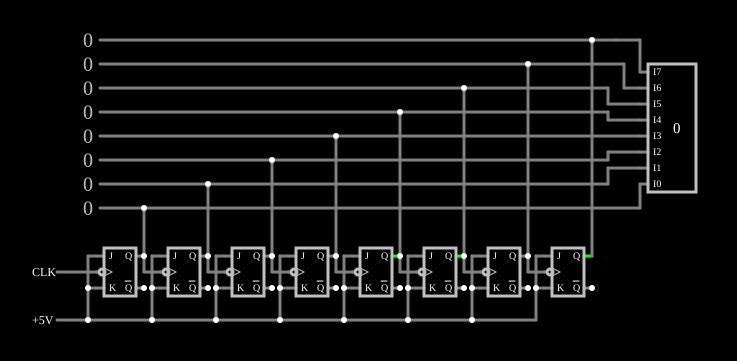

# Contador assíncrono de 8 bits

<!-- navegacao:inicio -->
[Índice](README.md) · [Anterior: 4-Bit Ripple Counter](counter.md) · [Próximo: Synchronous Counter](synccounter.md)
<!-- navegacao:fim -->

## Objetivo

Mostrar o mesmo contador em cascata do [4-Bit Ripple Counter](counter.md) com oito estágios: de $0$ a $255$, com cada bit dividindo a frequência do anterior por $2$.

## O circuito

<!-- esquema:inicio -->

<!-- esquema:fim -->

Oito flip-flops JK disparados pela borda de descida, com $J = K = 1$, em cascata (o relógio de cada um é a saída $Q$ do anterior). O primeiro recebe um relógio de $1\ \text{kHz}$. As oito saídas vão a saídas lógicas (elementos 62 a 68 e 78, do bit menos ao mais significativo) e a um mostrador decimal de 8 bits (elemento 79). O exemplo abre com os flip-flops no estado $176$.

<!-- componentes:inicio -->
| N.º | Tipo | Elemento | Valores |
|----:|------|----------|---------|
| 0 | `JKFlipFlopElm` | JK flip-flop | High Logic Voltage = 5; Reset Pin = não; Positive Edge Triggered = não; Invert Reset = não |
| 1 | `JKFlipFlopElm` | JK flip-flop | High Logic Voltage = 5; Reset Pin = não; Positive Edge Triggered = não; Invert Reset = não |
| 7 | `JKFlipFlopElm` | JK flip-flop | High Logic Voltage = 5; Reset Pin = não; Positive Edge Triggered = não; Invert Reset = não |
| 8 | `JKFlipFlopElm` | JK flip-flop | High Logic Voltage = 5; Reset Pin = não; Positive Edge Triggered = não; Invert Reset = não |
| 9 | `JKFlipFlopElm` | JK flip-flop | High Logic Voltage = 5; Reset Pin = não; Positive Edge Triggered = não; Invert Reset = não |
| 10 | `JKFlipFlopElm` | JK flip-flop | High Logic Voltage = 5; Reset Pin = não; Positive Edge Triggered = não; Invert Reset = não |
| 11 | `JKFlipFlopElm` | JK flip-flop | High Logic Voltage = 5; Reset Pin = não; Positive Edge Triggered = não; Invert Reset = não |
| 48 | `RailElm` | square wave gen | Max Voltage = 2.5; Waveform = Square Wave; DC Offset (V) = 2.5; Internal Resistance (ohms) = 0; Show Voltage = não; Specify As = Frequency/Duty Cycle; Frequency (Hz) = 1k; Phase Offset (degrees) = 0; Duty Cycle = 50; Rise/Fall Time (s) = 0 |
| 54 | `RailElm` | voltage source | Voltage = 5; Waveform = D/C; DC Offset (V) = 0; Internal Resistance (ohms) = 0 |
| 62 | `LogicOutputElm` | logic output | Threshold = 2.5; Current Required = não; Numeric = sim; Ternary = não |
| 63 | `LogicOutputElm` | logic output | Threshold = 2.5; Current Required = não; Numeric = sim; Ternary = não |
| 64 | `LogicOutputElm` | logic output | Threshold = 2.5; Current Required = não; Numeric = sim; Ternary = não |
| 65 | `LogicOutputElm` | logic output | Threshold = 2.5; Current Required = não; Numeric = sim; Ternary = não |
| 66 | `LogicOutputElm` | logic output | Threshold = 2.5; Current Required = não; Numeric = sim; Ternary = não |
| 67 | `LogicOutputElm` | logic output | Threshold = 2.5; Current Required = não; Numeric = sim; Ternary = não |
| 68 | `LogicOutputElm` | logic output | Threshold = 2.5; Current Required = não; Numeric = sim; Ternary = não |
| 73 | `JKFlipFlopElm` | JK flip-flop | High Logic Voltage = 5; Reset Pin = não; Positive Edge Triggered = não; Invert Reset = não |
| 78 | `LogicOutputElm` | logic output | Threshold = 2.5; Current Required = não; Numeric = sim; Ternary = não |
| 79 | `DecimalDisplayElm` | decimal display | High Logic Voltage = 5; Bit Order = MSB First; # of Bits = 8; Display Mode = Decimal |
<!-- componentes:fim -->

## Teoria

Cada estágio divide por $2$, e o bit $Q_k$ tem frequência $f_{clk}/2^{k+1}$: de $500\ \text{Hz}$ no bit $0$ a $f_{clk}/256 \approx 3{,}9\ \text{Hz}$ no bit $7$. A contagem completa dura $256$ períodos do relógio, $256\ \text{ms}$. O atraso de cascata cresce com o número de estágios, o que limita a frequência máxima de um contador assíncrono longo; em contrapartida, o circuito é o mais simples possível e só o primeiro estágio trabalha na frequência do relógio, o que economiza energia.

## Resultados esperados

O simulador mostra $176$ ($10110000$) logo no início, $177$ depois da primeira borda de descida ($0{,}5\ \text{ms}$), $186$ em $10{,}1\ \text{ms}$, $20$ em $100{,}1\ \text{ms}$ (a contagem passou por $255$ e recomeçou) e $175$ em $255{,}1\ \text{ms}$, fechando o ciclo de $256\ \text{ms}$. O bit $0$ tem frequência de $500\ \text{Hz}$.

## O que observar

Os osciloscópios mostram os oito bits; repare que a cada bit o período dobra.

## Limites do modelo

- Sem atrasos de propagação, os estados transitórios da cascata não aparecem.

## Referências

Mano e Ciletti, *Digital Design*, capítulo sobre contadores; Wakerly, *Digital Design: Principles and Practices*, capítulo sobre contadores.

O circuito deste exemplo faz parte da coleção do simulador original de Paul Falstad e Iain Sharp (CircuitJS1); a explicação é deste projeto.
