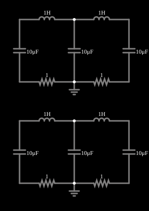

# Modos de LC acoplados (2)

<!-- navegacao:inicio -->
[Índice](README.md) · [Próximo: Weak Coupling](coupled2.md)
<!-- navegacao:fim -->

## Objetivo

Mostrar os modos normais de dois circuitos ressonantes acoplados: um sistema de dois graus de liberdade só oscila em frequência única quando excitado de um modo particular, e as duas frequências dos modos são diferentes.

## O circuito

<!-- esquema:inicio -->

<!-- esquema:fim -->

Há duas cópias do mesmo circuito, uma sobre a outra. Cada uma é uma cadeia de dois indutores de $1\ \text{H}$ em série, com capacitores de $10\ \mu\text{F}$ ligados a cada um dos três nós e, por baixo, resistores de $1\ \Omega$ entre os capacitores. Cada cópia forma duas malhas que **compartilham o capacitor do meio**, que é o acoplamento entre as malhas. As cópias diferem só pelas tensões iniciais dos capacitores: $(5, 0, 5)\ \text{V}$ na de baixo e $(5, 0, -5)\ \text{V}$ na de cima.

<!-- componentes:inicio -->
| N.º | Tipo | Elemento | Valores |
|----:|------|----------|---------|
| 0 | `InductorElm` | inductor | Inductance (H) = 1; Trapezoidal Approximation = sim; Initial Current (on Reset) (A) = 0; Saturation Current (A) (0=none) = 0 |
| 1 | `InductorElm` | inductor | Inductance (H) = 1; Trapezoidal Approximation = sim; Initial Current (on Reset) (A) = 0; Saturation Current (A) (0=none) = 0 |
| 2 | `CapacitorElm` | capacitor | Capacitance (F) = 10μ; Trapezoidal Approximation = sim; Initial Voltage (on Reset) = 5; Series Resistance = 0 |
| 3 | `CapacitorElm` | capacitor | Capacitance (F) = 10μ; Trapezoidal Approximation = sim; Initial Voltage (on Reset) = 1m; Series Resistance = 0 |
| 4 | `CapacitorElm` | capacitor | Capacitance (F) = 10μ; Trapezoidal Approximation = sim; Initial Voltage (on Reset) = 5; Series Resistance = 0 |
| 5 | `ResistorElm` | resistor | Resistance (ohms) = 1 |
| 6 | `ResistorElm` | resistor | Resistance (ohms) = 1 |
| 7 | `GroundElm` | ground | Symbol = Earth |
| 8 | `InductorElm` | inductor | Inductance (H) = 1; Trapezoidal Approximation = sim; Initial Current (on Reset) (A) = 0; Saturation Current (A) (0=none) = 0 |
| 9 | `InductorElm` | inductor | Inductance (H) = 1; Trapezoidal Approximation = sim; Initial Current (on Reset) (A) = 0; Saturation Current (A) (0=none) = 0 |
| 10 | `CapacitorElm` | capacitor | Capacitance (F) = 10μ; Trapezoidal Approximation = sim; Initial Voltage (on Reset) = 5; Series Resistance = 0 |
| 11 | `CapacitorElm` | capacitor | Capacitance (F) = 10μ; Trapezoidal Approximation = sim; Initial Voltage (on Reset) = 1m; Series Resistance = 0 |
| 12 | `CapacitorElm` | capacitor | Capacitance (F) = 10μ; Trapezoidal Approximation = sim; Initial Voltage (on Reset) = -5; Series Resistance = 0 |
| 13 | `ResistorElm` | resistor | Resistance (ohms) = 1 |
| 14 | `ResistorElm` | resistor | Resistance (ohms) = 1 |
| 15 | `GroundElm` | ground | Symbol = Earth |
<!-- componentes:fim -->

## Teoria

Se cada malha tem indutância $L$ e os capacitores são todos iguais a $C$, as correntes de malha $i_1$ e $i_2$ obedecem a

$$L\,\ddot q_1 = -\frac{2q_1 - q_2}{C},\qquad L\,\ddot q_2 = -\frac{2q_2 - q_1}{C},$$

(com os amortecimentos pequenos de $1\ \Omega$ desprezados), em que $q_k$ é a carga que passou pela malha $k$. Procurando soluções $q_k \propto e^{j\omega t}$, os modos normais são os autovetores da matriz $\begin{pmatrix}2 & -1\\ -1 & 2\end{pmatrix}$ de autovalores $\lambda$ e frequências

$$\omega_k = \omega_0\sqrt{\lambda_k},\qquad \omega_0 = \frac{1}{\sqrt{LC}} = 316{,}2\ \text{rad/s}:$$

- **modo em fase**, $\lambda = 1$: as duas correntes de malha são iguais e a corrente no capacitor do meio se anula; $f = \omega_0/2\pi = 50{,}33\ \text{Hz}$;
- **modo em oposição**, $\lambda = 3$: as correntes são opostas e o capacitor do meio recebe o dobro; $f = \sqrt{3}\,\omega_0/2\pi = 87{,}17\ \text{Hz}$.

Para $N$ malhas acopladas em cadeia, $\lambda_k = 2 - 2\cos\dfrac{k\pi}{N+1}$, $k = 1,\dots,N$.

## Resultados esperados

A cópia de cima, com tensões iniciais $(5, 0, -5)\ \text{V}$, excita só o modo em fase: o capacitor do meio fica em repouso ($0\ \text{V}$) e os dois outros oscilam com tensão oposta à frequência de $50{,}33\ \text{Hz}$ ($\pm 4{,}657\ \text{V}$ em $t = 0{,}1\ \text{s}$). A cópia de baixo, com $(5, 0, 5)\ \text{V}$, excita só o modo em oposição, a $87{,}17\ \text{Hz}$, e o capacitor do meio chega a ser carregado ($3{,}985\ \text{V}$ em $0{,}1\ \text{s}$). As verificações conferem as duas frequências (tolerância de 2%) e quatro tensões em $t = 0{,}1\ \text{s}$ (cálculo independente do circuito por integração numérica, a menos de 0,1% do simulador).

## O que observar

- Veja as duas cópias oscilarem com frequências diferentes, cada uma com forma pura (uma só frequência).
- Num sistema acoplado, uma condição inicial qualquer é uma mistura dos modos e produz batimentos (veja "Acoplamento fraco").
- Mude o capacitor do meio (duplo clique): as frequências dos modos se afastam ou se aproximam.

## Limites do modelo

A estimativa de frequências despreza os resistores de $1\ \Omega$ (que causam um amortecimento lento: $\alpha = R/2L = 0{,}5\ \text{s}^{-1}$, de modo que a amplitude cai menos de 5% em $0{,}1\ \text{s}$) e supõe componentes ideais. Os modos aqui descritos são os de um sistema linear; um sistema real tem, por exemplo, não linearidades no ferro dos indutores.

## Referências

- J. W. Nilsson e S. A. Riedel, *Circuitos Elétricos*, Pearson.
- C. K. Alexander e M. N. O. Sadiku, *Fundamentos de Circuitos Elétricos*, AMGH.

O circuito deste exemplo faz parte da coleção do simulador original de Paul Falstad e Iain Sharp (CircuitJS1); a explicação é deste projeto.
