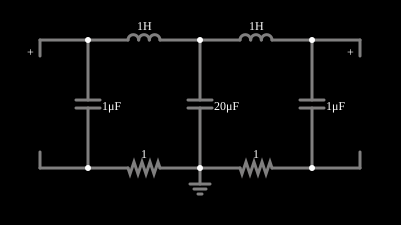

# Acoplamento fraco

<!-- navegacao:inicio -->
[Índice](README.md) · [Anterior: LC Modes (2)](coupled1.md) · [Próximo: LC Modes (3)](coupled3.md)
<!-- navegacao:fim -->

## Objetivo

Mostrar o que acontece quando dois circuitos ressonantes iguais são acoplados fracamente: eles trocam energia lentamente, e as amplitudes de cada um sobem e descem em batimentos.

## O circuito

<!-- esquema:inicio -->

<!-- esquema:fim -->

Duas malhas LC, cada uma com um indutor de $1\ \text{H}$ e um capacitor de $1\ \mu\text{F}$, compartilham um capacitor central **grande**, de $20\ \mu\text{F}$ (que é o acoplamento; um capacitor grande tem pouca reatância e, por isso, acopla pouco as duas malhas). Resistores de $1\ \Omega$ fecham as malhas. As tensões iniciais dos capacitores são as do instante em que o exemplo foi salvo. Duas sondas e três osciloscópios mostram as tensões.

<!-- componentes:inicio -->
| N.º | Tipo | Elemento | Valores |
|----:|------|----------|---------|
| 0 | `InductorElm` | inductor | Inductance (H) = 1; Trapezoidal Approximation = sim; Initial Current (on Reset) (A) = 0; Saturation Current (A) (0=none) = 0 |
| 1 | `InductorElm` | inductor | Inductance (H) = 1; Trapezoidal Approximation = sim; Initial Current (on Reset) (A) = 0; Saturation Current (A) (0=none) = 0 |
| 2 | `CapacitorElm` | capacitor | Capacitance (F) = 1μ; Trapezoidal Approximation = sim; Initial Voltage (on Reset) = 720.1m; Series Resistance = 0 |
| 3 | `CapacitorElm` | capacitor | Capacitance (F) = 20μ; Trapezoidal Approximation = sim; Initial Voltage (on Reset) = 289.4m; Series Resistance = 0 |
| 4 | `CapacitorElm` | capacitor | Capacitance (F) = 1μ; Trapezoidal Approximation = sim; Initial Voltage (on Reset) = -1.5; Series Resistance = 0 |
| 5 | `ResistorElm` | resistor | Resistance (ohms) = 1 |
| 6 | `ResistorElm` | resistor | Resistance (ohms) = 1 |
| 7 | `GroundElm` | ground | Symbol = Earth |
| 10 | `ProbeElm` | voltmeter | Show Voltage = não; Value = Voltage; Scale = Auto; Use Circle Symbol = não; Series Resistance (0 = infinite) = 0 |
| 13 | `ProbeElm` | voltmeter | Show Voltage = não; Value = Voltage; Scale = Auto; Use Circle Symbol = não; Series Resistance (0 = infinite) = 0 |
<!-- componentes:fim -->

## Teoria

Com $C_1 = 1\ \mu\text{F}$ nos extremos e $C_2 = 20\ \mu\text{F}$ no meio, as duas malhas têm o mesmo $\omega_1 = 1/\sqrt{LC_1} = 1000\ \text{rad/s}$, e o capacitor compartilhado as acopla. Os dois modos normais são:

- **em fase** (correntes iguais, nenhuma corrente em $C_2$): $\omega_a = \dfrac{1}{\sqrt{LC_1}} = 1000\ \text{rad/s}$, $f_a = 159{,}15\ \text{Hz}$;
- **em oposição** (correntes opostas): $\omega_b = \sqrt{\dfrac{1}{L}\left(\dfrac{1}{C_1} + \dfrac{2}{C_2}\right)} = 1048{,}8\ \text{rad/s}$, $f_b = 166{,}92\ \text{Hz}$.

Uma condição inicial que excita só uma das malhas é a soma dos dois modos, e a soma de duas senoides de frequências próximas é um **batimento**: oscilação à frequência média, com envoltória que varia à frequência da diferença,

$$f_{bat} = f_b - f_a = 7{,}77\ \text{Hz}\quad (T_{bat} \approx 0{,}129\ \text{s}).$$

A energia passa de uma malha para a outra a cada meio período de batimento. Quanto mais fraco o acoplamento (capacitor central maior), mais próximas as duas frequências e mais lenta a troca.

## Resultados esperados

Os modos puros são conferidos pelo capacitor do meio, que só participa do modo em oposição: sua frequência é $166{,}92\ \text{Hz}$ (teoria $166{,}92$, simulador $166{,}92$), enquanto os capacitores dos extremos, dominados pelo modo em fase (de $159{,}15\ \text{Hz}$), oscilam a $158{,}99\ \text{Hz}$ (frequência média lida pelos cruzamentos por zero de um sinal com batimento). As tensões em $t = 0{,}1\ \text{s}$ ($0{,}299\ \text{V}$ no capacitor do meio e $-1{,}048\ \text{V}$ no de um extremo) e em $0{,}25\ \text{s}$ ($-1{,}012\ \text{V}$ no outro extremo) vêm de uma integração numérica independente, a menos de 0,4% do simulador. As verificações usam tolerâncias de 1% (frequências) e 2% (tensões).

## O que observar

- Veja as envoltórias dos osciloscópios: a amplitude de uma malha cai enquanto a da outra sobe, e depois o contrário.
- Reduza o capacitor central (aumentando o acoplamento): as duas frequências se afastam e os batimentos aceleram.
- Compare com o exemplo "Modos de LC (2)", em que o acoplamento é forte ($C_2 = C_1$) e as frequências dos modos são bem diferentes.

## Limites do modelo

Componentes lineares ideais; os resistores de $1\ \Omega$ amortecem as oscilações lentamente. A frequência lida pelo simulador (zero-crossing médio) de um sinal com batimento é só a frequência média; os extremos de cada trecho não são exatamente os da teoria.

## Referências

- J. W. Nilsson e S. A. Riedel, *Circuitos Elétricos*, Pearson.
- C. K. Alexander e M. N. O. Sadiku, *Fundamentos de Circuitos Elétricos*, AMGH.

O circuito deste exemplo faz parte da coleção do simulador original de Paul Falstad e Iain Sharp (CircuitJS1); a explicação é deste projeto.
