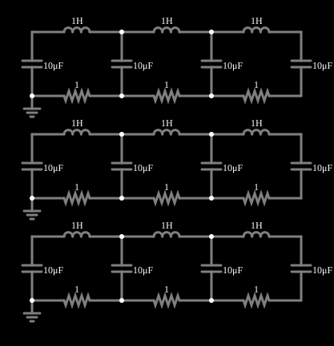

# Modos de LC acoplados (3)

<!-- navegacao:inicio -->
[Índice](README.md) · [Anterior: Weak Coupling](coupled2.md) · [Próximo: LC Ladder](ladder.md)
<!-- navegacao:fim -->

## Objetivo

Estender o exemplo anterior a três malhas acopladas: um sistema com três modos normais, cada um com sua frequência e sua forma, mostrados por três cópias do circuito excitadas em modos diferentes.

## O circuito

<!-- esquema:inicio -->

<!-- esquema:fim -->

Três cópias, uma sobre a outra, de uma cadeia de três indutores de $1\ \text{H}$ em série com quatro capacitores de $10\ \mu\text{F}$ (e resistores de $1\ \Omega$ entre eles), formando três malhas acopladas pelos capacitores compartilhados. As tensões iniciais dos capacitores são diferentes em cada cópia, e cada uma foi escolhida para excitar um só modo.

<!-- componentes:inicio -->
| N.º | Tipo | Elemento | Valores |
|----:|------|----------|---------|
| 0 | `InductorElm` | inductor | Inductance (H) = 1; Trapezoidal Approximation = sim; Initial Current (on Reset) (A) = 0; Saturation Current (A) (0=none) = 0 |
| 1 | `InductorElm` | inductor | Inductance (H) = 1; Trapezoidal Approximation = sim; Initial Current (on Reset) (A) = 0; Saturation Current (A) (0=none) = 0 |
| 2 | `CapacitorElm` | capacitor | Capacitance (F) = 10μ; Trapezoidal Approximation = sim; Initial Voltage (on Reset) = -1.5; Series Resistance = 0 |
| 3 | `CapacitorElm` | capacitor | Capacitance (F) = 10μ; Trapezoidal Approximation = sim; Initial Voltage (on Reset) = -622.6m; Series Resistance = 0 |
| 4 | `CapacitorElm` | capacitor | Capacitance (F) = 10μ; Trapezoidal Approximation = sim; Initial Voltage (on Reset) = 622.6m; Series Resistance = 0 |
| 5 | `ResistorElm` | resistor | Resistance (ohms) = 1 |
| 6 | `ResistorElm` | resistor | Resistance (ohms) = 1 |
| 7 | `InductorElm` | inductor | Inductance (H) = 1; Trapezoidal Approximation = sim; Initial Current (on Reset) (A) = 0; Saturation Current (A) (0=none) = 0 |
| 8 | `CapacitorElm` | capacitor | Capacitance (F) = 10μ; Trapezoidal Approximation = sim; Initial Voltage (on Reset) = 1.5; Series Resistance = 0 |
| 9 | `ResistorElm` | resistor | Resistance (ohms) = 1 |
| 10 | `GroundElm` | ground | Symbol = Earth |
| 11 | `InductorElm` | inductor | Inductance (H) = 1; Trapezoidal Approximation = sim; Initial Current (on Reset) (A) = 0; Saturation Current (A) (0=none) = 0 |
| 12 | `InductorElm` | inductor | Inductance (H) = 1; Trapezoidal Approximation = sim; Initial Current (on Reset) (A) = 0; Saturation Current (A) (0=none) = 0 |
| 13 | `CapacitorElm` | capacitor | Capacitance (F) = 10μ; Trapezoidal Approximation = sim; Initial Voltage (on Reset) = -3.2; Series Resistance = 0 |
| 14 | `CapacitorElm` | capacitor | Capacitance (F) = 10μ; Trapezoidal Approximation = sim; Initial Voltage (on Reset) = 3.2; Series Resistance = 0 |
| 15 | `CapacitorElm` | capacitor | Capacitance (F) = 10μ; Trapezoidal Approximation = sim; Initial Voltage (on Reset) = 3.2; Series Resistance = 0 |
| 16 | `ResistorElm` | resistor | Resistance (ohms) = 1 |
| 17 | `ResistorElm` | resistor | Resistance (ohms) = 1 |
| 18 | `InductorElm` | inductor | Inductance (H) = 1; Trapezoidal Approximation = sim; Initial Current (on Reset) (A) = 0; Saturation Current (A) (0=none) = 0 |
| 19 | `CapacitorElm` | capacitor | Capacitance (F) = 10μ; Trapezoidal Approximation = sim; Initial Voltage (on Reset) = -3.2; Series Resistance = 0 |
| 20 | `ResistorElm` | resistor | Resistance (ohms) = 1 |
| 21 | `GroundElm` | ground | Symbol = Earth |
| 22 | `InductorElm` | inductor | Inductance (H) = 1; Trapezoidal Approximation = sim; Initial Current (on Reset) (A) = 0; Saturation Current (A) (0=none) = 0 |
| 23 | `InductorElm` | inductor | Inductance (H) = 1; Trapezoidal Approximation = sim; Initial Current (on Reset) (A) = 0; Saturation Current (A) (0=none) = 0 |
| 24 | `CapacitorElm` | capacitor | Capacitance (F) = 10μ; Trapezoidal Approximation = sim; Initial Voltage (on Reset) = 950.5m; Series Resistance = 0 |
| 25 | `CapacitorElm` | capacitor | Capacitance (F) = 10μ; Trapezoidal Approximation = sim; Initial Voltage (on Reset) = -2.3; Series Resistance = 0 |
| 26 | `CapacitorElm` | capacitor | Capacitance (F) = 10μ; Trapezoidal Approximation = sim; Initial Voltage (on Reset) = 2.3; Series Resistance = 0 |
| 27 | `ResistorElm` | resistor | Resistance (ohms) = 1 |
| 28 | `ResistorElm` | resistor | Resistance (ohms) = 1 |
| 29 | `InductorElm` | inductor | Inductance (H) = 1; Trapezoidal Approximation = sim; Initial Current (on Reset) (A) = 0; Saturation Current (A) (0=none) = 0 |
| 30 | `CapacitorElm` | capacitor | Capacitance (F) = 10μ; Trapezoidal Approximation = sim; Initial Voltage (on Reset) = -950.5m; Series Resistance = 0 |
| 31 | `ResistorElm` | resistor | Resistance (ohms) = 1 |
| 32 | `GroundElm` | ground | Symbol = Earth |
<!-- componentes:fim -->

## Teoria

Para $N$ malhas LC iguais acopladas em cadeia, as frequências dos modos normais são

$$\omega_k = \omega_0\sqrt{2 - 2\cos\frac{k\pi}{N+1}},\qquad \omega_0 = \frac{1}{\sqrt{LC}},\quad k = 1,\dots,N,$$

e as formas dos modos (as correntes de cada malha) são $a_{k,m} \propto \sin\dfrac{km\pi}{N+1}$. Para $N = 3$ e $\omega_0 = 316{,}2\ \text{rad/s}$ ($\omega_0/2\pi = 50{,}33\ \text{Hz}$):

| modo | $\lambda = 2 - 2\cos\frac{k\pi}{4}$ | $f$ | forma das correntes de malha |
|:----:|:--------:|----:|:---------------------------|
| 1 | $2 - \sqrt2 = 0{,}586$ | $38{,}52\ \text{Hz}$ | $(1,\ \sqrt2,\ 1)$, todas em fase |
| 2 | $2$ | $71{,}18\ \text{Hz}$ | $(1,\ 0,\ -1)$ |
| 3 | $2 + \sqrt2 = 3{,}414$ | $93{,}00\ \text{Hz}$ | $(1,\ -\sqrt2,\ 1)$ |

Quanto maior o número de nós da forma modal, maior a frequência: é a mesma estrutura das ondas estacionárias numa corda com extremos fixos.

## Resultados esperados

Cada cópia do circuito foi iniciada com as tensões de um modo, de modo que a de cima oscila à frequência $38{,}52\ \text{Hz}$ (modo 1), a do meio a $71{,}18\ \text{Hz}$ (modo 2) e a de baixo a $93{,}00\ \text{Hz}$ (modo 3), em acordo com a fórmula acima. As verificações conferem as três frequências (tolerância de 1%; o simulador fica a menos de 0,01% da integração independente) e uma tensão de cada cópia em $t = 0{,}1\ \text{s}$ ($-4{,}162\ \text{V}$, $-4{,}353\ \text{V}$ e $+4{,}261\ \text{V}$, tolerância de 2%).

## O que observar

- Veja as três cópias oscilando com frequências diferentes e sem batimento (cada uma é um só modo).
- Compare as formas das tensões nos capacitores de cada cópia: o modo 2 tem um capacitor sempre em repouso (um "nó" do modo).
- Mude uma tensão inicial: a cópia passa a ter mais de um modo e aparece batimento.

## Limites do modelo

Componentes lineares ideais, com resistores de $1\ \Omega$ que amortecem lentamente.

## Referências

- J. W. Nilsson e S. A. Riedel, *Circuitos Elétricos*, Pearson.
- C. K. Alexander e M. N. O. Sadiku, *Fundamentos de Circuitos Elétricos*, AMGH.

O circuito deste exemplo faz parte da coleção do simulador original de Paul Falstad e Iain Sharp (CircuitJS1); a explicação é deste projeto.
