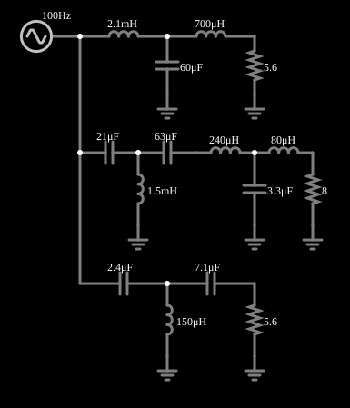

# Divisor de frequências (crossover) de três vias

<!-- navegacao:inicio -->
[Índice](README.md) · [Anterior: Twin-T Filter](twint.md) · [Próximo: Butterworth Low-Pass (10 pole)](butter10lo.md)
<!-- navegacao:fim -->

## Objetivo

Mostrar como um "crossover" de caixa acústica separa o sinal em três faixas: graves, médios e agudos, cada uma enviada ao alto-falante apropriado.

## O circuito

<!-- esquema:inicio -->

<!-- esquema:fim -->

Um mesmo sinal de teste (varredura de 100 Hz a 20 kHz em 0,25 s, 5 V de pico) alimenta três filtros LC: um **passa-baixas** (indutor em série, capacitor em derivação, carga de $5{,}6\ \Omega$: o *woofer*), um **passa-faixa** (carga de $8\ \Omega$: o *midrange*) e um **passa-altas** (capacitores em série, indutores em derivação, carga de $5{,}6\ \Omega$: o *tweeter*). Três osciloscópios mostram as tensões nas três cargas.

<!-- componentes:inicio -->
| N.º | Tipo | Elemento | Valores |
|----:|------|----------|---------|
| 0 | `SweepElm` | sweep (log) | Min Frequency (Hz) = 100; Max Frequency (Hz) = 20k; Sweep Time (s) = 250m; Logarithmic = sim; Max Voltage = 5; Bidirectional = sim |
| 1 | `InductorElm` | inductor | Inductance (H) = 2.1m; Trapezoidal Approximation = sim; Initial Current (on Reset) (A) = 0; Saturation Current (A) (0=none) = 0 |
| 2 | `CapacitorElm` | capacitor | Capacitance (F) = 60μ; Trapezoidal Approximation = sim; Initial Voltage (on Reset) = 1m; Series Resistance = 0 |
| 3 | `InductorElm` | inductor | Inductance (H) = 700μ; Trapezoidal Approximation = sim; Initial Current (on Reset) (A) = 0; Saturation Current (A) (0=none) = 0 |
| 4 | `ResistorElm` | resistor | Resistance (ohms) = 5.6 |
| 5 | `GroundElm` | ground | Symbol = Earth |
| 6 | `GroundElm` | ground | Symbol = Earth |
| 8 | `CapacitorElm` | capacitor | Capacitance (F) = 21μ; Trapezoidal Approximation = sim; Initial Voltage (on Reset) = 1m; Series Resistance = 0 |
| 9 | `CapacitorElm` | capacitor | Capacitance (F) = 63μ; Trapezoidal Approximation = sim; Initial Voltage (on Reset) = 1m; Series Resistance = 0 |
| 10 | `InductorElm` | inductor | Inductance (H) = 240μ; Trapezoidal Approximation = sim; Initial Current (on Reset) (A) = 0; Saturation Current (A) (0=none) = 0 |
| 11 | `InductorElm` | inductor | Inductance (H) = 80μ; Trapezoidal Approximation = sim; Initial Current (on Reset) (A) = 0; Saturation Current (A) (0=none) = 0 |
| 12 | `InductorElm` | inductor | Inductance (H) = 1.5m; Trapezoidal Approximation = sim; Initial Current (on Reset) (A) = 0; Saturation Current (A) (0=none) = 0 |
| 13 | `CapacitorElm` | capacitor | Capacitance (F) = 3.3μ; Trapezoidal Approximation = sim; Initial Voltage (on Reset) = 1m; Series Resistance = 0 |
| 14 | `ResistorElm` | resistor | Resistance (ohms) = 8 |
| 15 | `GroundElm` | ground | Symbol = Earth |
| 16 | `GroundElm` | ground | Symbol = Earth |
| 17 | `GroundElm` | ground | Symbol = Earth |
| 19 | `CapacitorElm` | capacitor | Capacitance (F) = 2.4μ; Trapezoidal Approximation = sim; Initial Voltage (on Reset) = 1m; Series Resistance = 0 |
| 20 | `CapacitorElm` | capacitor | Capacitance (F) = 7.1μ; Trapezoidal Approximation = sim; Initial Voltage (on Reset) = 1m; Series Resistance = 0 |
| 21 | `InductorElm` | inductor | Inductance (H) = 150μ; Trapezoidal Approximation = sim; Initial Current (on Reset) (A) = 0; Saturation Current (A) (0=none) = 0 |
| 22 | `GroundElm` | ground | Symbol = Earth |
| 23 | `ResistorElm` | resistor | Resistance (ohms) = 5.6 |
| 24 | `GroundElm` | ground | Symbol = Earth |
<!-- componentes:fim -->

## Teoria

Cada via é uma escada LC de ordem 2 a 4 projetada para a sua faixa. Nas frequências de cruzamento as duas vias vizinhas têm a mesma amplitude, e idealmente a soma de potências é constante. Para um filtro passa-baixas de segunda ordem (Butterworth) $|H| = 1/\sqrt{1+(f/f_c)^4}$, e para o passa-altas $|H| = 1/\sqrt{1+(f_c/f)^4}$; o passa-faixa combina os dois. O cruzamento entre duas vias de mesma ordem em $f_c$ ocorre em $-3\ \text{dB}$ de cada uma.

## Resultados esperados

A análise do circuito dá:

| $f$ | graves | médios | agudos |
|----:|-------:|-------:|-------:|
| 100 Hz | 1,00 | 0,00 | 0,00 |
| 500 Hz | 0,89 | 0,44 | 0,00 |
| 800 Hz | 0,44 | 0,88 | 0,00 |
| 2 kHz | 0,03 | 1,09 | 0,03 |
| 5 kHz | 0,00 | 1,12 | 0,49 |
| 10 kHz | 0,00 | 0,50 | 0,74 |
| 20 kHz | 0,00 | 0,07 | 0,89 |

Os cruzamentos (mesma amplitude) ficam em cerca de 637 Hz (graves e médios) e 8,6 kHz (médios e agudos). O ganho dos médios passa de 1 (cerca de 1,12): o filtro tem uma ligeira ressonância. As verificações conferem a saída dos graves em 300 Hz, a dos médios em 2 kHz e a dos agudos em 10 kHz.

## O que observar

- Cada osciloscópio mostra uma faixa: o dos graves cai depois de 500 Hz, o dos médios sobe e desce, o dos agudos só sobe depois de alguns kHz.
- Perto de 637 Hz as curvas dos graves e médios se cruzam.

## Limites do modelo

Como a frequência varia continuamente, a amplitude vista num instante aproxima a resposta em regime permanente daquela frequência (as verificações usam janelas curtas em torno do instante e uma tolerância que cobre esse efeito). Componentes ideais. O alto-falante real não é um resistor: sua impedância varia com a frequência, e isso muda o desempenho do crossover.

## Referências

- A. S. Sedra e K. C. Smith, *Microeletrônica*, Pearson.
- P. Horowitz e W. Hill, *The Art of Electronics*, Cambridge University Press.

O circuito deste exemplo faz parte da coleção do simulador original de Paul Falstad e Iain Sharp (CircuitJS1); a explicação é deste projeto.
