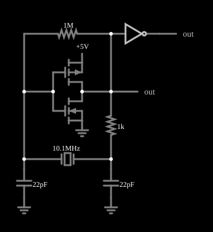

# Oscilador a cristal com inversor CMOS

<!-- navegacao:inicio -->
[Índice](README.md) · [Anterior: Inverter Oscillator](inv-osc.md)
<!-- navegacao:fim -->

## Objetivo

Mostrar o **oscilador de cristal com inversor CMOS** (oscilador de Pierce), o circuito de relógio da maioria dos microcontroladores: um inversor polarizado como amplificador, um cristal de quartzo e dois capacitores formam um oscilador de frequência muito estável. O exemplo mostra o **início da oscilação**, que cresce exponencialmente a partir de ruído.

## O circuito

<!-- esquema:inicio -->

<!-- esquema:fim -->

Um PMOS e um NMOS (modelo padrão, sem diodo de corpo) formam um [inversor CMOS](cmosinverter.md) que atua como amplificador. Um resistor de $1\ \text{M}\Omega$ liga a saída do inversor à sua entrada, polarizando-o na região de transição, e o **cristal** (indutância $2{,}5\ \text{mH}$, capacitância série $0{,}1\ \text{pF}$, capacitância paralela $28{,}7\ \text{pF}$, resistência $6{,}4\ \Omega$) liga a entrada do inversor à saída (esta, por um resistor de $1\ \text{k}\Omega$); há um capacitor de $22\ \text{pF}$ de cada lado do cristal à terra (um deles com $0{,}1\ \Omega$ de resistência série). Um inversor lógico, na saída, produz a onda quadrada. O passo de tempo é de $50\ \text{ps}$.

<!-- componentes:inicio -->
| N.º | Tipo | Elemento | Valores |
|----:|------|----------|---------|
| 2 | `CapacitorElm` | capacitor | Capacitance (F) = 22p; Trapezoidal Approximation = sim; Initial Voltage (on Reset) = 1m; Series Resistance = 100m |
| 3 | `CapacitorElm` | capacitor | Capacitance (F) = 22p; Trapezoidal Approximation = sim; Initial Voltage (on Reset) = 1m; Series Resistance = 0 |
| 4 | `GroundElm` | ground | Symbol = Earth |
| 5 | `GroundElm` | ground | Symbol = Earth |
| 6 | `NMosfetElm` | MOSFET | Model = default-nodiode; Swap D/S = não |
| 7 | `PMosfetElm` | MOSFET | Model = default-nodiode; Swap D/S = não |
| 12 | `GroundElm` | ground | Symbol = Earth |
| 13 | `RailElm` | voltage source | Voltage = 5; Waveform = D/C; DC Offset (V) = 0; Internal Resistance (ohms) = 0 |
| 14 | `ResistorElm` | resistor | Resistance (ohms) = 1M |
| 19 | `ResistorElm` | resistor | Resistance (ohms) = 1k |
| 21 | `OutputElm` | output | Show Voltage = não |
| 22 | `InverterElm` | inverter | Slew Rate (V/ns) = 1; High Logic Voltage = 5; DeMorgan's Symbol = não |
| 23 | `OutputElm` | output | Show Voltage = não |
| 24 | `CrystalElm` | crystal | Parallel Capacitance = 28.7p; Series Capacitance (F) = 0.1p; Inductance (H) = 2.5m; Resistance (Ω) = 6.4; Show Frequency = sim |
<!-- componentes:fim -->

## Teoria

O cristal tem as duas ressonâncias de [Oscilador a cristal de quartzo](crystalosc2.md):

$$f_s = \frac{1}{2\pi\sqrt{L C_s}} = 10{,}0659\ \text{MHz}, \qquad f_p = f_s\sqrt{1 + C_s/C_0} = 10{,}0834\ \text{MHz},$$

e entre elas é indutivo. No oscilador de Pierce, o cristal atua como o indutor de um circuito $\pi$ com os dois capacitores, que dá ao amplificador inversor o deslocamento de fase de $180^\circ$ que falta para a realimentação positiva. A oscilação começa a partir de ruído com **crescimento exponencial** $A(t) = A_0\,e^{t/\tau_g}$ enquanto o ganho de malha supera $1$, e satura quando o inversor atinge os trilhos.

## Resultados esperados

O simulador mostra uma oscilação em $10{,}083\ \text{MHz}$, na faixa entre $f_s$ e $f_p$. Com a capacitância de carga dos dois capacitores de $22\ \text{pF}$ em série ($11\ \text{pF}$), a fórmula $f = f_s\sqrt{1 + C_s/(C_0 + C_L)}$ dá $10{,}0785\ \text{MHz}$; o simulador dá $10{,}0833\ \text{MHz}$, $0{,}05\%$ acima (o resistor de $1\ \text{k}\Omega$ e o inversor também carregam o cristal). Em $t = 2$ a $3\ \mu\text{s}$ a amplitude do componente nesta frequência no nó do inversor é de apenas $1{,}18\ \mu\text{V}$ (sobre um nível contínuo de $2{,}500\ \text{V}$); ela cresce exponencialmente, com $1{,}38\ \mu\text{V}$ em $0{,}1\ \text{ms}$, $5{,}6\ \mu\text{V}$ em $1\ \text{ms}$ e $26{,}6\ \mu\text{V}$ em $2\ \text{ms}$ (constante de tempo de crescimento de cerca de $0{,}64\ \text{ms}$, medida entre $1$ e $2\ \text{ms}$). Por isso a saída do inversor lógico já mostra uma onda quadrada de $0$ a $5\ \text{V}$ nessa frequência (ele comuta quando o nó cruza $2{,}5\ \text{V}$, ainda que por microvolts), enquanto o nó do inversor ainda é praticamente constante. Extrapolando, o crescimento até uma amplitude de volts leva cerca de $9\ \text{ms}$ de tempo simulado ($\approx 1{,}8 \cdot 10^{8}$ passos de $50\ \text{ps}$), que não está nas verificações por demorar alguns minutos. As verificações, feitas em $0{,}1\ \text{ms}$, conferem a frequência no nó do inversor, o seu nível contínuo e o máximo da saída lógica (tolerância de $0{,}1\%$).

## O que observar

Ao executar o exemplo, nos primeiros milissegundos de tempo simulado quase nada aparece no nó do inversor; só depois de alguns milissegundos a oscilação sai do nível de ruído e sobe até a amplitude de regime. Para testar: aumente a resistência série do cristal e veja o crescimento ficar mais lento (menos ganho em excesso), e com um valor grande a oscilação não começar; troque os capacitores de $22\ \text{pF}$ por $10\ \text{pF}$ e veja a frequência mudar um pouco, dentro da faixa de $f_s$ a $f_p$.

## Limites do modelo

- A diferença de $0{,}05\%$ entre a fórmula da capacitância de carga e a frequência simulada não foi analisada; o efeito do resistor de $1\ \text{k}\Omega$ e do inversor sobre a frequência não está incluído na fórmula.
- Os valores de amplitude e a constante de crescimento vêm de simulações longas do simulador (de até $2\ \text{ms}$) e não fazem parte das verificações automáticas; a oscilação em $0{,}1\ \text{ms}$ está em microvolts.
- O cristal é um modelo de um só modo, sem variação com a temperatura; o inversor não tem capacitâncias; o ruído que inicia a oscilação é o numérico do simulador, não ruído térmico.

## Referências

Horowitz e Hill, *The Art of Electronics*, seção sobre osciladores a cristal; Sedra e Smith, *Microelectronic Circuits*, capítulo sobre osciladores senoidais (osciladores de cristal, o circuito de Pierce).

O circuito deste exemplo faz parte da coleção do simulador original de Paul Falstad e Iain Sharp (CircuitJS1); a explicação é deste projeto.
