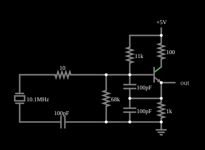

# Oscilador a cristal de quartzo

<!-- navegacao:inicio -->
[Índice](README.md) · [Anterior: Emitter-Coupled LC Oscillator](eclosc.md)
<!-- navegacao:fim -->

## Objetivo

Mostrar um oscilador de transistor cuja frequência é fixada por um **cristal de quartzo**, e não por um circuito LC: o cristal se comporta como um circuito ressonante de fator de qualidade altíssimo, o que torna a frequência muito estável e muito próxima da frequência própria do cristal.

## O circuito

<!-- esquema:inicio -->

<!-- esquema:fim -->

Um NPN ($\beta = 1000$) é polarizado por um divisor ($11\ \text{k}\Omega$ de $+5\ \text{V}$ à base e $68\ \text{k}\Omega$ da base à terra); o coletor liga-se a $+5\ \text{V}$ por $100\ \Omega$ e o emissor, à terra por $1\ \text{k}\Omega$. Dois capacitores de $100\ \text{pF}$ em série, entre a base e a terra, têm o ponto médio ligado ao emissor (divisor capacitivo de um oscilador Colpitts, cuja saída é a tensão do emissor). A malha de realimentação passa por um resistor de $10\ \Omega$ e pelo **cristal** (indutância $2{,}5\ \text{mH}$, capacitância série $0{,}1\ \text{pF}$, capacitância paralela $28{,}7\ \text{pF}$ e resistência $6{,}4\ \Omega$) em série com um capacitor de $100\ \text{pF}$ à terra.

<!-- componentes:inicio -->
| N.º | Tipo | Elemento | Valores |
|----:|------|----------|---------|
| 0 | `ResistorElm` | resistor | Resistance (ohms) = 11k |
| 1 | `ResistorElm` | resistor | Resistance (ohms) = 68k |
| 2 | `ResistorElm` | resistor | Resistance (ohms) = 1k |
| 5 | `OutputElm` | output | Show Voltage = não |
| 6 | `RailElm` | voltage source | Voltage = 5; Waveform = D/C; DC Offset (V) = 0; Internal Resistance (ohms) = 0 |
| 7 | `GroundElm` | ground | Symbol = Earth |
| 8 | `NTransistorElm` | transistor | Beta/hFE = 1k; Swap E/C = não; Draw Circle = não; Model = default |
| 9 | `ResistorElm` | resistor | Resistance (ohms) = 100 |
| 12 | `CapacitorElm` | capacitor | Capacitance (F) = 100p; Trapezoidal Approximation = sim; Initial Voltage (on Reset) = 1m; Series Resistance = 0 |
| 13 | `CapacitorElm` | capacitor | Capacitance (F) = 100p; Trapezoidal Approximation = sim; Initial Voltage (on Reset) = 1m; Series Resistance = 0 |
| 16 | `ResistorElm` | resistor | Resistance (ohms) = 10 |
| 17 | `CapacitorElm` | capacitor | Capacitance (F) = 100p; Trapezoidal Approximation = sim; Initial Voltage (on Reset) = 1m; Series Resistance = 0 |
| 18 | `CrystalElm` | crystal | Parallel Capacitance = 28.7p; Series Capacitance (F) = 0.1p; Inductance (H) = 2.5m; Resistance (Ω) = 6.4; Show Frequency = sim |
<!-- componentes:fim -->

## Teoria

**O cristal.** O modelo elétrico do cristal (modelo de Butterworth–Van Dyke) é um ramo série $R$–$L$–$C_s$ em paralelo com a capacitância dos eletrodos $C_0$. Ele tem duas frequências de ressonância:

$$f_s = \frac{1}{2\pi\sqrt{L\,C_s}} = \frac{1}{2\pi\sqrt{2{,}5\ \text{mH} \cdot 0{,}1\ \text{pF}}} \approx 10{,}0659\ \text{MHz}, \qquad f_p = f_s\sqrt{1 + \frac{C_s}{C_0}} \approx 10{,}0834\ \text{MHz}.$$

Entre $f_s$ e $f_p$, que ficam a menos de $0{,}2\%$ uma da outra, o cristal é **indutivo** e se comporta como o indutor de um oscilador Colpitts; a reatância varia muito rapidamente com a frequência e fixa a frequência de oscilação. O fator de qualidade é $Q = \omega_s L/R = 2\pi \cdot 10{,}0659 \cdot 10^6 \cdot 2{,}5 \cdot 10^{-3}/6{,}4 \approx 24\,700$, contra algumas dezenas num circuito LC comum.

**Frequência de oscilação.** Com capacitâncias externas $C_L$ em série com o cristal, a frequência vale $f = f_s\sqrt{1 + C_s/(C_0 + C_L)}$, sempre entre $f_s$ e $f_p$.

## Resultados esperados

A saída oscila a $10{,}074\ \text{MHz}$, entre $f_s = 10{,}066\ \text{MHz}$ e $f_p = 10{,}083\ \text{MHz}$, como a teoria prevê, e a frequência é a mesma em $1{,}5\ \mu\text{s}$ e em $21{,}5\ \mu\text{s}$ (o arquivo já traz o estado de regime). A tensão do emissor vai de $0{,}815\ \text{V}$ a $4{,}146\ \text{V}$ (cerca de $3{,}3\ \text{V}$ pico a pico): o transistor conduz só em parte do ciclo. As verificações conferem a frequência (em duas janelas de $1\ \mu\text{s}$) e o máximo e o mínimo da tensão do emissor (tolerância de $0{,}2\%$ na frequência e $1\%$ nas tensões). Como o passo de tempo é de $50\ \text{ps}$, essas janelas exigem centenas de milhares de passos.

## O que observar

A saída é uma onda de $\approx 100\ \text{ns}$ de período, quase estável em amplitude e em frequência. Para testar: mude a capacitância de $100\ \text{pF}$ ligada ao cristal e veja a frequência deslocar-se muito pouco, dentro da faixa $f_s$–$f_p$ (um oscilador LC comum, com a mesma variação de capacitância, mudaria muito mais); aumente a resistência série do cristal e veja a oscilação perder amplitude e, com valores grandes, parar.

## Limites do modelo

- O cristal é um modelo de parâmetros concentrados em torno de um único modo; um cristal real tem também modos espúrios e harmônicos (*overtones*).
- Não há variação com a temperatura: num cristal real, a frequência varia algumas partes por milhão com a temperatura e a idade.
- O transistor não tem capacitâncias, que em $10\ \text{MHz}$ já modificam um pouco a capacitância de carga.
- O exemplo traz o circuito já em oscilação; a partida de um oscilador a cristal real é lenta, pois a amplitude cresce com a constante de tempo $2L/R \approx 0{,}8\ \text{ms}$ do ramo série do cristal, por causa do $Q$ elevado.

## Referências

Horowitz e Hill, *The Art of Electronics*, seção 5.x (osciladores a cristal); Sedra e Smith, *Microelectronic Circuits*, capítulo sobre osciladores senoidais (cristais de quartzo).

O circuito deste exemplo faz parte da coleção do simulador original de Paul Falstad e Iain Sharp (CircuitJS1); a explicação é deste projeto.
