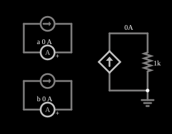

# Somador de correntes (fonte de corrente controlada)

<!-- navegacao:inicio -->
[Índice](README.md) · [Anterior: CVS Voltage Ramp](cs-ramp.md) · [Próximo: CVS Integrator](cs-integrator.md)
<!-- navegacao:fim -->

## Objetivo

Mostrar como somar **correntes** de dois ramos diferentes com uma fonte controlada: dois amperímetros com rótulo (`a` e `b`) medem as correntes, e uma fonte de corrente controlada com a expressão $i(a) + i(b)$ soma as duas.

## O circuito

<!-- esquema:inicio -->

<!-- esquema:fim -->

Duas fontes de corrente ($15\ \text{mA}$ e $5\ \text{mA}$, ajustáveis por *sliders* chamados \"Current 1\" e \"Current 2\") circulam cada uma por um amperímetro, de rótulos `a` e `b`. A fonte de corrente controlada, com a expressão $i(a) + i(b)$, faz passar a soma por um resistor de $1\ \text{k}\Omega$.

<!-- componentes:inicio -->
| N.º | Tipo | Elemento | Valores |
|----:|------|----------|---------|
| 1 | `ResistorElm` | resistor | Resistance (ohms) = 1k |
| 3 | `GroundElm` | ground | Symbol = Earth |
| 4 | `CurrentElm` | current source | Current (A) = 15m; Max Voltage (V, 0=unlimited) = 0 |
| 7 | `CurrentElm` | current source | Current (A) = 5m; Max Voltage (V, 0=unlimited) = 0 |
| 8 | `AmmeterElm` | Ammeter | Value = Current; Scale = Auto; Circular Symbol = sim; Label = a |
| 10 | `AmmeterElm` | Ammeter | Value = Current; Scale = Auto; Circular Symbol = sim; Label = b |
| 12 | `ControlledCurrentElm` | Controlled Current Source | Output Current = i(a)+i(b) |
<!-- componentes:fim -->

## Teoria

As fontes controladas de dois terminais (o losango) são definidas por uma **expressão** que lê o resto do circuito **pelo nome**: $v(\text{nome})$ é a tensão de um nó rotulado ou sobre um voltímetro com rótulo, $i(\text{nome})$ a corrente de um amperímetro com rótulo, e $\text{dvdt}$ / $\text{didt}$ as suas taxas de variação. O resultado é a tensão (fonte de tensão controlada, com o $+$ no segundo terminal) ou a corrente (fonte de corrente controlada, no sentido da seta) que a fonte impõe. Aqui $i(a) = I_1$ e $i(b) = I_2$ são as correntes dos dois ramos, lidas pelos amperímetros, e a fonte produz

$$I_\text{out} = i(a) + i(b) = I_1 + I_2;$$

o resistor converte essa corrente na tensão $V = R\,(I_1 + I_2)$.

## Resultados esperados

| Grandeza | Teoria | Simulador |
|----------|-------:|----------:|
| $I_1 + I_2$ | $15 + 5 = 20\ \text{mA}$ | $20{,}000\ \text{mA}$ (corrente no resistor) |
| Tensão no resistor de $1\ \text{k}\Omega$ | $20\ \text{V}$ | $20{,}000\ \text{V}$ |

As verificações conferem a corrente e a tensão no resistor.

## O que observar

- Mova os *sliders*: a corrente no resistor é sempre a soma das duas, e a tensão no resistor acompanha.
- Os dois ramos de entrada são isolados entre si: nenhuma das fontes de corrente "enxerga" a outra (o que não ocorreria ligando-as em paralelo).
- Troque $a + b$ por $a - b$ para obter um subtrator, ou por $2a + b$ para uma soma ponderada.

## Limites do modelo

As fontes controladas são ideais, com amperímetros de impedância nula e saída de corrente ideal e sem limite de tensão nem de corrente: a tensão de $20\ \text{V}$ no resistor não tem alimentação que a limite. Os *sliders* mudam apenas as correntes das fontes.

## Referências

- J. W. Nilsson e S. A. Riedel, *Circuitos Elétricos*, Pearson.
- A. S. Sedra e K. C. Smith, *Microeletrônica*, Pearson.
- P. Falstad, *CircuitJS1 — Controlled Sources* (documentação do simulador).

O circuito deste exemplo faz parte da coleção do simulador original de Paul Falstad e Iain Sharp (CircuitJS1); a explicação é deste projeto.
