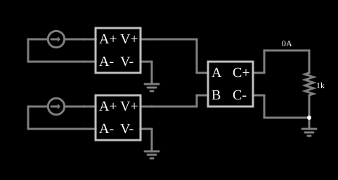

# Somador de correntes (CCVS e VCCS)

<!-- navegacao:inicio -->
[Índice](README.md) · [Anterior: VCVS Voltage Ramp](cs-ramp.md) · [Próximo: VCVS Integrator](cs-integrator.md)
<!-- navegacao:fim -->

## Objetivo

Mostrar como somar **correntes** de dois ramos diferentes com fontes controladas: duas fontes controladas por corrente (CCVS) convertem cada corrente em uma tensão proporcional, e uma fonte de corrente controlada por tensão (VCCS) com a expressão $a + b$ soma as duas.

## O circuito

<!-- esquema:inicio -->

<!-- esquema:fim -->

Duas fontes de corrente ($15\ \text{mA}$ e $5\ \text{mA}$, ajustáveis por *sliders* chamados "Current 1" e "Current 2") passam cada uma por uma CCVS com a expressão $i$ (a tensão de saída, em volts, é igual à corrente de entrada, em amperes: transresistência de $1\ \Omega$). As duas tensões resultantes alimentam as entradas $a$ e $b$ de uma VCCS com a expressão $a + b$, cuja corrente de saída passa por um resistor de $1\ \text{k}\Omega$.

<!-- componentes:inicio -->
| N.º | Tipo | Elemento | Valores |
|----:|------|----------|---------|
| 0 | `CCVSElm` | CCVS | Output Function = i; # of Inputs = 2 |
| 1 | `CCVSElm` | CCVS | Output Function = i; # of Inputs = 2 |
| 2 | `VCCSElm` | VCCS | Output Function = a+b; # of Inputs = 2 |
| 7 | `GroundElm` | ground | Symbol = Earth |
| 8 | `GroundElm` | ground | Symbol = Earth |
| 11 | `ResistorElm` | resistor | Resistance (ohms) = 1k |
| 14 | `GroundElm` | ground | Symbol = Earth |
| 15 | `CurrentElm` | current source | Current (A) = 15m; Max Voltage (V, 0=unlimited) = 0 |
| 20 | `CurrentElm` | current source | Current (A) = 5m; Max Voltage (V, 0=unlimited) = 0 |
<!-- componentes:fim -->

## Teoria

As fontes controladas deste simulador são definidas por uma **expressão** sobre as entradas, que se chamam $a$, $b$, $c$, ... (as tensões ou correntes nos terminais de controle). O resultado é a tensão (VCVS, CCVS) ou a corrente (VCCS, CCCS) que a fonte impõe na saída. A CCVS com a expressão $i$ produz $V = i\cdot 1\ \Omega$, então $a = I_1\cdot 1\ \Omega$ e $b = I_2\cdot 1\ \Omega$ (em volts, numericamente iguais às correntes em amperes). A VCCS com a expressão $a + b$ produz uma corrente

$$I_\text{out} = a + b = I_1 + I_2$$

(com a transcondutância de $1\ \text{S}$ implícita), e o resistor converte essa corrente na tensão $V = R\,(I_1 + I_2)$.

## Resultados esperados

| Grandeza | Teoria | Simulador |
|----------|-------:|----------:|
| $I_1 + I_2$ | $15 + 5 = 20\ \text{mA}$ | $20{,}000\ \text{mA}$ (corrente no resistor) |
| Tensão no resistor de $1\ \text{k}\Omega$ | $20\ \text{V}$ | $20{,}000\ \text{V}$ |

As verificações conferem a corrente e a tensão no resistor.

## O que observar

- Mova os *sliders*: a corrente no resistor é sempre a soma das duas, e a tensão no resistor acompanha.
- Os dois ramos de entrada são isolados entre si: nenhuma das fontes de corrente "enxerga" a outra (o que não ocorreria ligando-as em paralelo).
- Troque $a + b$ por $a - b$ para obter um subtrator, ou por $2a + b$ para uma soma ponderada.

## Limites do modelo

As fontes controladas são ideais, com impedância de entrada nula (as CCVS) e infinita (a VCCS) e sem limite de tensão nem de corrente: a tensão de $20\ \text{V}$ no resistor não tem alimentação que a limite. Os *sliders* mudam apenas as correntes das fontes.

## Referências

- J. W. Nilsson e S. A. Riedel, *Circuitos Elétricos*, Pearson.
- A. S. Sedra e K. C. Smith, *Microeletrônica*, Pearson.
- P. Falstad, *CircuitJS1 — Controlled Sources* (documentação do simulador).

O circuito deste exemplo faz parte da coleção do simulador original de Paul Falstad e Iain Sharp (CircuitJS1); a explicação é deste projeto.
