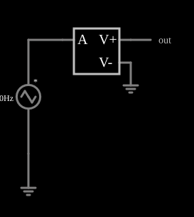

# Derivador (VCVS com derivada da entrada)

<!-- navegacao:inicio -->
[Índice](README.md) · [Anterior: VCVS Integrator](cs-integrator.md) · [Próximo: CCVS Variable Inductor](cs-varinduct.md)
<!-- navegacao:fim -->

## Objetivo

Mostrar como uma fonte controlada calcula a derivada da entrada: a função $\text{dadt}$ devolve a taxa de variação da entrada $a$, e a expressão $\text{clamp}(\text{dadt}\cdot 0{,}01, -15, 15)$ faz um derivador de ganho $10\ \text{ms}$ com saída limitada a $\pm 15\ \text{V}$.

## O circuito

<!-- esquema:inicio -->

<!-- esquema:fim -->

Uma fonte de onda triangular de $40\ \text{Hz}$ e $5\ \text{V}$ de pico (com fase de $90^\circ$) alimenta a entrada de uma VCVS com a expressão $\text{clamp}(\text{dadt}\cdot 0{,}01,\ -15,\ 15)$. Um elemento de saída mostra o resultado.

<!-- componentes:inicio -->
| N.º | Tipo | Elemento | Valores |
|----:|------|----------|---------|
| 0 | `DCVoltageElm` | triangle gen | Max Voltage = 5; Waveform = Triangle; DC Offset (V) = 0; Internal Resistance (ohms) = 0; Show Voltage = não; Frequency (Hz) = 40; Phase Offset (degrees) = 90 |
| 1 | `GroundElm` | ground | Symbol = Earth |
| 2 | `VCVSElm` | VCVS | Output Function = clamp(dadt*.01, -15, 15); # of Inputs = 1 |
| 4 | `GroundElm` | ground | Symbol = Earth |
| 5 | `OutputElm` | output | Show Voltage = não |
<!-- componentes:fim -->

## Teoria

As fontes controladas deste simulador são definidas por uma **expressão** sobre as entradas, que se chamam $a$, $b$, $c$, ... (as tensões ou correntes nos terminais de controle). O resultado é a tensão (VCVS, CCVS) ou a corrente (VCCS, CCCS) que a fonte impõe na saída. A saída é $V_\text{out} = 0{,}01\ \text{s}\cdot \dfrac{da}{dt}$, limitada a $\pm 15\ \text{V}$. Uma triangular de pico $V_p = 5\ \text{V}$ e frequência $f = 40\ \text{Hz}$ tem inclinação constante de módulo $4V_pf = 800\ \text{V/s}$ em cada meio ciclo, e portanto a saída é uma onda quadrada de amplitude

$$|V_\text{out}| = 0{,}01\cdot 800 = 8\ \text{V},$$

dentro do limite de $15\ \text{V}$. Diferente do derivador com operacional, não há inversão do sinal, e não há instabilidade de alta frequência (o modelo é ideal).

## Resultados esperados

Em $t = 10\ \text{ms}$ a entrada está descendo e a saída vale $-8{,}000\ \text{V}$. Em um ciclo ($25\ \text{ms}$) a saída é uma quadrada entre $-8$ e $+8\ \text{V}$. As verificações conferem os valores nesse instante e os extremos (tolerância de 0,5% e 1%).

## O que observar

- A saída é uma onda quadrada que muda de sinal nos picos da triangular.
- A saída fica positiva quando a entrada sobe e negativa quando desce (sem inversão).
- Aumente a frequência (ou o ganho) até $|V_\text{out}| > 15\ \text{V}$ e veja o limite da função $\text{clamp}$ cortar a onda.

## Limites do modelo

A derivada é calculada numericamente entre dois passos de tempo, de modo que ruído ou bordas abruptas na entrada produzem picos grandes (limitados pelo $\text{clamp}$). O modelo é ideal e não tem os problemas de estabilidade do derivador com operacional.

## Referências

- J. W. Nilsson e S. A. Riedel, *Circuitos Elétricos*, Pearson.
- A. S. Sedra e K. C. Smith, *Microeletrônica*, Pearson.
- P. Falstad, *CircuitJS1 — Controlled Sources* (documentação do simulador).

O circuito deste exemplo faz parte da coleção do simulador original de Paul Falstad e Iain Sharp (CircuitJS1); a explicação é deste projeto.
