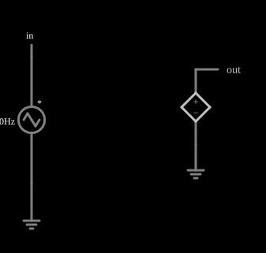

# Derivador (fonte de tensão controlada com a derivada de um nó)

<!-- navegacao:inicio -->
[Índice](README.md) · [Anterior: CVS Integrator](cs-integrator.md) · [Próximo: CCS Variable Inductor](cs-varinduct.md)
<!-- navegacao:fim -->

## Objetivo

Mostrar como uma fonte controlada calcula a derivada de uma tensão: a função $\text{dvdt}(\text{in})$ devolve a taxa de variação da tensão do nó rotulado `in`, e a expressão $\text{clamp}(\text{dvdt}(\text{in})\cdot 0{,}01, -15, 15)$ faz um derivador de ganho $10\ \text{ms}$ com saída limitada a $\pm 15\ \text{V}$.

## O circuito

<!-- esquema:inicio -->

<!-- esquema:fim -->

Uma fonte de onda triangular de $40\ \text{Hz}$ e $5\ \text{V}$ de pico (com fase de $90^\circ$) está ligada ao nó rotulado `in`. Uma fonte de tensão controlada com a expressão $\text{clamp}(\text{dvdt}(\text{in})\cdot 0{,}01,\ -15,\ 15)$ gera a saída, que um elemento de saída mostra.

<!-- componentes:inicio -->
| N.º | Tipo | Elemento | Valores |
|----:|------|----------|---------|
| 0 | `DCVoltageElm` | triangle gen | Max Voltage = 5; Waveform = Triangle; DC Offset (V) = 0; Internal Resistance (ohms) = 0; Show Voltage = não; Frequency (Hz) = 40; Phase Offset (degrees) = 90 |
| 1 | `GroundElm` | ground | Symbol = Earth |
| 2 | `GroundElm` | ground | Symbol = Earth |
| 3 | `OutputElm` | output | Show Voltage = não |
| 4 | `ControlledVoltageElm` | Controlled Voltage Source | Output Voltage = clamp(dvdt(in)*.01, -15, 15) |
| 5 | `LabeledNodeElm` | Labeled Node | Text = in; Internal Node = não; Rotate Text When Vertical = não |
<!-- componentes:fim -->

## Teoria

As fontes controladas de dois terminais (o losango) são definidas por uma **expressão** que lê o resto do circuito **pelo nome**: $v(\text{nome})$ é a tensão de um nó rotulado ou sobre um voltímetro com rótulo, $i(\text{nome})$ a corrente de um amperímetro com rótulo, e $\text{dvdt}$ / $\text{didt}$ as suas taxas de variação. O resultado é a tensão (fonte de tensão controlada, com o $+$ no segundo terminal) ou a corrente (fonte de corrente controlada, no sentido da seta) que a fonte impõe. A saída é $V_\text{out} = 0{,}01\ \text{s}\cdot \dfrac{dv_\text{in}}{dt}$, limitada a $\pm 15\ \text{V}$. Uma triangular de pico $V_p = 5\ \text{V}$ e frequência $f = 40\ \text{Hz}$ tem inclinação constante de módulo $4V_pf = 800\ \text{V/s}$ em cada meio ciclo, e portanto a saída é uma onda quadrada de amplitude

$$|V_\text{out}| = 0{,}01\cdot 800 = 8\ \text{V},$$

dentro do limite de $15\ \text{V}$. Diferente do derivador com operacional, não há inversão do sinal, e não há instabilidade de alta frequência (o modelo é ideal).

## Resultados esperados

Em $t = 10\ \text{ms}$ a entrada está descendo e a saída vale $-8{,}000\ \text{V}$. Em um ciclo ($25\ \text{ms}$) a saída é uma quadrada entre $-8$ e $+8\ \text{V}$. As verificações conferem os valores nesse instante e os extremos (tolerância de 0,5% e 1%).

## O que observar

- A saída é uma onda quadrada que muda de sinal nos picos da triangular.
- A saída fica positiva quando a entrada sobe e negativa quando desce (sem inversão).
- Aumente a frequência (ou o ganho) até $|V_\text{out}| > 15\ \text{V}$ e veja o limite da função $\text{clamp}$ cortar a onda.

## Limites do modelo

A derivada é calculada numericamente entre dois passos de tempo, de modo que ruído ou bordas abruptas na entrada produzem picos grandes (limitados pelo $\text{clamp}$). O modelo é ideal e não tem os problemas de estabilidade do derivador com operacional.

## Referências

- J. W. Nilsson e S. A. Riedel, *Circuitos Elétricos*, Pearson.
- A. S. Sedra e K. C. Smith, *Microeletrônica*, Pearson.
- P. Falstad, *CircuitJS1 — Controlled Sources* (documentação do simulador).

O circuito deste exemplo faz parte da coleção do simulador original de Paul Falstad e Iain Sharp (CircuitJS1); a explicação é deste projeto.
