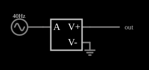

# Retificador de onda completa (VCVS)

<!-- navegacao:inicio -->
[Índice](README.md) · [Anterior: VCVS Multiplier](cs-multiplier.md) · [Próximo: VCVS Voltage Ramp](cs-ramp.md)
<!-- navegacao:fim -->

## Objetivo

Mostrar que, com uma fonte controlada, um retificador de onda completa ideal é uma única expressão, $\text{abs}(a)$, sem diodos nem quedas de tensão.

## O circuito

<!-- esquema:inicio -->

<!-- esquema:fim -->

Uma fonte senoidal de $40\ \text{Hz}$ e $5\ \text{V}$ de pico liga-se à entrada de uma VCVS cuja expressão é $\text{abs}(a)$. Um elemento de saída e um osciloscópio mostram a saída.

<!-- componentes:inicio -->
| N.º | Tipo | Elemento | Valores |
|----:|------|----------|---------|
| 0 | `VCVSElm` | VCVS | Output Function = abs(a); # of Inputs = 1 |
| 1 | `RailElm` | A/C source | Max Voltage = 5; Waveform = A/C; DC Offset (V) = 0; Internal Resistance (ohms) = 0; Show Voltage = não; Frequency (Hz) = 40; Phase Offset (degrees) = 0 |
| 2 | `GroundElm` | ground | Symbol = Earth |
| 3 | `OutputElm` | output | Show Voltage = não |
<!-- componentes:fim -->

## Teoria

As fontes controladas deste simulador são definidas por uma **expressão** sobre as entradas, que se chamam $a$, $b$, $c$, ... (as tensões ou correntes nos terminais de controle). O resultado é a tensão (VCVS, CCVS) ou a corrente (VCCS, CCCS) que a fonte impõe na saída. A saída é o valor absoluto da entrada: $V_\text{out} = |5\sin(2\pi\cdot 40\,t)|$. Para um senoide de pico $V_p$, o valor médio da retificação de onda completa e o valor eficaz são

$$\overline{V} = \frac{2}{\pi}\,V_p = 3{,}183\ \text{V}, \qquad V_\text{rms} = \frac{V_p}{\sqrt 2} = 3{,}536\ \text{V},$$

e o valor eficaz é igual ao da entrada (a retificação não muda a potência).

## Resultados esperados

Em uma janela de $0{,}05\ \text{s}$ (dois ciclos de entrada, quatro meios ciclos de saída):

| Grandeza | Teoria | Simulador |
|----------|-------:|----------:|
| Valor médio | $3{,}183\ \text{V}$ | $3{,}183\ \text{V}$ |
| Valor eficaz | $3{,}536\ \text{V}$ | $3{,}536\ \text{V}$ |
| Mínimo | $0\ \text{V}$ | $0\ \text{V}$ |

As verificações conferem esses três valores (tolerância de 1%).

## O que observar

- A saída é uma sequência de meias senoides positivas, com o dobro da frequência da entrada ($80\ \text{Hz}$).
- Não há a "zona morta" de $0{,}6\ \text{V}$ que um diodo de silício causaria: é um retificador ideal, e mesmo sinais pequenos são retificados.
- Compare com o retificador de precisão com operacionais (exemplo "Full-Wave Rectifier" dos operacionais).

## Limites do modelo

A função $\text{abs}$ é perfeita e instantânea: em um circuito real é preciso de operacionais e diodos, que limitam a frequência e a precisão perto do cruzamento por zero. A saída não tem limite de corrente.

## Referências

- A. S. Sedra e K. C. Smith, *Microeletrônica*, Pearson.
- P. Horowitz e W. Hill, *The Art of Electronics*, Cambridge University Press.
- P. Falstad, *CircuitJS1 — Controlled Sources* (documentação do simulador).

O circuito deste exemplo faz parte da coleção do simulador original de Paul Falstad e Iain Sharp (CircuitJS1); a explicação é deste projeto.
