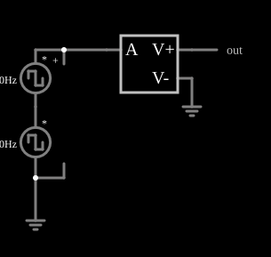

# Integrador (VCVS com realimentação interna)

<!-- navegacao:inicio -->
[Índice](README.md) · [Anterior: Current Adder](cs-currentadder.md) · [Próximo: VCVS Differentiator](cs-diff.md)
<!-- navegacao:fim -->

## Objetivo

Mostrar como uma fonte controlada pode acumular o valor da entrada ao longo do tempo: a expressão $\text{lastoutput} + \text{timestep}\cdot 100\cdot a$ é a integração numérica (método de Euler) de $100\,a$, o que dá um integrador ideal sem amplificador operacional.

## O circuito

<!-- esquema:inicio -->

<!-- esquema:fim -->

A entrada é a soma de duas fontes de onda quadrada em série: uma de $40\ \text{Hz}$ e $\pm 5\ \text{V}$ (com fase de $180^\circ$) e outra de $80\ \text{Hz}$ e $\pm 2\ \text{V}$. A VCVS tem uma entrada e a expressão $\text{lastoutput} + \text{timestep}\cdot 100\cdot a$. Um elemento de saída mostra o resultado.

<!-- componentes:inicio -->
| N.º | Tipo | Elemento | Valores |
|----:|------|----------|---------|
| 0 | `GroundElm` | ground | Symbol = Earth |
| 1 | `DCVoltageElm` | square wave gen | Max Voltage = 5; Waveform = Square Wave; DC Offset (V) = 0; Internal Resistance (ohms) = 0; Show Voltage = não; Specify As = Frequency/Duty Cycle; Frequency (Hz) = 40; Phase Offset (degrees) = 180; Duty Cycle = 50; Rise/Fall Time (s) = 0 |
| 2 | `DCVoltageElm` | square wave gen | Max Voltage = 2; Waveform = Square Wave; DC Offset (V) = 0; Internal Resistance (ohms) = 0; Show Voltage = não; Specify As = Frequency/Duty Cycle; Frequency (Hz) = 80; Phase Offset (degrees) = 0; Duty Cycle = 50; Rise/Fall Time (s) = 0 |
| 3 | `ProbeElm` | voltmeter | Show Voltage = não; Value = Voltage; Scale = Auto; Use Circle Symbol = não; Series Resistance (0 = infinite) = 0 |
| 7 | `VCVSElm` | VCVS | Output Function = lastoutput+timestep*100*a; # of Inputs = 1 |
| 8 | `GroundElm` | ground | Symbol = Earth |
| 9 | `OutputElm` | output | Show Voltage = não |
<!-- componentes:fim -->

## Teoria

As fontes controladas deste simulador são definidas por uma **expressão** sobre as entradas, que se chamam $a$, $b$, $c$, ... (as tensões ou correntes nos terminais de controle). O resultado é a tensão (VCVS, CCVS) ou a corrente (VCCS, CCCS) que a fonte impõe na saída. Na expressão, $\text{lastoutput}$ é a saída no passo de tempo anterior e $\text{timestep}$ é o passo. Então

$$V_\text{out}(t + \Delta t) = V_\text{out}(t) + 100\,a\,\Delta t \quad\Longrightarrow\quad V_\text{out}(t) = 100\int_0^t a\,d\tau,$$

um integrador de ganho $100\ \text{s}^{-1}$ (equivalente a $RC = 10\ \text{ms}$), **sem inversão**. A entrada assume, a cada $6{,}25\ \text{ms}$, os valores $-3$, $-7$, $+7$ e $+3\ \text{V}$ em um ciclo de $25\ \text{ms}$, e em cada trecho a saída varia de $100\cdot a\cdot 6{,}25\ \text{ms}$, isto é, $-1{,}875$, $-4{,}375$, $+4{,}375$ e $+1{,}875\ \text{V}$.

## Resultados esperados

Partindo de $0\ \text{V}$, a saída desce a $-6{,}25\ \text{V}$ em $t = 12{,}5\ \text{ms}$ e volta a $0\ \text{V}$ em $25\ \text{ms}$, e repete:

| Grandeza | Teoria | Simulador |
|----------|-------:|----------:|
| Saída em $t = 10\ \text{ms}$ ($-1{,}875 - 2{,}625$) | $-4{,}50\ \text{V}$ | $-4{,}493\ \text{V}$ |
| Mínimo em um ciclo | $-6{,}25\ \text{V}$ | $-6{,}25\ \text{V}$ |
| Máximo em um ciclo | $0\ \text{V}$ | $0\ \text{V}$ |

A diferença de $0{,}007\ \text{V}$ em $t = 10\ \text{ms}$ é o efeito do passo de $5\ \mu\text{s}$ no primeiro instante da simulação. As verificações conferem a saída em $10\ \text{ms}$ e os extremos.

## O que observar

- A saída é uma linha quebrada: rampas descendentes nos trechos de entrada negativa e ascendentes nos de entrada positiva.
- Como a entrada tem média nula, a saída volta ao ponto de partida a cada ciclo.
- Compare com o integrador com operacional (exemplo "Integrator"): aqui o sinal de saída tem o mesmo sinal (não inverte).

## Limites do modelo

A integração é de Euler com o passo da simulação ($5\ \mu\text{s}$), então tem erro de primeira ordem em $\Delta t$; não há fuga nem *offset*, e um nível contínuo na entrada faria a saída derivar indefinidamente (o modelo não satura).

## Referências

- J. W. Nilsson e S. A. Riedel, *Circuitos Elétricos*, Pearson.
- A. S. Sedra e K. C. Smith, *Microeletrônica*, Pearson.
- P. Falstad, *CircuitJS1 — Controlled Sources* (documentação do simulador).

O circuito deste exemplo faz parte da coleção do simulador original de Paul Falstad e Iain Sharp (CircuitJS1); a explicação é deste projeto.
